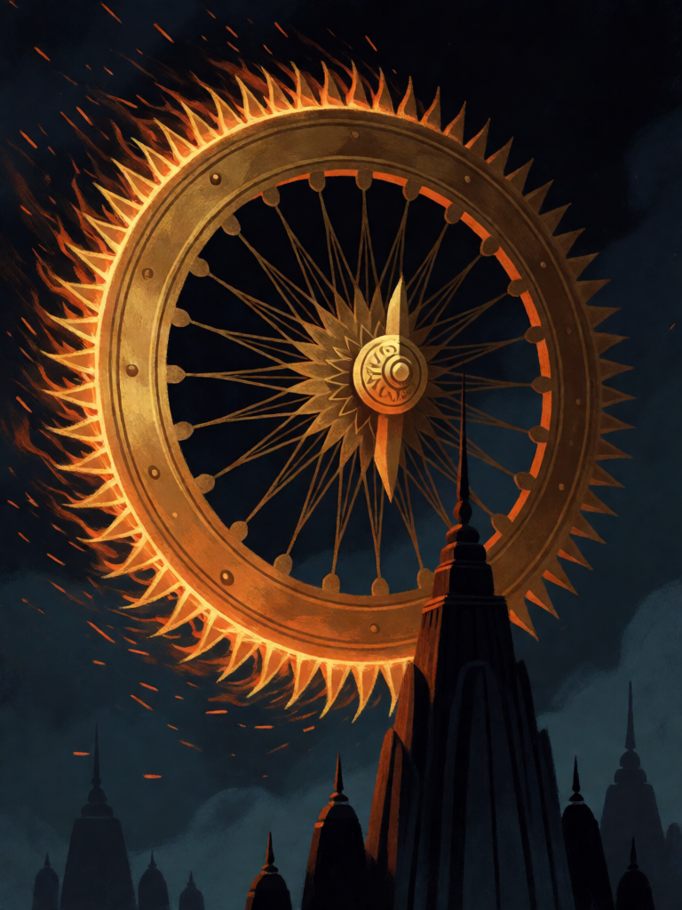

# Sudarshana Chakra

[← Hinduísmo](../hinduismo.md) · [Wiki KodeX](../README.md) · [◀ Vajra](hin_vajra.md) · [Gandiva ▶](hin_gandiva.md)

| Carta | Arte |
|---|---|
|  |  |

| | |
|---|---|
| **Tradição** | Hinduísmo |
| **Tipo** | Relíquia |
| **Custo de Fé** | 3 |
| **Palavras-chave** | — |
| **Lendária** | não |
| **Cópias no deck** | 1 |
| **Id** | `hin_sudarshana_chakra` |

## Texto da carta

> Portadora: +2 ATK / +1 Vida e Ímpeto. Quando a portadora atacar, causa 1 de dano a uma Entidade inimiga.

**EN — Sudarshana Chakra:** *Bearer: +2 ATK / +1 Health and Rush. When the bearer attacks, deal 1 damage to an enemy Entity.*

## Contexto mitológico

O Sudarshana Chakra ("disco de boa visão") é a arma de Vishnu: um disco de 108 dentes serrilhados que gira no indicador de sua mão direita, dispara à velocidade do pensamento, destrói o alvo e volta à mão. Nos bronzes e pinturas, aparece com chamas ao redor e, em templos do sul, é adorado como uma divindade própria (Chakrattalvar).

O Mahabharata (Adi Parva) conta que Agni o entregou a Krishna no incêndio de Khandava, ao mesmo tempo em que dava o Gandiva a Arjuna; o Bhagavata (8.9) narra o uso mais célebre: durante a distribuição da amrita, o asura Rahu se disfarça de deva e bebe; Surya e Chandra o denunciam, e Vishnu lhe corta a cabeça com o disco — a cabeça, já imortal, persegue sol e lua para sempre (os eclipses). No Sabha Parva, Krishna decapita o rei Shishupala no sacrifício Rajasuya, depois de perdoar cem ofensas prometidas à mãe dele. No Shiva Purana, Vishnu recebe o disco de Shiva como prêmio de devoção, depois de oferecer o próprio olho no lugar de um lótus que faltava.

Na carta, o disco gira no dedo da portadora: quem a empunha avança na hora (Ímpeto) e, em cada investida, o disco voa e corta mais alguém.

## Papel no jogo

A Relíquia mais agressiva do deck: dá Ímpeto a quem não tem (Rama, Narasimha, Arjuna, Kali) e transforma cada ataque em dois — o golpe principal e 1 de dano em outro alvo (um token, ou o corpo que Garuda e Lanka já feriram). Sobre Hanuman, cada turno termina um corpo a menos. Equipada num corpo recém-invocado, cria um turno de ataque surpresa. Fraca: a portadora vira alvo prioritário e leva o disco com ela ao morrer.

## Atributos visuais

disco dourado de borda serrilhada · cubo central ornamentado · anel de fogo na borda · girando no ar

Balanço (conta de custo)

Orçamento P = 2·3+1 = 7 pts (+1 Relíquia = 8). Gasto: +2 ATK 2 + +1 Vida 1 + Ímpeto 1 + 1 de dano a Entidade escolhida a cada ataque (repetível, sem Usos: 1 × 2 = 2) = 6. Dentro (P−2).
Rodada 2 de balanceamento (pacote H1 do Analista): dano por ataque 2 → 1 (parte do pacote de Relíquias).
Revisão: era +2/+2 com 3 de dano por ataque contado uma vez só (3); como repetível cheio valia 11. Caiu para +2/+1 e 2 de dano.

Ficha completa: `cartas/hinduismo/27_sudarshana_chakra.md` · cartas base da versão Alpha
