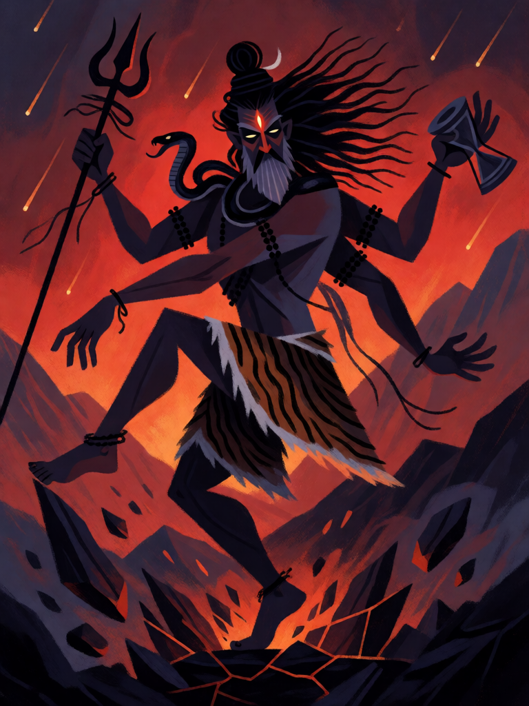

# Tandava

[← Hinduísmo](../hinduismo.md) · [Wiki KodeX](../README.md) · [◀ Vishvarupa, a Forma Universal](hin_vishvarupa.md) · [Vajra ▶](hin_vajra.md)

| Carta | Arte |
|---|---|
|  |  |

| | |
|---|---|
| **Tradição** | Hinduísmo |
| **Tipo** | Rito |
| **Custo de Fé** | 5 |
| **Palavras-chave** | — |
| **Lendária** | não |
| **Cópias no deck** | 1 |
| **Id** | `hin_tandava` |

## Texto da carta

> 2 de dano a todas as Entidades inimigas e 3 de dano à Cornucópia inimiga.

**EN — Tandava:** *2 damage to all enemy Entities and 3 damage to the enemy Cornucopia.*

## Contexto mitológico

Tandava é a dança cósmica de Shiva — nome derivado de Tandu, o servo a quem Shiva a ensinou e que a transmitiu ao sábio Bharata, autor do Natya Shastra, tratado fundador da dança e do teatro indianos. Há duas faces: o Ananda Tandava, a dança do êxtase, em que Shiva, como Nataraja, sustenta o ritmo do universo dentro do círculo de fogo; e o Rudra Tandava, a dança da fúria, em que o mesmo ritmo acelera até desfazer a criação no fim do ciclo (pralaya).

O Shiva Purana conta o Rudra Tandava mais lembrado: quando Sati, primeira esposa de Shiva, morre humilhada no sacrifício do pai Daksha, Shiva arranca uma mecha de cabelo e dela nasce o terrível Virabhadra, que destrói o yajna e decapita Daksha; depois Shiva carrega o corpo de Sati pelos mundos, dançando de dor, até que Vishnu corta o corpo em pedaços com o Chakra — e onde cada pedaço cai nasce um templo (os Shakti Pithas). Em Chidambaram, no sul, a tradição diz que Shiva venceu Kali numa competição de dança, erguendo a perna acima da cabeça — o passo urdhva tandava que ela, por pudor, não repetiu.

O Rito é o Rudra Tandava descendo sobre a mesa do adversário: campo e Cornucópia tremem juntos.

## Papel no jogo

O finalizador do deck e seu único dano direto grande: 2 a cada Entidade inimiga (mata tokens e corpos pequenos; os médios ficam feridos para o ataque) e 3 à Cornucópia — depois de alguns ataques de Hanuman, é frequentemente a carta que fecha a partida. Jogado no turno 5–6, limpa o campo para que os atacantes com Ímpeto do turno seguinte batam direto no oponente. Caro: 5 Fé é o turno inteiro, e contra um oponente com Vida alta na mesa rende menos.

## Atributos visuais

silhueta escura de Shiva dançando · exatamente quatro braços · tridente e tambor damaru · terceiro olho brilhando · pé golpeando o chão que racha

Balanço (conta de custo)

Orçamento P = 2·5+1 = 11 pts. Gasto: 2 de dano a todas as inimigas (2 × 1,5 = 3) + 3 de dano direto à Cornucópia (3 × 2 = 6) = 9. Dentro (P−2). Máximo de 3 de dano direto por carta respeitado.
Rodada 2 de balanceamento (2º passe, metade leve do pacote H2 do Analista): área 3 → 2 (−1,4 pp medido). Com H1 o deck ficou em 58,5 / 57,2 (seeds 11/12), no teto da faixa; o corte dá margem sem tocar no dano direto, que é a identidade da carta.

Ficha completa: `cartas/hinduismo/25_tandava.md` · cartas base da versão Alpha
