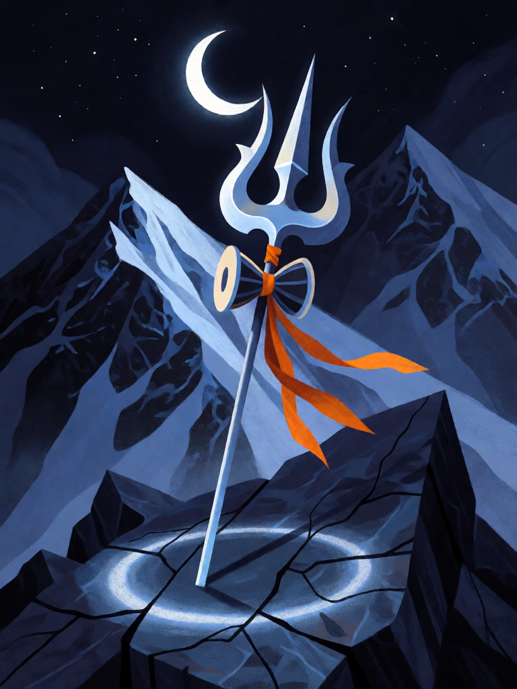

# Trishula

[← Hinduísmo](../hinduismo.md) · [Wiki KodeX](../README.md) · [◀ Gandiva](hin_gandiva.md)

| Carta | Arte |
|---|---|
|  |  |

| | |
|---|---|
| **Tradição** | Hinduísmo |
| **Tipo** | Relíquia |
| **Custo de Fé** | 4 |
| **Palavras-chave** | — |
| **Lendária** | não |
| **Cópias no deck** | 1 |
| **Id** | `hin_trishula` |

## Texto da carta

> Portadora: +3 ATK / +1 Vida. Quando atacar, 1 de dano a uma Entidade inimiga. Quando morrer, 2 de dano a todas as Entidades inimigas.

**EN — Trishula:** *Bearer: +3 ATK / +1 Health. When it attacks, 1 damage to an enemy Entity. When it dies, 2 damage to all enemy Entities.*

## Contexto mitológico

O Trishula ("três pontas") é o tridente de Shiva, a arma que o identifica em toda imagem — ao lado do damaru, o tambor em forma de ampulheta que costuma estar amarrado ao cabo. As três pontas foram lidas de muitas maneiras: os três gunas (sattva, rajas, tamas) que compõem a natureza; os três tempos (passado, presente, futuro); as três funções de criação, preservação e destruição; os três canais sutis do yoga (ida, pingala, sushumna), com o cabo como a coluna. É também a arma de Durga, que a recebe de Shiva no Devi Mahatmya e com ela atravessa Mahishasura.

O Shiva Purana e o Linga Purana contam que o tridente cai sobre o que deve ser dissolvido: com ele Shiva decapita o Ganesha-menino à porta de Parvati (antes de restaurá-lo com a cabeça de elefante) e, em algumas versões, fere Andhaka, o asura cego, mantendo-o espetado na ponta por mil anos até que a devoção o purifique. Diante de todo templo de Shiva, o tridente está plantado como estandarte, e os sadhus shaivas o carregam como cajado.

Na carta, o tridente de Shiva faz da portadora um instrumento de dissolução: a cada ataque, uma ponta alcança outro inimigo; quando a portadora cai, o tridente cai com ela — sobre todos.

## Papel no jogo

A Relíquia mais cara do deck: +3/+1 e 1 de dano extra por ataque fazem de Hanuman (que cresce a cada ataque) ou de Kali (que cresce a cada morte) uma máquina; e matar a portadora custa ao oponente 2 de dano em todo o campo dele — a resposta do deck à sua própria fraqueza, a remoção do portador. Sobre Shiva, um 8/6 com Ímpeto. Cara: 4 Fé num só corpo — contra bounce (Ganesha inimigo) perde-se tudo sem o Último Sopro.

## Atributos visuais

tridente de prata de três pontas · cabo longo cravado na rocha · pequeno tambor damaru amarrado · fita de pano açafrão · pico nevado com lua crescente

Balanço (conta de custo)

Orçamento P = 2·4+1 = 9 pts (+1 Relíquia = 10). Gasto: +3 ATK 3 + +1 Vida 1 + 1 de dano a Entidade escolhida a cada ataque (repetível, sem Usos: 1 × 2 = 2) + 2 de dano a todas as inimigas quando a portadora morre (2 × 1,5 = 3) = 9. Dentro (P−1).
Rodada 2 de balanceamento (pacote H1 do Analista): +2 → +1 Vida (pacote de Relíquias).
Revisão: o dano por ataque era 2, contado uma vez só; como repetível cheio o total dava 12. Caiu para 1 por ataque; o Último Sopro ficou.

Ficha completa: `cartas/hinduismo/29_trishula.md` · cartas base da versão Alpha
