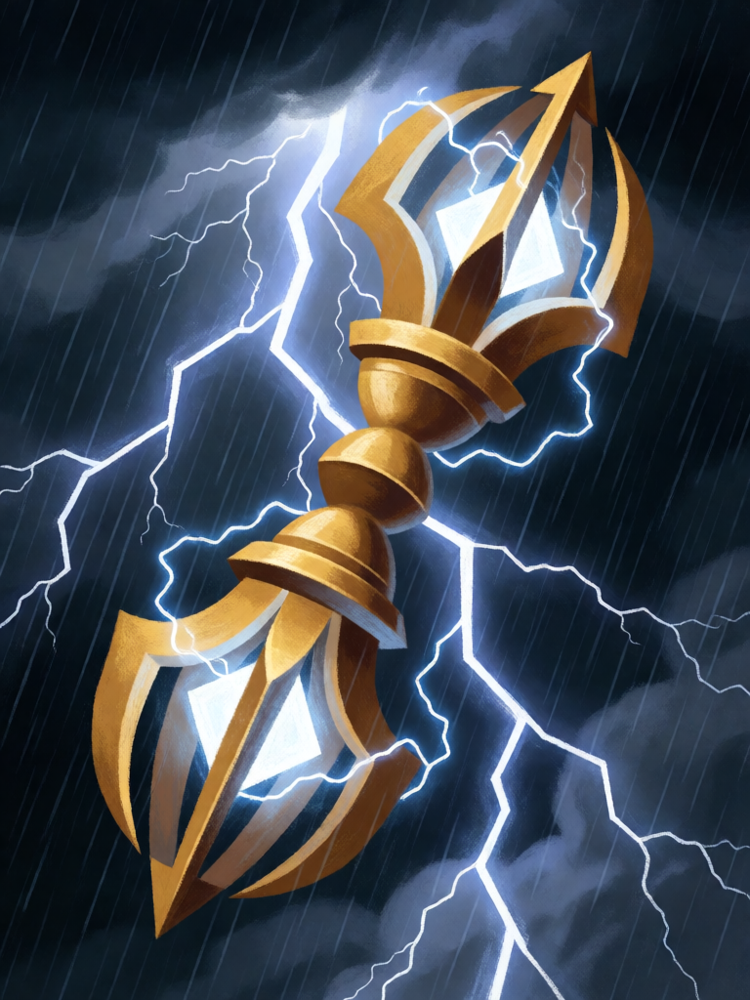

# Vajra

[← Hinduísmo](../hinduismo.md) · [Wiki KodeX](../README.md) · [◀ Tandava](hin_tandava.md) · [Sudarshana Chakra ▶](hin_sudarshana_chakra.md)

| Carta | Arte |
|---|---|
|  |  |

| | |
|---|---|
| **Tradição** | Hinduísmo |
| **Tipo** | Relíquia |
| **Custo de Fé** | 2 |
| **Palavras-chave** | — |
| **Lendária** | não |
| **Cópias no deck** | 1 |
| **Id** | `hin_vajra` |

## Texto da carta

> Portadora: +2 ATK. Ao equipar, causa 2 de dano a uma Entidade inimiga.

**EN — Vajra:** *Bearer: +2 ATK. When equipped, deal 2 damage to an enemy Entity.*

## Contexto mitológico

O Vajra ("raio", "diamante") é a arma de Indra, rei dos devas e deus da tempestade — o deus mais invocado do Rigveda, com cerca de 250 hinos. O hino 1.32 é o mais célebre: Indra, embriagado de soma, ergue o vajra forjado por Tvashtar e mata Vritra, a serpente-dragão que represava as águas do mundo; os rios rompem como vacas soltas do curral e o céu e a terra tremem. O vajra é a força do trovão em forma de arma: a cabeça de raios cruzados, dura como o diamante, que nenhuma defesa resiste.

O Bhagavata Purana (6.9–10) conta a origem puranica: o asura Vritra só podia ser morto por uma arma feita dos ossos do sábio Dadhichi, que, pedido pelos deuses, abandona o corpo em meditação para que Tvashtar molde o vajra. O mesmo símbolo passou ao budismo (vajra/dorje) como emblema da indestrutibilidade.

Na carta, o raio cai no instante em que Indra o empunha: a arma é tão impacto quanto equipamento.

## Papel no jogo

A Relíquia de abertura do deck: no turno 2 ou 3, 2 de dano a um alvo (mata tokens e os corpos de 1–2 de Vida) e um portador com +2 ATK que ataca em seguida. Sobre Garuda vira um 3/2 com Ímpeto que já limpou o bloqueador pequeno; os de 3 de Vida ficam para o combate. Buscável com Matsya. Fraca sem portador em campo, e o bônus some com a morte dele — que agora não ganha Vida para resistir.

## Atributos visuais

vajra dourado de duas pontas · garras curvas nas duas extremidades · núcleo de diamante · raios elétricos ao redor · céu de tempestade

Balanço (conta de custo)

Orçamento P = 2·2+1 = 5 pts (+1 Relíquia = 6). Gasto: +2 ATK 2 + 2 de dano a Entidade escolhida 2 = 4. Dentro (P−2).
Rodada 2 de balanceamento (pacote H1 do Analista): saiu o +1 Vida (as quatro Relíquias −1 Vida = −5,0 pp medido em conjunto: a força do deck está em corpos que chegam à mesa com arma e sobrevivem).
Rodada 1 de balanceamento: era 3 de dano (6/6) — 3 de dano por 2 Fé mais corpo era a remoção barata que esvaziava o campo inimigo antes da rodada 4 (83,6 % de WR global).

Ficha completa: `cartas/hinduismo/26_vajra.md` · cartas base da versão Alpha
