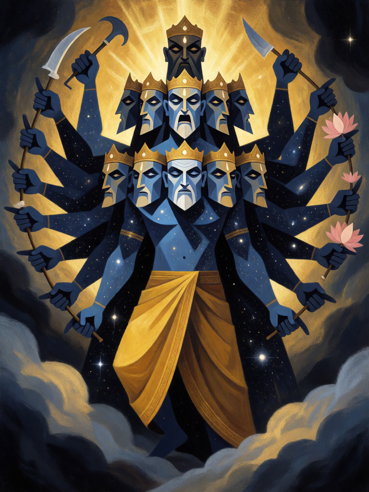

# Vishvarupa, a Forma Universal

[← Hinduísmo](../hinduismo.md) · [Wiki KodeX](../README.md) · [◀ Descida do Avatar](hin_descida_do_avatar.md) · [Tandava ▶](hin_tandava.md)

| Carta | Arte |
|---|---|
|  |  |

| | |
|---|---|
| **Tradição** | Hinduísmo |
| **Tipo** | Rito |
| **Custo de Fé** | 4 |
| **Palavras-chave** | — |
| **Lendária** | não |
| **Cópias no deck** | 1 |
| **Id** | `hin_vishvarupa` |
| **Arte** | provisória nesta Alpha |

## Texto da carta

> Uma Entidade aliada passa a ter ATK 6 e Vida 6 e ganha Ímpeto.

**EN — Vishvarupa, the Universal Form:** *An allied Entity becomes 6 ATK and 6 Health and gains Rush.*

## Contexto mitológico

No capítulo 11 da Bhagavad Gita, Arjuna, depois de ouvir Krishna explicar que ele é a origem e o fim de todas as coisas, pede para ver essa forma. Krishna lhe dá um olho divino, e Arjuna vê a Vishvarupa — a forma universal: incontáveis bocas e olhos, ornamentos e armas erguidas, sóis a arder ao mesmo tempo, todos os deuses e todos os seres contidos num só corpo sem começo, meio ou fim. Vê os guerreiros dos dois exércitos — Bhishma, Drona, Karna, os Kauravas — já entrando nas bocas em chamas do deus. Aterrorizado, pergunta quem é aquele, e a resposta é o verso mais lembrado do capítulo: "Eu sou o Tempo, destruidor dos mundos, que vem consumir todos os seres" (BG 11.32).

Arjuna pede que Krishna volte à forma de quatro braços, depois à forma humana amiga; Krishna o faz e explica que nem o estudo dos Vedas nem o sacrifício mostram aquela forma — só a devoção. A Vishvarupa é a revelação de que o auriga, o amigo, o guerreiro ao lado, é o universo inteiro.

O Rito é essa revelação aplicada a quem está em campo: a criatura comum mostra, por um instante, o que de fato é — e, como Arjuna depois da visão, pega o arco e avança.

## Papel no jogo

Transformação: qualquer Entidade aliada vira 6/6 com Ímpeto, mantendo as demais palavras-chave e a Relíquia. Melhor sobre corpos pequenos com texto bom — Jatayu, Matsya (o 0/1 do turno 1 vira um 6/6 que ataca na hora), Rama (6/6 com Renascer) — ou para "curar" um Hanuman ferido a 1 de Vida, que volta a 6/6 e continua crescendo (o crescimento acumulado é zerado: a carta define os valores). Sobre Shiva seria um rebaixamento, portanto não se usa nele. Fraco em mesa vazia — exige um corpo em campo.

## Atributos visuais

gigante cósmico de pele azul · exatamente onze cabeças em camadas · exatamente vinte braços com armas · corpo cheio de estrelas e galáxias

Balanço (conta de custo)

Orçamento P = 2·4+1 = 9 pts. Gasto: definir ATK 6 / Vida 6 — valor medido contra o corpo médio 2/3 (tabela §10): +4 ATK e +3 Vida permanentes = 7 + Ímpeto 1 = 8. Dentro.
Revisão: era "5/5" sem Ímpeto, avaliado pelo pior caso (0/1); pelo corpo médio valia só 5 pts, abaixo de P−2. Subiu para 6/6 e ganhou Ímpeto.

Ficha completa: `cartas/hinduismo/24_vishvarupa.md` · cartas base da versão Alpha
