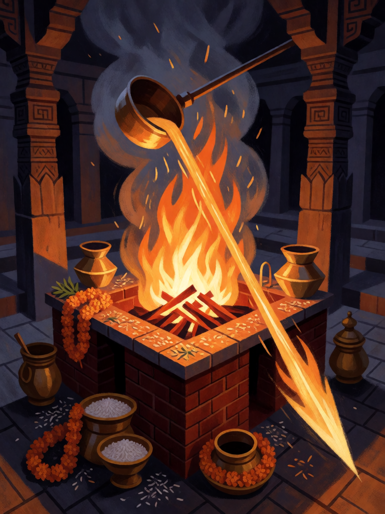

# Yajna, o Fogo Sacrificial

[← Hinduísmo](../hinduismo.md) · [Wiki KodeX](../README.md) · [◀ Om](hin_om.md) · [Samudra Manthan ▶](hin_samudra_manthan.md)

| Carta | Arte |
|---|---|
|  |  |

| | |
|---|---|
| **Tradição** | Hinduísmo |
| **Tipo** | Rito |
| **Custo de Fé** | 2 |
| **Palavras-chave** | — |
| **Lendária** | não |
| **Cópias no deck** | 1 |
| **Id** | `hin_yajna` |

## Texto da carta

> Cause 2 de dano a uma Entidade inimiga e ganhe 2 de Fé temporária.

**EN — Yajna, the Sacrificial Fire:** *Deal 2 damage to an enemy Entity and gain 2 temporary Faith.*

## Contexto mitológico

O yajna é o sacrifício védico: o rito central da religião mais antiga da Índia, descrito e regulado nos quatro Vedas e nos Brahmanas. Sacerdotes acendem o fogo em altares de tijolo dispostos segundo a geometria dos Shulba Sutras, recitam hinos e vertem oblações — ghee (manteiga clarificada), grãos, leite, soma — nas chamas, enquanto Agni, o fogo, as leva aos deuses. O universo mesmo, diz o Rigveda (10.90, Purusha Sukta), nasceu de um sacrifício primordial; e os deuses dependem das oferendas dos homens tanto quanto os homens das chuvas dos deuses.

A Bhagavad Gita (3.9–16) reinterpreta o yajna: toda ação feita como oferenda, sem apego ao fruto, é sacrifício; e em 4.24–33 Krishna enumera os sacrifícios do saber, da respiração, da ascese, concluindo que "o sacrifício do conhecimento é superior ao de bens materiais". Em muitas histórias, o yajna é também arma: Dasharatha realiza um para ter filhos, Draupadi nasce do fogo de um yajna, e o yajna interrompido de Daksha custa a vida de Sati.

O Rito traz as duas faces: o fogo que fere e a energia que o sacrifício devolve a quem o oferece.

## Papel no jogo

Remoção barata que se paga sozinha: 2 de dano terminam um corpo ferido ou matam um 2 de Vida, e a Fé temporária volta inteira — na prática, um Rito gratuito que custa só a carta. Combina com o ping de Garuda e Arjuna para matar um 3 de Vida no mesmo turno. Fraco contra corpos grandes, onde 2 de dano é pouco.

## Atributos visuais

altar de fogo quadrado de tijolos · concha de latão vertendo ghee · oferendas de grãos e cravos · jato de fogo projetado à frente

Balanço (conta de custo)

Orçamento P = 2·2+1 = 5 pts. Gasto: 2 de dano a Entidade escolhida 2 + 2 de Fé temporária (2 × 1,5 = 3) = 5. Dentro.

Ficha completa: `cartas/hinduismo/20_yajna.md` · cartas base da versão Alpha
