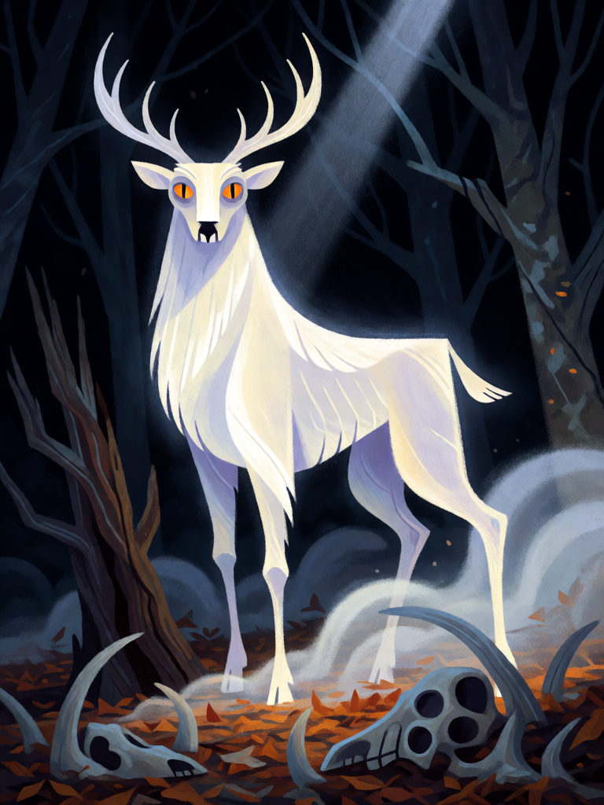

# Anhangá

[← Indígena brasileira](../indigena.md) · [Wiki KodeX](../README.md) · [◀ Boitatá](ind_boitata.md) · [Mapinguari ▶](ind_mapinguari.md)

| Carta | Arte |
|---|---|
|  |  |

| | |
|---|---|
| **Tradição** | Indígena brasileira |
| **Tipo** | Entidade |
| **Custo de Fé** | 4 |
| **ATK / DEF** | 3 / 3 |
| **Palavras-chave** | — |
| **Lendária** | não |
| **Cópias no deck** | 1 |
| **Id** | `ind_anhanga` |

## Texto da carta

> Sempre que outra Entidade aliada morrer, invoca um Veado Branco 1/2.

**EN — Anhangá:** *Whenever another allied Entity dies, summon a 1/2 White Deer.*

## Contexto mitológico

Para os Tupinambá do século XVI, *Anhanga* era o espírito errante dos mortos, o terror das noites: Anchieta (1560) e Cardim (c. 1584) o descrevem como o ser que "anda pelo mato" e de quem todos têm medo; os jesuítas o traduziram como "diabo", o que distorceu a figura. Métraux (*A religião dos Tupinambás*, 1928) a devolve ao lugar: um espectro ligado aos mortos e à floresta, não um princípio do mal.

No folclore amazônico posterior, recolhido por Couto de Magalhães (*O Selvagem*, 1876) e Cascudo (*Dicionário do Folclore Brasileiro*), o Anhangá é o **protetor dos animais de caça**, que aparece como um **veado branco de olhos de fogo**. Quem persegue uma fêmea com filhote ou caça demais é levado pelo Anhangá a visões e alucinações, e às vezes mata o próprio parente pensando ser a caça.

Na carta, Anhangá é a resposta da mata à morte: quando uma aliada cai, ele faz surgir o veado branco — a caça que não pode ser caçada.

## Papel no jogo

Motor de tokens em deck que espera perder peças pequenas: cada Queixada, Aruanã ou Saci que morre vira um Veado Branco 1/2, que mantém o campo cheio para Terra sem Males e para a aura do Cocar. Combina com Kuarup e Dádiva de Mani (as mortes não são perda total). Como não tem Guarda, costuma ser atacado por último — que é o que ele quer. Fraco se o campo já estiver lotado (sem slot, não há token).

## Atributos visuais

veado branco espectral · olhos de fogo laranja · translúcido com névoa branca · ossos de caça a seus pés

Balanço (conta de custo)

Orçamento P = 2·4+1 = 9 pts. Gasto (tabela §10): ATK 3 + Vida 3 + `ally_dies` → token Veado Branco 1/2 (a + v = 3; gatilho repetível: valor cheio) = 9. Dentro. _(Revisão: conta confirmada. Nota: Sacrifício contaria como morte e dispararia o Veado, mas o deck não tem Sacrifício.)_

Ficha completa: `cartas/indigena/06_anhanga.md` · cartas base da versão Alpha
