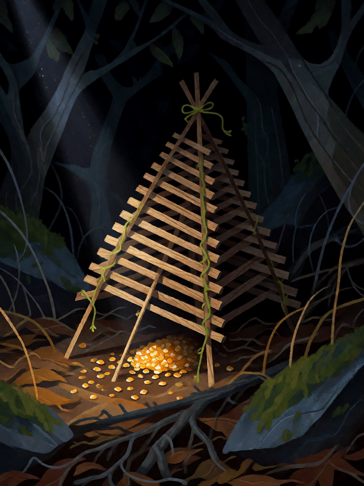

# Arapuca

[← Indígena brasileira](../indigena.md) · [Wiki KodeX](../README.md) · [◀ Tupã, o Trovão](ind_tupa.md) · [Mundéu ▶](ind_mundeu.md)

| Carta | Arte |
|---|---|
|  |  |

| | |
|---|---|
| **Tradição** | Indígena brasileira |
| **Tipo** | Selo |
| **Custo de Fé** | 1 |
| **Palavras-chave** | — |
| **Lendária** | não |
| **Cópias no deck** | 2 |
| **Id** | `ind_arapuca` |

## Texto da carta

> Quando uma Entidade inimiga atacar uma Entidade sua: ela sofre 1 de dano, não ataca no próximo turno dela, e você compra 1 carta.

**EN — Arapuca:** *When an enemy Entity attacks one of your Entities: it takes 1 damage, can't attack on its next turn, and you draw 1 card.*

## Contexto mitológico

A arapuca é a armadilha de pássaros mais difundida do Brasil, e o nome é tupi: *uirá-puca*, "coisa que prende pássaro" (Cascudo, *Dicionário do Folclore Brasileiro*). É uma pirâmide de varetas amarradas com cipó, armada sobre um gatilho com isca de milho ou fruta; quando o pássaro bica a isca, a pirâmide cai e o prende vivo, sem feri-lo.

Os cronistas do século XVI já descrevem as técnicas indígenas de captura — Gabriel Soares de Sousa (*Tratado Descritivo do Brasil*, 1587) dedica capítulos aos modos de caçar aves e caça miúda — e a arapuca passou intacta para a cultura caipira e sertaneja, com o mesmo nome e a mesma forma. É a imagem do caçador paciente que não mata: espera, prende, e decide depois.

Na carta é exatamente isso: o atacante fica preso um turno, leva o susto da queda, e você ganha tempo (uma carta) enquanto ele está na gaiola.

## Papel no jogo

Selo barato de tempo, com duas cópias para aparecer cedo. Colocado no turno 1 ou 2, pune o primeiro ataque inimigo: a criatura atacante perde seu próximo ataque, e você repõe a carta. Ideal para proteger Saci, Curupira e tokens até Boitatá chegar. Dispara só em ataque a uma Entidade sua (`enemy_attacks`); um ataque direto à Cornucópia, com o seu campo vazio, não o aciona — então sempre mantenha um corpo em campo. Fraco contra decks que não atacam (controle de Ritos), caso em que fica parado ocupando um dos 2 slots de Selo.

## Atributos visuais

armadilha piramidal de varetas amarradas com cipó · gatilho de vareta · isca de milho embaixo · escondida entre folhas

Balanço (conta de custo)

Orçamento P = 2·1+1 = 3 pts, +1 grátis de Selo = 4. Gasto (tabela §10): 1 de dano ao atacante (1) + Freeze no atacante (1,5) + comprar 1 (1,5) = 4. Dentro. _(Revisão: conta refeita com o valor oficial de Freeze = 1,5; resultado igual.)_

Ficha completa: `cartas/indigena/11_arapuca.md` · cartas base da versão Alpha
