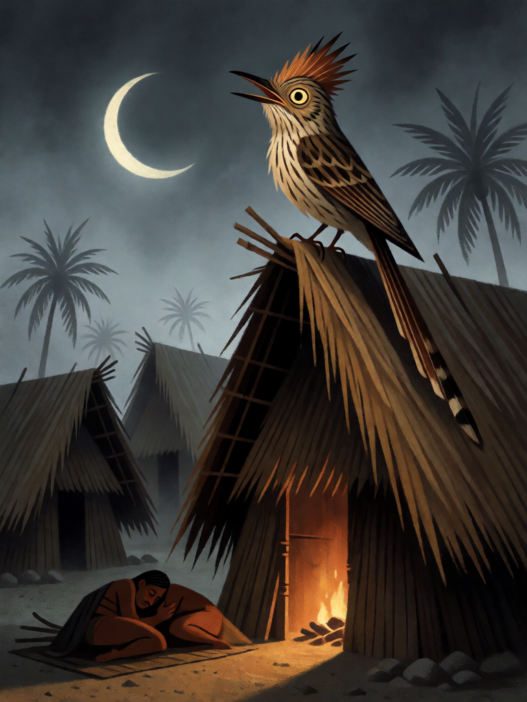

# Assovio da Matinta

[← Indígena brasileira](../indigena.md) · [Wiki KodeX](../README.md) · [◀ Mundéu](ind_mundeu.md) · [Sopro do Pajé ▶](ind_sopro_do_paje.md)

| Carta | Arte |
|---|---|
|  |  |

| | |
|---|---|
| **Tradição** | Indígena brasileira |
| **Tipo** | Selo |
| **Custo de Fé** | 1 |
| **Palavras-chave** | — |
| **Lendária** | não |
| **Cópias no deck** | 1 |
| **Id** | `ind_assovio_da_matinta` |

## Texto da carta

> No fim do turno do oponente: ele descarta 1 carta aleatória e sua Cornucópia sofre 1 de dano.

**EN — Matinta's Whistle:** *At the end of your opponent's turn: they discard 1 random card and their Cornucopia takes 1 damage.*

## Contexto mitológico

A Matinta Perera (Matintaperera, Matinta-Pereira) é figura do Pará e do baixo Amazonas: uma velha que, à noite, se transforma num pássaro e pousa nos telhados assobiando um silvo agudo e repetido — *matinta-perê, matinta-perê* — até que alguém da casa prometa fumo. Na manhã seguinte uma velha da vizinhança aparece para cobrar o tabaco prometido; quem não dá sofre uma desgraça. Cascudo (*Dicionário do Folclore Brasileiro*) e Barbosa Rodrigues (*Poranduba Amazonense*, 1890) registram o mito, aparentado ao Saci do Norte, que também é pássaro e também se chama matinta.

O nome e o pássaro são indígenas — o assobio é o da *Tapera naevia*, o saci ou peitica, ave cujo canto noturno é mau agouro em toda a Amazônia. A velha-feiticeira é acréscimo colonial. A carta fica com o núcleo: o assobio que tira o sono e a cobrança inevitável.

## Papel no jogo

Pressão fora do combate, coisa rara no deck: no fim do turno do oponente, ele perde uma carta da mão e 1 ponto de Cornucópia. Melhor cedo (turno 1–2), quando o oponente ainda tem mão cheia, ou contra decks de controle que não atacam e não disparam Arapuca/Mundéu. É o único dano direto do deck junto com Fogo de Monan. Dispara só uma vez e vai ao cemitério.

## Atributos visuais

pássaro saci (Tapera naevia) estriado de marrom · crista eriçada · bico aberto assobiando · sobre telhado de palha · lua crescente

Balanço (conta de custo)

Orçamento P = 2·1+1 = 3 pts, +1 grátis de Selo = 4. Gasto (tabela §10): oponente descarta 1 aleatória (2) + 1 de dano direto à Cornucópia (2) = 4. Dentro. _(Revisão: conta confirmada. Dano direto do deck: 1 aqui + 1 em Fogo de Monan = 2 ≤ 8.)_

Ficha completa: `cartas/indigena/13_assovio_da_matinta.md` · cartas base da versão Alpha
