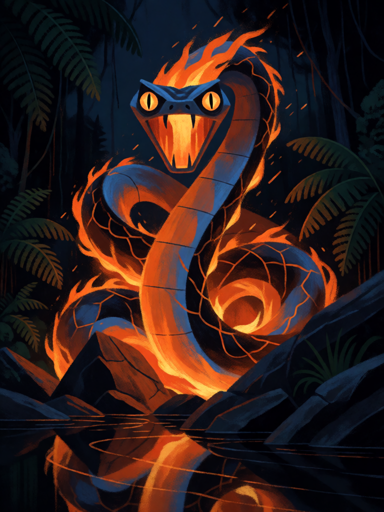

# Boitatá

[← Indígena brasileira](../indigena.md) · [Wiki KodeX](../README.md) · [◀ Iara](ind_iara.md) · [Anhangá ▶](ind_anhanga.md)

| Carta | Arte |
|---|---|
|  |  |

| | |
|---|---|
| **Tradição** | Indígena brasileira |
| **Tipo** | Entidade |
| **Custo de Fé** | 4 |
| **ATK / DEF** | 3 / 4 |
| **Palavras-chave** | Guarda |
| **Lendária** | não |
| **Cópias no deck** | 2 |
| **Id** | `ind_boitata` |

## Texto da carta

> Guarda. Sempre que sofrer dano de um ataque, causa 1 de dano ao atacante.

**EN — Boitatá:** *Guard. Whenever this takes damage from an attack, deal 1 damage to the attacker.*

## Contexto mitológico

*Mboi-tatá*, "cobra de fogo" em tupi. É um dos seres mais antigos do folclore brasileiro: Anchieta, na carta de 1560, já fala do *Baetatá*, "coisa de fogo", que corre pelos campos à noite e persegue os indígenas. Cascudo (*Geografia dos Mitos Brasileiros*, 1947) reúne as variantes: serpente de fogo que vive nos rios e campos, de olhos enormes e luminosos; no Rio Grande do Sul, *Baitatá*; no sertão, confundida com o fogo-fátuo dos pântanos.

A versão gaúcha, fixada por João Simões Lopes Neto em *Lendas do Sul* (1913), conta que, num dilúvio de trevas, uma cobra sobreviveu num buraco comendo os olhos dos animais mortos, até ficar cheia de luz e transparente. A versão mais difundida faz dela a **protetora dos campos contra quem lhes põe fogo**: o Boitatá persegue e queima o incendiário, ou o enlouquece com sua luz. É o fogo da mata voltado contra quem o usa mal.

Por isso a carta é a guardiã punitiva central do deck: Guarda e dano devolvido a quem ataca suas aliadas. É a carta-teste de estilo do projeto (`cartas/_teste_estilo/boitata.md`), mantida com os mesmos números.

## Papel no jogo

A "cola" do campo. Com Guarda, atrai os ataques — e cada ataque que o fere queima o atacante por 1 (o fogo da serpente). É o Curupira grande: 3/4 que devolve dano a quem bate nele, mas não se fere ao atacar (o contragolpe do defensor não tem atacante). Com Curupira ao lado, o oponente escolhe qual guardiã vai pagar para atacar. Segura Caipora, Saci e tokens. Alvo ideal para o Cocar do Morubixaba e para o Kuarup (reviver para o campo). Morre para Ritos de 4 de dano e sofre contra `silence`.

## Atributos visuais

serpente feita de fogo · olhos enormes amarelos brilhantes · empinada em guarda de frente · boca aberta com fogo dentro

Balanço (conta de custo)

Orçamento P = 2·4+1 = 9 pts. Gasto (tabela §10): ATK 3 + Vida 4 + Guarda 1 + `on_damaged` 1 de dano ao atacante (gatilho repetível: valor cheio, 1) = 9. Dentro.
Rodada 1 de balanceamento: o gatilho era `ally_attacked` ("outra aliada atacada"), que com Guarda quase nunca ocorria (0,15 disparo por partida: a Guarda atrai o ataque para o próprio Boitatá). Passou a `on_damaged`, como Curupira e Mapinguari.

Ficha completa: `cartas/indigena/05_boitata.md` · cartas base da versão Alpha
