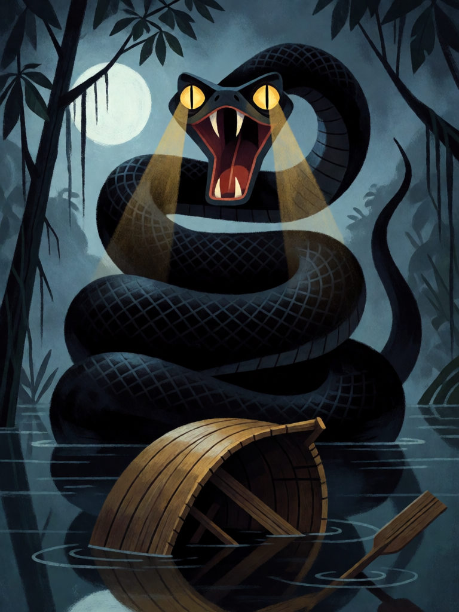

# Cobra-Grande

[← Indígena brasileira](../indigena.md) · [Wiki KodeX](../README.md) · [◀ Mapinguari](ind_mapinguari.md) · [Jaci, a Lua ▶](ind_jaci.md)

| Carta | Arte |
|---|---|
|  |  |

| | |
|---|---|
| **Tradição** | Indígena brasileira |
| **Tipo** | Entidade |
| **Custo de Fé** | 6 |
| **ATK / DEF** | 5 / 6 |
| **Palavras-chave** | — |
| **Lendária** | não |
| **Cópias no deck** | 1 |
| **Id** | `ind_cobra_grande` |

## Texto da carta

> Sempre que uma Entidade inimiga morrer, Cobra-Grande ganha +1/+1 permanente.

**EN — Cobra-Grande:** *Whenever an enemy Entity dies, Cobra-Grande gains permanent +1/+1.*

## Contexto mitológico

A Cobra-Grande, *Boiúna* ou *Mboiúna* ("cobra preta" em tupi), é a serpente colossal dos rios amazônicos: com os olhos acesos como faróis, vira barco iluminado, afunda canoas, abre igarapés com o corpo e vive no fundo dos lagos. Barbosa Rodrigues (*Poranduba Amazonense*, 1890) e Cascudo (*Geografia dos Mitos Brasileiros*) a situam no centro do imaginário ribeirinho do Pará e do Amazonas: toda cidade grande, dizem, tem uma Cobra-Grande dormindo embaixo da igreja.

O ciclo mais conhecido é o de **Honorato (Norato) e Maria Caninana**, gêmeos filhos de uma indígena que foi engravidada pela cobra; Maria é má e Honorato bom, e Honorato se desencanta quando um soldado tem coragem de derramar leite na sua boca de serpente e feri-lo. Raul Bopp fez do mito o poema *Cobra Norato* (1931), marco do modernismo.

A carta a mostra como a devoradora dos rios: cada Entidade inimiga que morre a alimenta — ela engole o que cai na água.

## Papel no jogo

Finalizador que cresce: entra 5/6 e, a cada inimiga que o deck mata (contragolpes de Curupira, Boitatá e Mapinguari, Fogo de Monan, bloqueios), ganha +1/+1 permanente. Em partida longa passa Tupã em corpo. Com Ibirapema (+2 ATK, Ímpeto) ataca no turno em que entra. Sem Guarda, deixa Boitatá segurar e ataca por cima. Vulnerável à Iara inimiga ou a qualquer `bounce`, que apaga o crescimento.

## Atributos visuais

sucuri negra colossal · olhos amarelos como faróis · saindo do rio em espirais · canoa virada pequena

Balanço (conta de custo)

Orçamento P = 2·6+1 = 13 pts. Gasto (tabela §10): ATK 5 + Vida 6 + `enemy_dies` → +1 ATK perm (1) + +1 Vida perm (1) = 2 (gatilho repetível: valor cheio) = 13. Dentro. _(Revisão: conta confirmada.)_

Ficha completa: `cartas/indigena/08_cobra_grande.md` · cartas base da versão Alpha
