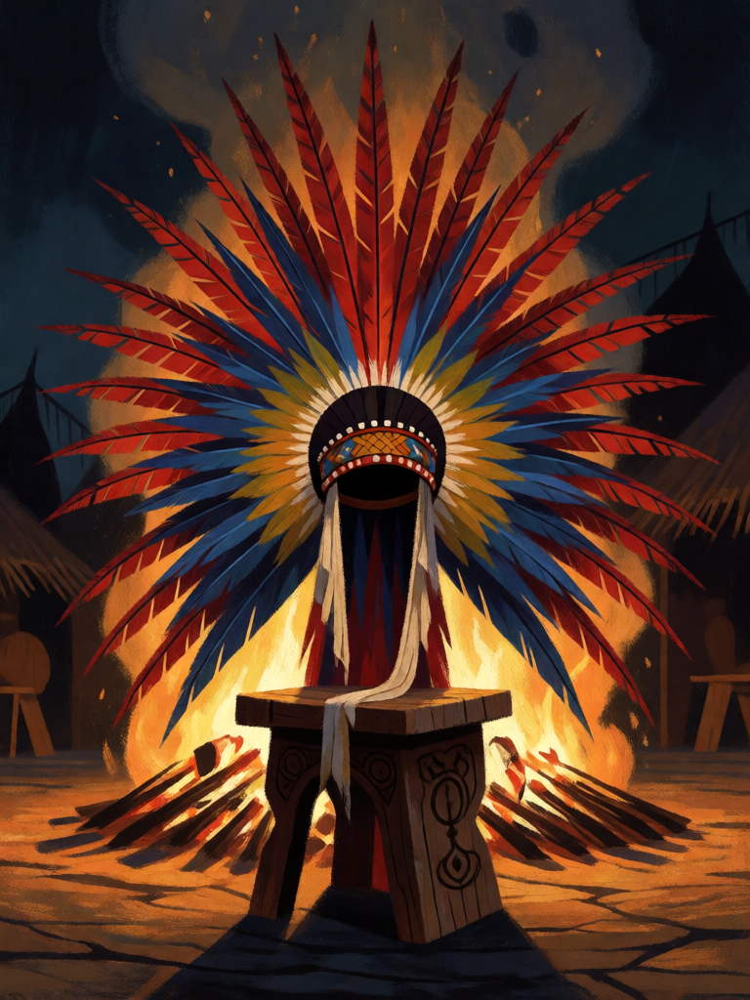

# Cocar do Morubixaba

[← Indígena brasileira](../indigena.md) · [Wiki KodeX](../README.md) · [◀ Maracá do Pajé](ind_maraca_do_paje.md)

| Carta | Arte |
|---|---|
|  |  |

| | |
|---|---|
| **Tradição** | Indígena brasileira |
| **Tipo** | Relíquia |
| **Custo de Fé** | 3 |
| **Palavras-chave** | — |
| **Lendária** | não |
| **Cópias no deck** | 1 |
| **Id** | `ind_cocar_do_morubixaba` |

## Texto da carta

> A portadora ganha +3 Vida e Guarda. Enquanto ela estiver em campo, todas as suas Entidades ganham +1 ATK.

**EN — Morubixaba's Headdress:** *The bearer gains +3 Health and Guard. While it's on the field, all your Entities have +1 ATK.*

## Contexto mitológico

*Morubixaba* (*mburuvixá*, "o que é grande") era o título do chefe tupinambá — não um rei, mas o guerreiro mais respeitado, que falava primeiro no conselho e conduzia a guerra, e cuja autoridade dependia de dar o exemplo e de generosidade. Gabriel Soares de Sousa (*Tratado Descritivo do Brasil*, 1587) e Jean de Léry (1578) descrevem os principais pelo ornamento: o **cocar** (*acangatara*, "coisa da cabeça") de penas de arara, guará e tucano, e o manto de penas (*guará-abucu*) reservado às grandes cerimônias.

O cocar é, em quase todos os povos indígenas do Brasil, a marca de função e prestígio — nunca enfeite banal. Entre os Kayapó e os Xavante, cada forma e cada cor correspondem a uma idade e a um papel; entre os Karajá e no Alto Xingu, cocares específicos pertencem a rituais específicos. Darcy Ribeiro (*Diários Índios*, 1996) e Kaká Werá Jecupé (*A Terra dos Mil Povos*, 1998) insistem que a liderança indígena se exerce pela palavra e pelo exemplo: o chefe é o primeiro a enfrentar o perigo e o que mais dá.

A carta faz da portadora um chefe: ela se oferece ao combate (Guarda), aguenta mais (+3 Vida) e, pelo exemplo, faz os outros baterem mais forte (+1 ATK).

## Papel no jogo

Dá Guarda a quem não tem — Mapinguari com Cocar é um 5/8 Guarda que devolve 2 por dano sofrido, e o inimigo é obrigado a atacá-lo. A aura +1 ATK em todas as aliadas transforma tokens 1/1 em 2/1 e faz o campo largo (Aruanãs, Queixada, Veados) ameaçar de verdade. Alvo preferido: Mapinguari ou Boitatá. Se a portadora morre, a aura some.

## Atributos visuais

cocar de penas de arara vermelhas, azuis e amarelas em leque · faixa de algodão com contas · sobre banquinho de madeira esculpido · fogueira atrás

Balanço (conta de custo)

Orçamento P = 2·3+1 = 7 pts, +1 grátis de Relíquia = 8. Gasto (tabela §10): +3 Vida permanente (3) + Guarda (1) + aura `static` +1 ATK em todas as aliadas (3) = 7. Dentro (P−1). _(Revisão: era +2 Vida = 6 pts, exatamente P−2 com a tabela oficial de aura = 3; subiu para +3 Vida para ficar na faixa P−1..P. A aura some se a portadora sair.)_

Ficha completa: `cartas/indigena/25_cocar_do_morubixaba.md` · cartas base da versão Alpha
