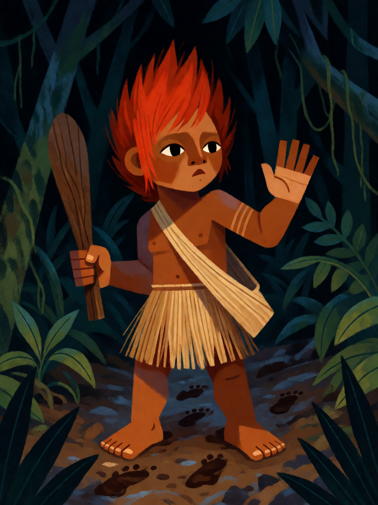

# Curupira

[← Indígena brasileira](../indigena.md) · [Wiki KodeX](../README.md) · [◀ Saci-Pererê](ind_saci_perere.md) · [Caipora ▶](ind_caipora.md)

| Carta | Arte |
|---|---|
|  |  |

| | |
|---|---|
| **Tradição** | Indígena brasileira |
| **Tipo** | Entidade |
| **Custo de Fé** | 2 |
| **ATK / DEF** | 1 / 2 |
| **Palavras-chave** | Guarda |
| **Lendária** | não |
| **Cópias no deck** | 2 |
| **Id** | `ind_curupira` |
| **Arte** | provisória nesta Alpha |

## Texto da carta

> Guarda. Sempre que sofrer dano, causa 1 de dano ao atacante.

**EN — Curupira:** *Guard. Whenever this takes damage, deal 1 damage to the attacker.*

## Contexto mitológico

O Curupira é o ser do folclore brasileiro com o registro escrito mais antigo: José de Anchieta, na carta de São Vicente de 1560, descreve os *curupiras* que "acometem os índios no mato" e para os quais se deixam penas e flechas nos caminhos. Gabriel Soares de Sousa (*Tratado Descritivo do Brasil*, 1587) repete o relato. Cascudo (*Dicionário do Folclore Brasileiro*) o acompanha de norte a sul: anão de cabelos vermelhos, dentes verdes ou azuis, e sobretudo os **pés virados para trás**, que fazem o rastro apontar para onde ele não está.

É o guardião da floresta e da caça. Pune o caçador que mata por prazer, que fere a fêmea prenhe ou o filhote, que derruba árvore sem necessidade — confundindo-o até que se perca, ou surrando-o. Quem pede licença e deixa fumo é poupado. Entre os Dessana e Tukano do Rio Negro existe o paralelo **Boraró**, também de pés para trás (Reichel-Dolmatoff, *Amazonian Cosmos*, 1971).

Na carta, o papel de guardião é **Guarda** (os inimigos têm de passar por ele) e a surra que ele dá a quem o fere é o dano devolvido a cada vez que sofre dano.

## Papel no jogo

Primeira linha de defesa: obriga o inimigo a atacá-lo e, cada vez que isso acontece, devolve 1 de dano além do seu ATK — um 2/2 inimigo que o ataca leva 2 e mata um Curupira que já custou ao oponente tempo. Protege Saci e os tokens de Caipora até Boitatá chegar. Alvo natural do Muiraquitã (+3 Vida e Renascer) e do Maracá (+1/+2). Perde para Ritos de dano, que o matam sem disparar o contragolpe de ataque.

## Atributos visuais

menino indígena ~11 anos · pés virados para trás (calcanhares à frente) · cabelo vermelho em chamas · postura de bloqueio de frente · tacape curto

Balanço (conta de custo)

Orçamento P = 2·2+1 = 5 pts. Gasto (tabela §10): ATK 1 + Vida 2 + Guarda 1 + `on_damaged` 1 de dano ao atacante (gatilho repetível: valor cheio, 1) = 5. Dentro. _(Revisão: conta confirmada.)_

Ficha completa: `cartas/indigena/02_curupira.md` · cartas base da versão Alpha
