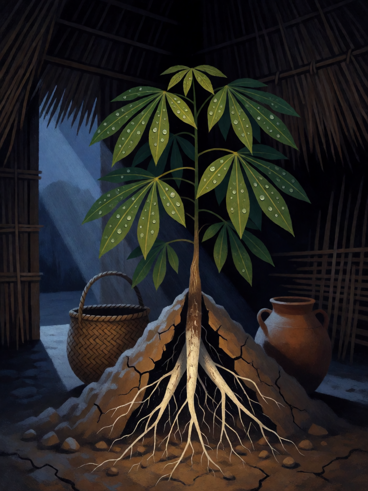

# Dádiva de Mani

[← Indígena brasileira](../indigena.md) · [Wiki KodeX](../README.md) · [◀ Dança do Aruanã](ind_danca_do_aruana.md) · [Kuarup ▶](ind_kuarup.md)

| Carta | Arte |
|---|---|
|  |  |

| | |
|---|---|
| **Tradição** | Indígena brasileira |
| **Tipo** | Rito |
| **Custo de Fé** | 3 |
| **Palavras-chave** | — |
| **Lendária** | não |
| **Cópias no deck** | 1 |
| **Id** | `ind_dadiva_de_mani` |

## Texto da carta

> Devolve uma Entidade do seu cemitério à sua mão. Sua Cornucópia cura 6. Compre 1 carta.

**EN — Gift of Mani:** *Return an Entity from your graveyard to your hand. Your Cornucopia heals 6. Draw 1 card.*

## Contexto mitológico

A lenda da mandioca foi recolhida por Couto de Magalhães (*O Selvagem*, 1876) entre falantes de nheengatu no Amazonas e é uma das mais contadas do país. A filha de um chefe apareceu grávida sem ter marido; o pai, furioso, só se acalmou quando um homem branco lhe apareceu em sonho dizendo que a moça era inocente. Nasceu uma menina branca, **Mani**, que andou e falou cedo e morreu com um ano, sem doença. Foi enterrada dentro da casa (*oca*), como era o costume, e a sepultura regada com as lágrimas da mãe.

Da cova nasceu uma planta desconhecida; a terra rachou e mostrou raízes grossas e brancas como o corpo da menina. Era a **mani-oca**, "casa de Mani" — a mandioca, alimento que sustenta até hoje os povos da floresta e o Brasil inteiro. Cascudo (*Dicionário do Folclore Brasileiro*) anota a lenda em todo o Norte e Nordeste e registra variantes populares em que é o orvalho da noite — Jaci, a Lua — que umedece a cova. Vale lembrar que a versão de Couto de Magalhães já traz marcas da catequese (a gravidez sem pai, o "homem branco" do sonho); o núcleo indígena é o do alimento que nasce do corpo enterrado, tema comum a muitos povos amazônicos.

A carta é a dádiva: o que foi enterrado volta transformado em alimento — a Entidade volta à mão, a aldeia se alimenta (cura 6) e algo novo brota (compra 1).

## Papel no jogo

Recuperação de meio de jogo: traz Boitatá ou Caipora de volta à mão para jogar de novo, cura 6 na Cornucópia (quase metade dela) e repõe a carta. Boa resposta a um turno ruim. Difere do Kuarup, que revive direto no campo por mais Fé — Mani é mais barata e mais flexível, Kuarup é mais rápido. Lenta contra decks agressivos se jogada sem criaturas no campo.

## Atributos visuais

pé de mandioca brotando de uma pequena cova · raízes brancas grossas rachando a terra · orvalho brilhante nas folhas · luar pela porta da oca

Balanço (conta de custo)

Orçamento P = 2·3+1 = 7 pts. Gasto (tabela §10): reviver Entidade do cemitério para a mão (2) + curar 6 de Cornucópia (1 por 2 pontos: 3) + comprar 1 (1,5) = 6,5. Dentro (P−0,5). _(Revisão: conta confirmada.)_

Ficha completa: `cartas/indigena/19_dadiva_de_mani.md` · cartas base da versão Alpha
