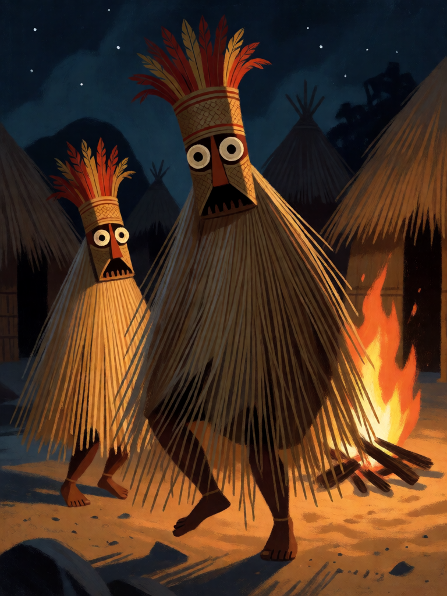

# Dança do Aruanã

[← Indígena brasileira](../indigena.md) · [Wiki KodeX](../README.md) · [◀ Fogo de Monan](ind_fogo_de_monan.md) · [Dádiva de Mani ▶](ind_dadiva_de_mani.md)

| Carta | Arte |
|---|---|
|  |  |

| | |
|---|---|
| **Tradição** | Indígena brasileira |
| **Tipo** | Rito |
| **Custo de Fé** | 2 |
| **Palavras-chave** | — |
| **Lendária** | não |
| **Cópias no deck** | 1 |
| **Id** | `ind_danca_do_aruana` |

## Texto da carta

> Invoca dois Aruanãs 1/1. Sua Cornucópia cura 2.

**EN — Aruanã Dance:** *Summon two 1/1 Aruanãs. Your Cornucopia heals 2.*

## Contexto mitológico

Os Karajá — que se chamam **Iny**, "nós" — vivem nas margens do rio Araguaia e na Ilha do Bananal (TO, GO, MT, PA). Sua cerimônia mais visível é a dos **Aruanãs** (*Ijasó*), espíritos do fundo do rio que vêm à aldeia na época das cheias. São personificados por dançarinos mascarados, **sempre em pares**, cobertos de saias de palha de buriti que escondem o corpo inteiro, com máscaras altas de penas e pintura. Cantam em falsete para que a voz não pareça humana, e dançam da casa dos homens até as mulheres, que os recebem com comida.

Paul Ehrenreich (*Beiträge zur Völkerkunde Brasiliens*, 1891) foi o primeiro a descrever o ritual; Manuel Ferreira Lima Filho (*Hetohoky: um rito Karajá*, 1994) o situa no ciclo ritual Iny, ao lado do Hetohoky, a festa de iniciação dos meninos. O nome Aruanã é o mesmo de um peixe do Araguaia (*Osteoglossum*); as máscaras são guardadas na casa dos homens (*Hetohoky*) e são proibidas às mulheres e crianças, que as recebem como espíritos, não como vizinhos fantasiados. Do mesmo povo são as *ritxoko*, bonecas de cerâmica que muitas vezes representam os Aruanãs dançando — esse saber foi registrado como patrimônio cultural brasileiro pelo Iphan em 2012, e é uma das portas pelas quais a dança se tornou conhecida fora da aldeia.

A carta traz os dançarinos em par — dois espíritos que chegam juntos, como mandam as cheias.

## Papel no jogo

Dois corpos por 2 Fé e a aldeia respira (cura 2 na Cornucópia). Enchem o campo para Terra sem Males (+1/+1 em cada), para a aura do Cocar e para o Anhangá (cada Aruanã que morre vira um Veado Branco). São também os alvos que o inimigo tem de atacar quando não há Guarda — e cada ataque dispara Boitatá, Arapuca e Mundéu. Precisa de dois slots livres; com o campo cheio é carta morta.

## Atributos visuais

dois dançarinos mascarados (um à frente, outro menor atrás) · corpo todo coberto por franja de palha de buriti · máscara alta trançada com coroa de penas vermelhas e amarelas · fogueira à beira do rio

Balanço (conta de custo)

Orçamento P = 2·2+1 = 5 pts. Gasto (tabela §10): 2 tokens Aruanã 1/1 (2 × (1+1) = 4) + curar 2 de Cornucópia (1) = 5. Dentro.
Rodada 1 de balanceamento: era só os dois tokens (4/5; 39 % no espelho, a carta mais fraca do deck). A cura cabe na identidade e leva a carta a P.

Ficha completa: `cartas/indigena/18_danca_do_aruana.md` · cartas base da versão Alpha
