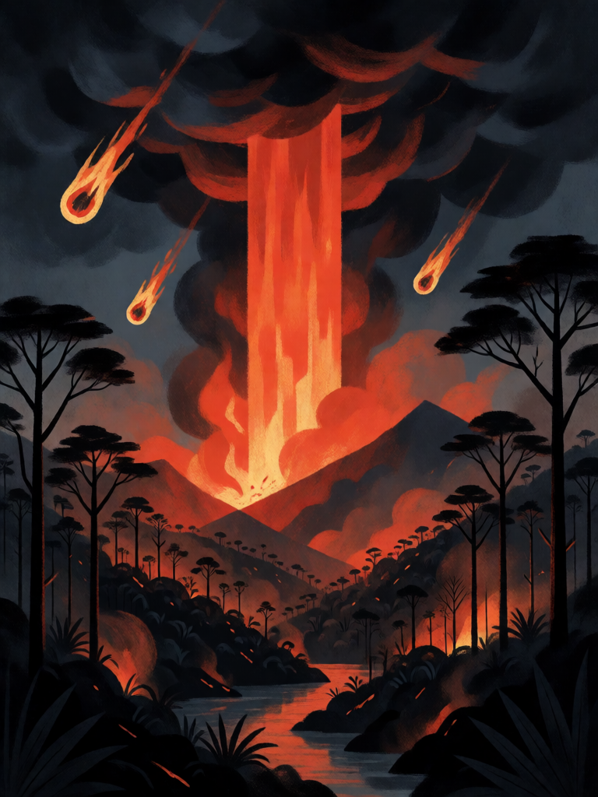

# Fogo de Monan

[← Indígena brasileira](../indigena.md) · [Wiki KodeX](../README.md) · [◀ Visão do Caapi](ind_visao_do_caapi.md) · [Dança do Aruanã ▶](ind_danca_do_aruana.md)

| Carta | Arte |
|---|---|
|  |  |

| | |
|---|---|
| **Tradição** | Indígena brasileira |
| **Tipo** | Rito |
| **Custo de Fé** | 2 |
| **Palavras-chave** | — |
| **Lendária** | não |
| **Cópias no deck** | 1 |
| **Id** | `ind_fogo_de_monan` |

## Texto da carta

> Causa 2 de dano a todas as Entidades inimigas e 1 de dano à Cornucópia inimiga.

**EN — Monan's Fire:** *Deal 2 damage to all enemy Entities and 1 damage to the enemy Cornucopia.*

## Contexto mitológico

Monan é o criador primordial dos Tupinambá segundo André Thevet (*Cosmographie Universelle*, 1575, livro XXI), que recolheu o relato dos pajés da Guanabara. Monan — "o antigo", "o que fez" — criou o céu, a terra, os animais e os primeiros homens, e vivia entre eles. Mas os homens se tornaram ingratos e esqueceram quem os fizera; então Monan mandou **Tatá**, o fogo do céu, que queimou toda a superfície da terra e a deixou com os vales e serras que tem hoje.

Só um homem se salvou: **Irin-Magé**, "o que vê", que foi levado ao céu e de lá implorou a Monan que apagasse o fogo. Monan fez cair uma chuva tão grande que ela apagou as chamas e, correndo pelas cavidades abertas pelo fogo, formou o mar — por isso a água do mar é salgada: é cinza. Métraux (*A religião dos Tupinambás*, 1928) analisa o mito como a versão tupi do dilúvio, ligada ao mesmo medo da destruição do mundo que, séculos depois, Nimuendajú encontrou entre os Apapocuva-Guarani.

A carta é o fogo que limpa: queima o campo inimigo e alcança, de leve, a própria casa do adversário.

## Papel no jogo

A limpeza em área do deck antes de Tupã: 2 de dano em todas as inimigas mata tokens, criaturas de 2 de Vida e tudo o que Curupira e Boitatá já arranharam — e cada morte alimenta a Cobra-Grande. O 1 de dano direto à Cornucópia é bônus. Use quando o oponente encher o campo de criaturas pequenas; contra uma única criatura grande, é fraco. Único "fogo" do deck além do Boitatá, de propósito: a identidade é defender, não queimar.

## Atributos visuais

coluna de fogo caindo do céu · bolas de fogo · floresta queimando em silhueta · cinzas e fumaça

Balanço (conta de custo)

Orçamento P = 2·2+1 = 5 pts. Gasto (tabela §10): 2 de dano a todas as inimigas (1,5 por ponto × 2 = 3) + 1 de dano direto à Cornucópia (2) = 5. Dentro. _(Revisão: conta confirmada.)_

Ficha completa: `cartas/indigena/17_fogo_de_monan.md` · cartas base da versão Alpha
