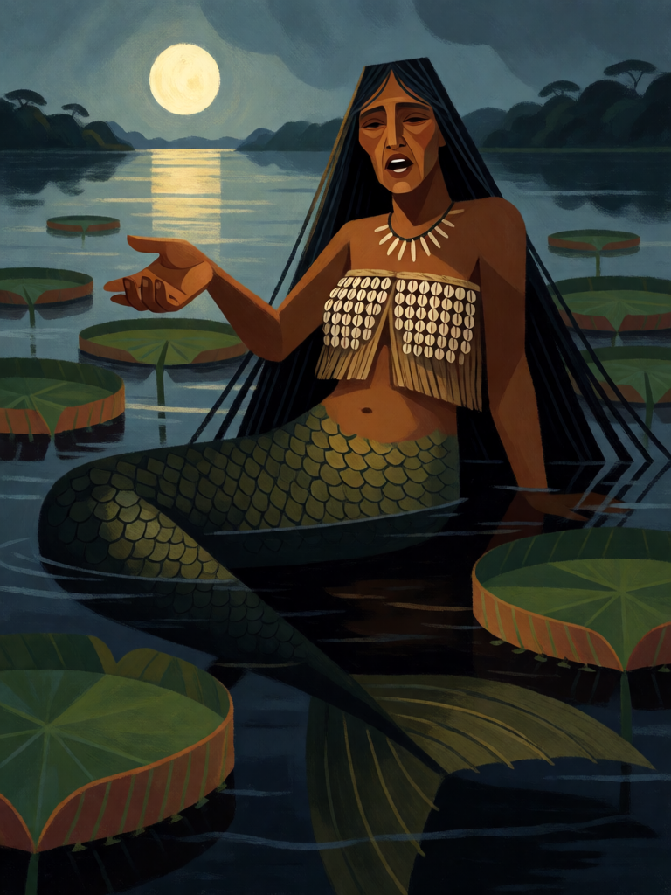

# Iara

[← Indígena brasileira](../indigena.md) · [Wiki KodeX](../README.md) · [◀ Caipora](ind_caipora.md) · [Boitatá ▶](ind_boitata.md)

| Carta | Arte |
|---|---|
|  |  |

| | |
|---|---|
| **Tradição** | Indígena brasileira |
| **Tipo** | Entidade |
| **Custo de Fé** | 3 |
| **ATK / DEF** | 2 / 3 |
| **Palavras-chave** | — |
| **Lendária** | não |
| **Cópias no deck** | 1 |
| **Id** | `ind_iara` |

## Texto da carta

> Despertar: devolve uma Entidade inimiga à mão do dono.

**EN — Iara:** *Awaken: Return an enemy Entity to its owner's hand.*

## Contexto mitológico

A Iara (Uiara, Mãe-d'água) é a sereia dos rios amazônicos: mulher de cabelos longos e cauda de peixe que canta nas tardes e atrai pescadores para o fundo, de onde não voltam — ou voltam "encantados", sem juízo. A forma atual é do século XIX; antes dela, Fernão Cardim (c. 1584) e Gabriel Soares de Sousa (1587) descreviam o **Ipupiara**, "morador do fundo", monstro masculino que abraçava e esmagava os banhistas. Barbosa Rodrigues (*Poranduba Amazonense*, 1890) e Cascudo (*Geografia dos Mitos Brasileiros*) acompanham a transformação do monstro em sereia sob influência romântica.

Numa versão popular amazônica, muito repetida em coletâneas do século XX, a Iara era uma guerreira indígena, a melhor da aldeia; os irmãos, com inveja, tentaram matá-la, ela os matou primeiro e foi lançada ao rio pelo pai, onde os peixes a transformaram. Daí o canto: vingança e saudade, não maldade. O nome vem do tupi *y* (água) + *îara* (senhora): "senhora das águas".

A carta não a faz matar — ela **atrai para longe**: a Entidade inimiga volta à mão, encantada, e o oponente perde o tempo investido nela.

## Papel no jogo

A única "remoção" do deck que não é fogo. Devolver à mão é mais forte quanto mais caro o alvo, e desfaz Relíquias equipadas e buffs permanentes (Terra sem Males do adversário). Use no turno em que o inimigo invoca sua carta grande; o corpo 2/3 segura a linha depois. Ruim contra decks de criaturas baratas e tokens, que simplesmente voltam.

## Atributos visuais

mulher indígena adulta · cauda de peixe de escamas verdes no lugar das pernas · top de conchas cobrindo o peito · mão direita estendida chamando · vitórias-régias

Balanço (conta de custo)

Orçamento P = 2·3+1 = 7 pts. Gasto (tabela §10): ATK 2 + Vida 3 + Despertar devolver Entidade inimiga à mão (2) = 7. Dentro. _(Revisão: conta confirmada.)_

Ficha completa: `cartas/indigena/04_iara.md` · cartas base da versão Alpha
