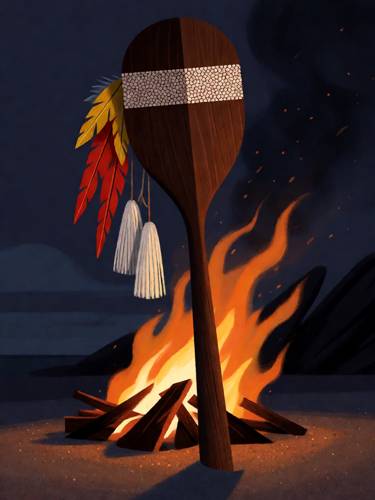

# Ibirapema

[← Indígena brasileira](../indigena.md) · [Wiki KodeX](../README.md) · [◀ Terra sem Males](ind_terra_sem_males.md) · [Muiraquitã ▶](ind_muiraquita.md)

| Carta | Arte |
|---|---|
|  |  |

| | |
|---|---|
| **Tradição** | Indígena brasileira |
| **Tipo** | Relíquia |
| **Custo de Fé** | 1 |
| **Palavras-chave** | — |
| **Lendária** | não |
| **Cópias no deck** | 1 |
| **Id** | `ind_ibirapema` |
| **Arte** | provisória nesta Alpha |

## Texto da carta

> A portadora ganha +2 ATK e Ímpeto.

**EN — Ibirapema:** *The bearer gains +2 ATK and Rush.*

## Contexto mitológico

A *ywyrapema* (ibirapema, "pau achatado") é o tacape cerimonial dos Tupinambá: uma clava de madeira dura, pesada, de cabeça larga e achatada, enfeitada com penas, pintura e cordões de algodão. Hans Staden (*Warhaftige Historia*, 1557), que quase morreu por ela, descreve-a em detalhe; Jean de Léry (1578) e Gabriel Soares de Sousa (1587) confirmam que era a arma do **sacrifício ritual do prisioneiro**, usada por um só homem, que para isso ganhava um novo nome e se tornava guerreiro pleno.

Diferente da borduna de guerra comum, a ibirapema não era apenas arma: era untada e enfeitada na véspera, em cauinagem, entregue ao executor pelas mulheres, e quem a usava ficava depois em reclusão, escarificado, para receber o novo nome. Staden a grafa *Iwera Pemme* e descreve a cerimônia inteira, do canto ao golpe. Métraux (*A religião dos Tupinambás*, 1928) a situa no centro do complexo guerreiro tupi — vingança, nome, memória. É o instrumento que transforma um homem em guerreiro no instante em que o empunha.

Na carta, dá à portadora a força do golpe (+2 ATK) e a prontidão de quem acaba de ganhar o nome (Ímpeto: ataca no turno em que entra).

## Papel no jogo

A única Relíquia ofensiva do deck. Melhor na Cobra-Grande ou no Mapinguari no turno em que entram: 7 ou 6 de ATK atacando imediatamente. Em Saci (Furtivo, Ímpeto) vira um ataque-surpresa de 3. Barata, não compete com a Fé de uma invocação grande no mesmo turno. Morre com a portadora.

## Atributos visuais

tacape de cabeça achatada em forma de remo · madeira escura polida · mosaico de casca de ovo e urucum na cabeça · penas de arara e borlas de algodão no cabo · fincado na areia

Balanço (conta de custo)

Orçamento P = 2·1+1 = 3 pts, +1 grátis de Relíquia = 4. Gasto (tabela §10): +2 ATK permanente (2) + Ímpeto (1) = 3. Dentro (P−1). _(Revisão: conta confirmada. Ímpeto numa Relíquia de 1 Fé é o ponto a vigiar no simulador: Cobra-Grande 7 ATK atacando no turno 6 — mas só Entidades, enquanto o inimigo tiver campo.)_

Ficha completa: `cartas/indigena/22_ibirapema.md` · cartas base da versão Alpha
