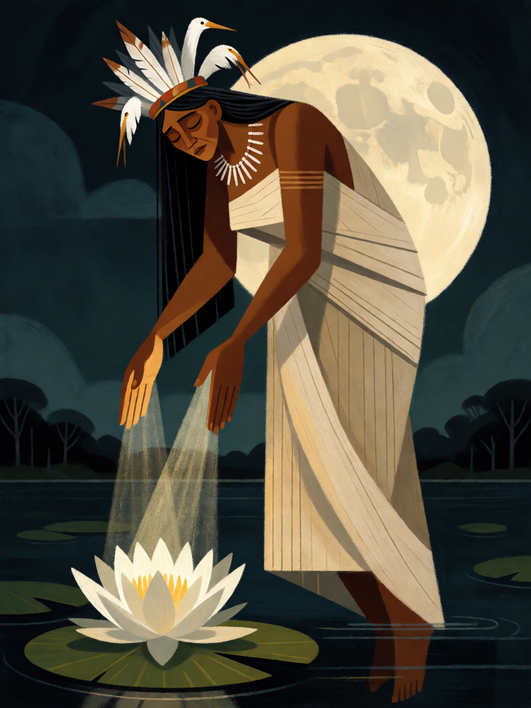

# Jaci, a Lua

[← Indígena brasileira](../indigena.md) · [Wiki KodeX](../README.md) · [◀ Cobra-Grande](ind_cobra_grande.md) · [Tupã, o Trovão ▶](ind_tupa.md)

| Carta | Arte |
|---|---|
|  |  |

| | |
|---|---|
| **Tradição** | Indígena brasileira |
| **Tipo** | Entidade |
| **Custo de Fé** | 6 |
| **ATK / DEF** | 4 / 5 |
| **Palavras-chave** | — |
| **Lendária** | sim |
| **Cópias no deck** | 1 |
| **Id** | `ind_jaci` |

## Texto da carta

> Lendária. Despertar: invoca uma Vitória-régia 0/2 com Guarda. No fim do seu turno, cura 2 em todas as Entidades aliadas.

**EN — Jaci, the Moon:** *Legendary. Awaken: Summon a 0/2 Water Lily with Guard. At the end of your turn, heal all allied Entities for 2.*

## Contexto mitológico

*Jacy* (Jaci, Yacy) é a Lua no ciclo tupi-guarani: feminina, irmã ou esposa do Sol Guaraci, protetora das plantas, da reprodução e dos amantes. Couto de Magalhães (*O Selvagem*, 1876) recolheu cantos em que as mulheres pedem à lua cheia (*Cairé*) e à lua nova (*Catiti*) que tragam o amado de volta; Barbosa Rodrigues (*Poranduba Amazonense*) traz *Jacy-tatá*, "fogo da lua", para as estrelas. Entre os Mbyá-Guarani, *Jasy* é um dos gêmeos míticos, irmão de Kuaray, o Sol (Cadogan, *Ayvu Rapyta*, 1959).

Jaci é também a deusa das lendas de transformação por amor. A mais conhecida é a da **vitória-régia**: a jovem Naiá, apaixonada pela Lua, acreditava que Jaci levava para o céu as moças que escolhia; uma noite viu a Lua refletida no lago, mergulhou para alcançá-la e se afogou. Jaci, comovida, transformou-a na "estrela das águas", a flor que abre de noite (Cascudo, *Dicionário do Folclore Brasileiro*; a lenda circula desde o fim do século XIX em coletâneas amazônicas e tem forte marca literária). Em variantes populares da lenda de Mani, é o orvalho da noite — a Lua — que umedece a cova de onde nasce a mandioca.

Por isso Jaci é a Lendária curadora do deck: traz consigo a Vitória-régia e, a cada noite (fim de turno), cura a mata.

## Papel no jogo

Virada defensiva do jogo longo. Entra com um escudo (Vitória-régia 0/2 Guarda) que absorve o primeiro ataque, e no fim de cada turno seu cura 2 em todas as aliadas — Boitatá, Mapinguari e Cobra-Grande voltam quase inteiros para o próximo turno, e os contragolpes do deck ficam sustentáveis. Com Terra sem Males, o campo fica grande e cheio. Jaci não ataca bem (4 ATK); ela mantém o resto vivo. Fraca contra `silence` e contra dano direto à Cornucópia, que a cura não alcança.

## Atributos visuais

mulher indígena adulta flutuando · vestido longo de algodão branco cobrindo o peito · cocar de penas brancas · palmas para baixo com luz curativa · vitória-régia branca · lua cheia atrás

Balanço (conta de custo)

Orçamento P = 2·6+1 = 13 pts; Lendária pode ir até 15. Gasto (tabela §10): ATK 4 + Vida 5 + Despertar token Vitória-régia 0/2 Guarda (0+2+1 = 3) + `end_turn` cura 2 em todas as aliadas (cura 2 = 1 pt unitário × 3 "em todas as aliadas" = 3; gatilho repetível: valor cheio) = 15. Lendária +2, no teto. _(Revisão: conta refeita com a regra oficial "cura em todas = unitário×3"; resultado igual.)_

Ficha completa: `cartas/indigena/09_jaci.md` · cartas base da versão Alpha
