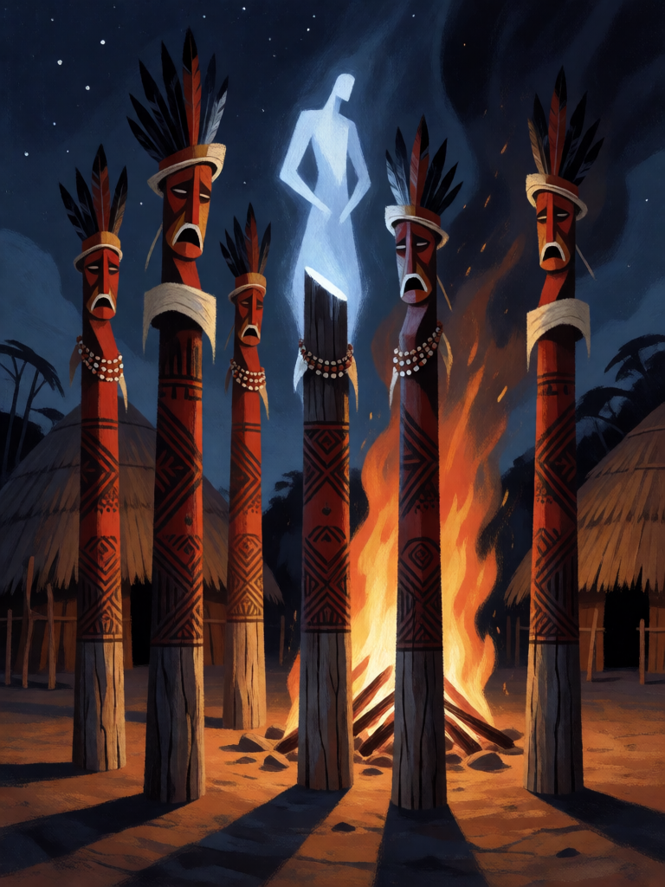

# Kuarup

[← Indígena brasileira](../indigena.md) · [Wiki KodeX](../README.md) · [◀ Dádiva de Mani](ind_dadiva_de_mani.md) · [Terra sem Males ▶](ind_terra_sem_males.md)

| Carta | Arte |
|---|---|
|  |  |

| | |
|---|---|
| **Tradição** | Indígena brasileira |
| **Tipo** | Rito |
| **Custo de Fé** | 4 |
| **Palavras-chave** | — |
| **Lendária** | não |
| **Cópias no deck** | 1 |
| **Id** | `ind_kuarup` |

## Texto da carta

> Traz uma Entidade do seu cemitério de volta ao campo. Compre 1 carta.

**EN — Kuarup:** *Bring an Entity from your graveyard back to the field. Draw 1 card.*

## Contexto mitológico

O Kuarup (*Kwarìp*, em kamayurá) é a grande festa funerária dos povos do Alto Xingu (MT) — Kamayurá, Kuikuro, Kalapalo, Waurá, Mehinako, Yawalapiti e outros — em homenagem aos mortos ilustres do ano. Troncos da árvore kuarup são cortados, fincados no centro da aldeia, pintados e enfeitados com cocares, braçadeiras e colares: cada tronco **é** um morto, que volta por uma noite. As famílias choram diante dos troncos; ao amanhecer, há lutas de *huka-huka* entre as aldeias convidadas e, ao fim, os troncos são lançados no rio e o luto termina.

O mito de origem, recolhido por Pedro Agostinho (*Kwarìp: mito e ritual no Alto Xingu*, 1974) e pelos irmãos Villas Bôas (*Xingu: os índios, seus mitos*, 1970), conta que o criador **Mavutsinim** tentou ressuscitar os mortos cortando troncos e cantando para eles; os troncos já começavam a virar gente quando um homem que tinha dormido com a mulher na véspera desobedeceu à proibição de assistir — e eles voltaram a ser madeira. Desde então os mortos não voltam — mas o Kuarup os traz de volta por uma noite.

A carta realiza o que Mavutsinim não conseguiu: a Entidade volta ao campo.

## Papel no jogo

O revive pesado do deck: por 4 Fé, Boitatá, Mapinguari ou mesmo Jaci voltam direto ao campo (sem Despertar — reviver para o campo não o dispara, regras §8; a aura de Jaci volta, a Vitória-régia não), e você repõe a carta. É o que torna as trocas do deck favoráveis — o inimigo gasta remoção em Boitatá, e ele volta. Precisa de um slot livre e de uma Entidade boa no cemitério; nos primeiros turnos é carta morta.

## Atributos visuais

fileira de troncos kuarup pintados de vermelho e preto · cocares e braçadeiras nos troncos · tronco central com luz azul de espírito · fogueira na praça

Balanço (conta de custo)

Orçamento P = 2·4+1 = 9 pts. Gasto (tabela §10): reviver para o campo = 3 + custo da Entidade ÷ 2 (Saci 4 · Boitatá, alvo típico, 5 · Jaci 6 · Tupã 6,5) + comprar 1 (1,5) = 5,5 a 8. Dentro em todos os casos (pior caso, Tupã, = P−1). _(Revisão: conta confirmada. Reviver Jaci/Tupã dispara o Despertar de novo — observar no simulador.)_

Ficha completa: `cartas/indigena/20_kuarup.md` · cartas base da versão Alpha
