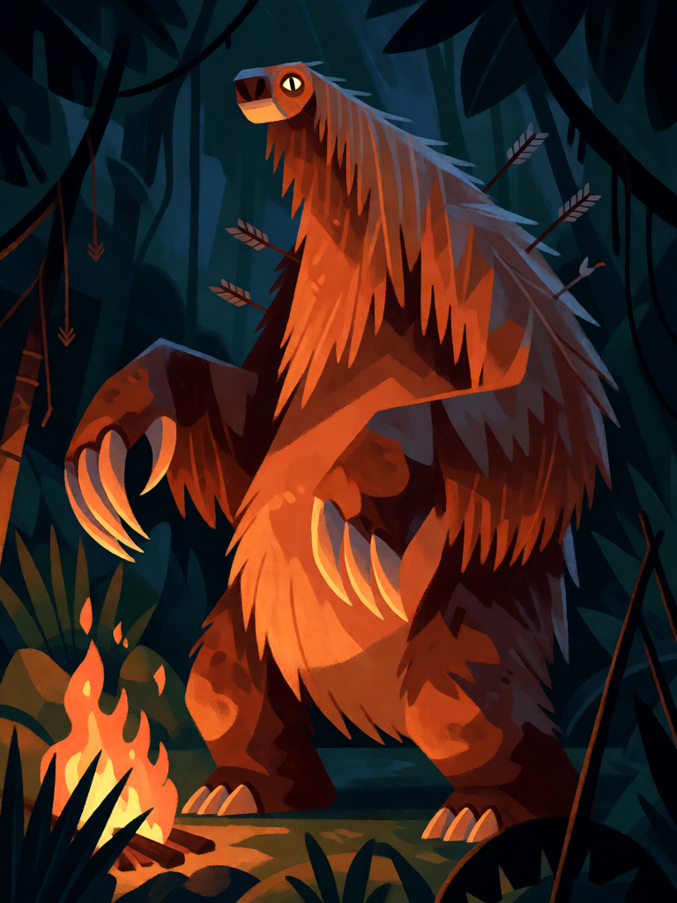

# Mapinguari

[← Indígena brasileira](../indigena.md) · [Wiki KodeX](../README.md) · [◀ Anhangá](ind_anhanga.md) · [Cobra-Grande ▶](ind_cobra_grande.md)

| Carta | Arte |
|---|---|
|  |  |

| | |
|---|---|
| **Tradição** | Indígena brasileira |
| **Tipo** | Entidade |
| **Custo de Fé** | 5 |
| **ATK / DEF** | 4 / 5 |
| **Palavras-chave** | — |
| **Lendária** | não |
| **Cópias no deck** | 1 |
| **Id** | `ind_mapinguari` |
| **Arte** | provisória nesta Alpha |

## Texto da carta

> Sempre que sofrer dano, causa 2 de dano ao atacante.

**EN — Mapinguari:** *Whenever this takes damage, deal 2 damage to the attacker.*

## Contexto mitológico

O Mapinguari é o gigante da floresta amazônica (Acre, Amazonas, Pará, Rondônia): peludo, com um olho só no meio da testa, **a boca aberta no ventre** e um couro tão duro que flechas e balas não entram — só o umbigo é vulnerável. Solta um grito que ensurdece e um cheiro que derruba. Cascudo (*Dicionário do Folclore Brasileiro*) o registra como um dos poucos "monstros" propriamente ditos do folclore de origem indígena; em muitas versões é um antigo pajé que buscou a imortalidade e virou bicho.

Os seringueiros e os povos do Juruá e do Purus o descrevem com detalhe suficiente para que o zoólogo David Oren (*Goeldiana Zoologia*, 1993; *Edentata*, 2001) tenha proposto que a lenda guarde a memória da preguiça-gigante terrestre (*Mylodon*), extinta há milhares de anos — uma hipótese sem prova, mas que diz muito sobre como o Mapinguari é descrito: lento, enorme, imbatível de frente.

A carta traduz o couro impenetrável e o grito: quem o fere sofre.

## Papel no jogo

O corpo grande do meio do jogo. Sem Guarda, mas ninguém quer atacá-lo: um 3/3 que o ataca leva 4 + 2 = 6. O grito só responde a **ataques**: dano de Ritos ou habilidades não tem atacante, e a ação é pulada (regra de resolução da DSL). Com Muiraquitã fica 4/8 com Renascer — um muro que volta. Vulnerável a `bounce`, `silence` e a `destroy`, e a Ritos de dano, que o ferem sem disparar o grito.

## Atributos visuais

gigante peludo tipo preguiça-gigante · um único olho no meio da testa · boca enorme no ventre · garras longas · flechas quebradas no couro

Balanço (conta de custo)

Orçamento P = 2·5+1 = 11 pts. Gasto (tabela §10): ATK 4 + Vida 5 + `on_damaged` 2 de dano ao atacante (gatilho repetível: valor cheio, 2) = 11. Dentro. _(Revisão: conta confirmada.)_

Ficha completa: `cartas/indigena/07_mapinguari.md` · cartas base da versão Alpha
