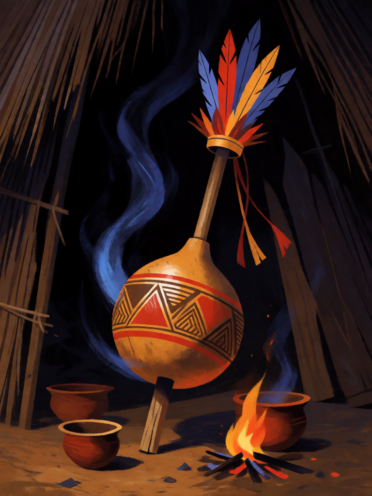

# Maracá do Pajé

[← Indígena brasileira](../indigena.md) · [Wiki KodeX](../README.md) · [◀ Muiraquitã](ind_muiraquita.md) · [Cocar do Morubixaba ▶](ind_cocar_do_morubixaba.md)

| Carta | Arte |
|---|---|
|  |  |

| | |
|---|---|
| **Tradição** | Indígena brasileira |
| **Tipo** | Relíquia |
| **Custo de Fé** | 2 |
| **Palavras-chave** | — |
| **Lendária** | não |
| **Cópias no deck** | 1 |
| **Id** | `ind_maraca_do_paje` |

## Texto da carta

> A portadora ganha +1/+2. Quando ela morrer, invoca um Espírito 1/1.

**EN — Pajé's Maracá:** *The bearer gains +1/+2. When it dies, summon a 1/1 Spirit.*

## Contexto mitológico

O maracá (*mbaraká*) é o chocalho de cabaça com sementes ou pedrinhas dentro, atravessado por um cabo de madeira e enfeitado com penas — o instrumento do pajé por excelência em todo o mundo tupi-guarani. Jean de Léry (*Viagem à Terra do Brasil*, 1578, cap. XVI) descreve, com espanto, os maracás "falantes" dos Tupinambá: os caraíbas sopravam fumaça neles, enfeitavam-nos com as melhores penas, fincavam-nos no chão da casa e lhes ofereciam comida e cauim, pois acreditavam que **um espírito morava dentro** e respondia pelo chocalho. André Thevet (1557) conta o mesmo e acrescenta que os maracás eram consultados antes da guerra.

Métraux (*A religião dos Tupinambás*, 1928) explica: o maracá é a voz do espírito auxiliar do pajé, o que lhe dá o poder de curar e de ver. Entre os Guarani de hoje o *mbaraka* (dos homens) e o *takuapu*, bastão de ritmo das mulheres, ainda conduzem o canto-reza na casa de reza (*opy*); nos textos recolhidos por Cadogan (*Ayvu Rapyta*, 1959) ambos aparecem entre os instrumentos sagrados que acompanham a palavra divina. É o objeto onde o invisível fica guardado.

Na carta, o maracá fortalece a portadora enquanto ela vive e, quando ela morre, o espírito que morava dentro dele sai e fica em campo.

## Papel no jogo

Relíquia de valor residual: +1/+2 faz Caipora 3/4 ou Curupira 2/4, e quando a portadora cai, o Espírito 1/1 mantém o slot ocupado — alimenta Anhangá (que invoca mais um Veado Branco com a morte) e Terra sem Males. Boa em Entidades que o inimigo vai querer matar (Boitatá, Curupira). Precisa de slot livre quando a portadora morre; o próprio slot dela se libera, então quase sempre funciona.

## Atributos visuais

chocalho de cabaça com cabo de madeira · pintura vermelha e preta · coroa de penas coloridas · fiapo azul de espírito saindo · tigelas de oferenda

Balanço (conta de custo)

Orçamento P = 2·2+1 = 5 pts, +1 grátis de Relíquia = 6. Gasto (tabela §10): +1 ATK (1) + +2 Vida (2) + `equipped_dies` → token Espírito 1/1 (a + v = 2) = 5. Dentro (P−1). _(Revisão: conta confirmada.)_

Ficha completa: `cartas/indigena/24_maraca_do_paje.md` · cartas base da versão Alpha
