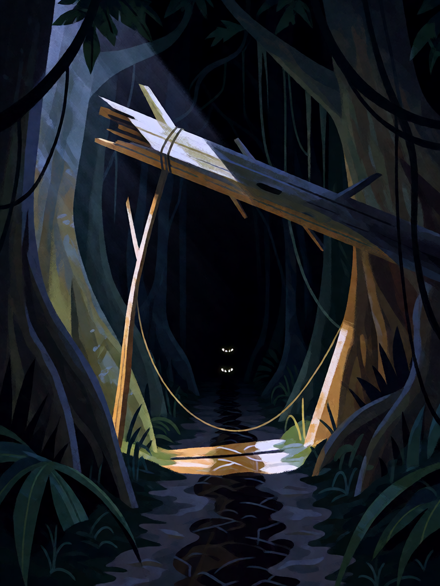

# Mundéu

[← Indígena brasileira](../indigena.md) · [Wiki KodeX](../README.md) · [◀ Arapuca](ind_arapuca.md) · [Assovio da Matinta ▶](ind_assovio_da_matinta.md)

| Carta | Arte |
|---|---|
|  |  |

| | |
|---|---|
| **Tradição** | Indígena brasileira |
| **Tipo** | Selo |
| **Custo de Fé** | 2 |
| **Palavras-chave** | — |
| **Lendária** | não |
| **Cópias no deck** | 2 |
| **Id** | `ind_mundeu` |

## Texto da carta

> Quando uma Entidade inimiga atacar uma Entidade sua: ela sofre 4 de dano e sua Cornucópia cura 4.

**EN — Mundéu:** *When an enemy Entity attacks one of your Entities: it takes 4 damage and your Cornucopia heals 4.*

## Contexto mitológico

O mundéu (do tupi *mundé*, "armadilha") é a armadilha de peso usada para caça grande — anta, veado, porco-do-mato, onça. Um tronco pesado fica suspenso sobre a trilha por uma forquilha ligada a um gatilho de isca ou de passagem; quando o animal toca o gatilho, o tronco cai e o esmaga. Soares de Sousa (*Tratado Descritivo do Brasil*, 1587) e, séculos depois, Cascudo (*Dicionário do Folclore Brasileiro*) descrevem o mundéu como a técnica indígena de caça mais eficiente para animais que o arco não derruba de um tiro.

Diferente da arapuca, o mundéu mata. E a caça apanhada no mundéu é a que alimenta a aldeia — a anta ou o queixada rendem o moquém da festa. Na lógica dos guardiões da mata do deck, o mundéu é o castigo definitivo do invasor, e também sua utilidade: o que entra à força vira comida.

## Papel no jogo

O Selo de dano do deck: 4 ao atacante mata a maioria das criaturas de custo até 4 no momento em que avançam, e ainda cura 4 na Cornucópia ("a caça alimenta a aldeia"). Combina com Boitatá e Curupira — o atacante leva o contragolpe e o tronco. Com duas cópias, o oponente aprende a temer qualquer Selo virado para baixo do deck indígena, o que por si só segura ataques. Ruim contra criaturas com mais de 4 de Vida (só fere) e inútil contra decks que não atacam. Como a Arapuca, só dispara em ataque a uma Entidade sua — não em ataque direto à Cornucópia.

## Atributos visuais

tronco pesado suspenso sobre a trilha · forquilha de sustentação · cipó-gatilho atravessado · olhos de bicho chegando no escuro

Balanço (conta de custo)

Orçamento P = 2·2+1 = 5 pts, +1 grátis de Selo = 6. Gasto (tabela §10): 4 de dano a Entidade (4) + curar 4 de Cornucópia (2) = 6. Dentro.
Rodada 1 de balanceamento: cura era 2 (5/6). É o Selo que mais dispara (84 %); sobe para P.

Ficha completa: `cartas/indigena/12_mundeu.md` · cartas base da versão Alpha
