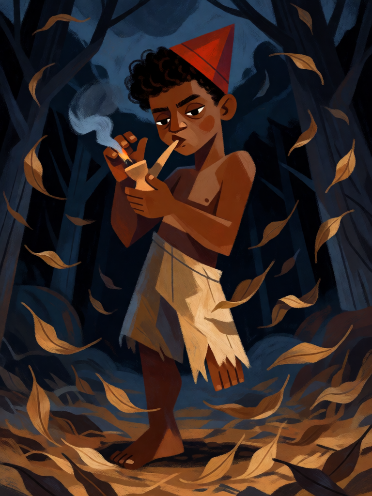

# Saci-Pererê

[← Indígena brasileira](../indigena.md) · [Wiki KodeX](../README.md) · [Curupira ▶](ind_curupira.md)

| Carta | Arte |
|---|---|
|  |  |

| | |
|---|---|
| **Tradição** | Indígena brasileira |
| **Tipo** | Entidade |
| **Custo de Fé** | 2 |
| **ATK / DEF** | 1 / 1 |
| **Palavras-chave** | Furtivo |
| **Lendária** | não |
| **Cópias no deck** | 2 |
| **Id** | `ind_saci_perere` |

## Texto da carta

> Furtivo. Despertar: uma Entidade inimiga não ataca no próximo turno dela.

**EN — Saci-Pererê:** *Stealth. Awaken: An enemy Entity can't attack on its next turn.*

## Contexto mitológico

O Saci é o mais popular dos seres do folclore brasileiro e um dos de origem mais discutida. O registro mais antigo, no Norte, é o de um pássaro — a *matintaperera*, cujo assobio anuncia azar — e o nome vem do tupi *çaa cy perereg*, "olho furado que pula". Câmara Cascudo (*Dicionário do Folclore Brasileiro*) mostra a figura descendo rumo ao Sul e ganhando, pelo caminho, a perna única, a carapuça vermelha e o cachimbo, elementos que o inquérito de Monteiro Lobato (*O Saci-Pererê: resultado de um inquérito*, 1918) já encontrava consolidados em São Paulo.

Apesar das camadas africanas (a figura do menino negro e o cachimbo, trazidos pelos povos escravizados) e ibéricas (a carapuça vermelha do trasgo português), o núcleo é indígena: o Saci viaja dentro do redemoinho de vento, trança as crinas dos cavalos, esconde objetos, faz o viajante perder o caminho. Não é maligno; é travesso, e a travessura serve à mata — ele atrapalha quem entra nela sem cuidado.

Na carta, o redemoinho invisível vira **Furtivo** (não pode ser alvo até atacar) e a travessura vira o Despertar que "prende" uma Entidade inimiga por um turno — o cavalo de crina trançada que não sai do lugar.

## Papel no jogo

Jogada de tempo barata: entra no turno 2, trava o melhor atacante inimigo por um turno e, Furtivo, não pode ser removido por Ritos antes de atacar. Serve para ganhar o turno em que Boitatá ou Caipora entram cansados. Como 1/1, morre para qualquer bloqueio; o valor está no Despertar, não no corpo. Fraco contra decks que ignoram criaturas e vão direto à Cornucópia.

## Atributos visuais

menino negro ~11 anos · perna esquerda amputada no quadril, apoiado só na direita · carapuça vermelha · cachimbo de barro aceso na mão direita · redemoinho de folhas

Balanço (conta de custo)

Orçamento P = 2·2+1 = 5 pts. Gasto (tabela §10): ATK 1 + Vida 1 + Furtivo 1 + Despertar Freeze em inimigo (1,5) = 4,5. Dentro (P−0,5). _(Revisão: conta refeita com o valor oficial de Freeze = 1,5; resultado igual.)_

Ficha completa: `cartas/indigena/01_saci_perere.md` · cartas base da versão Alpha
