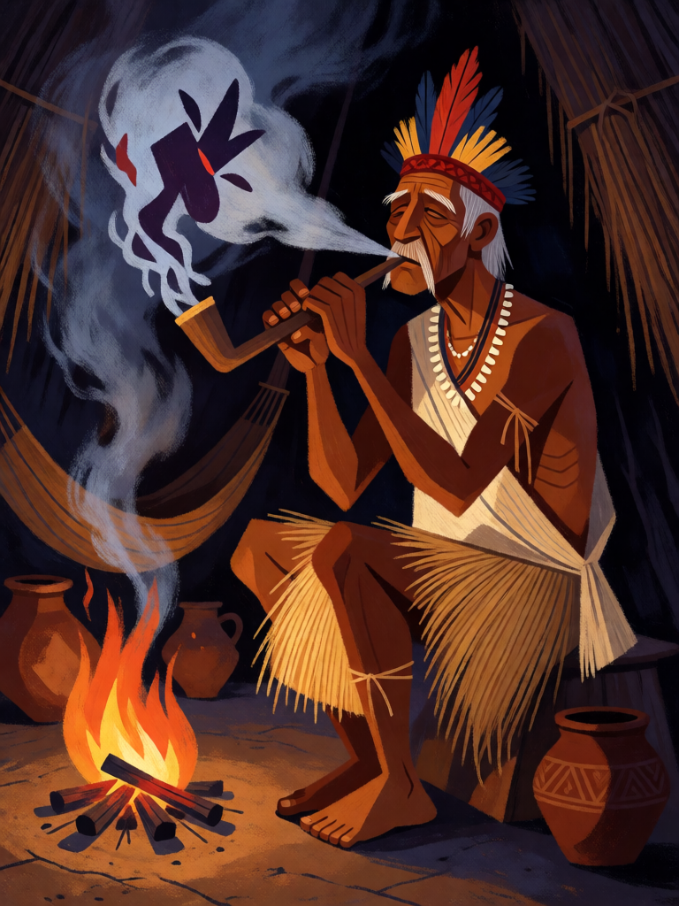

# Sopro do Pajé

[← Indígena brasileira](../indigena.md) · [Wiki KodeX](../README.md) · [◀ Assovio da Matinta](ind_assovio_da_matinta.md) · [Cauim ▶](ind_cauim.md)

| Carta | Arte |
|---|---|
|  |  |

| | |
|---|---|
| **Tradição** | Indígena brasileira |
| **Tipo** | Selo |
| **Custo de Fé** | 2 |
| **Palavras-chave** | — |
| **Lendária** | não |
| **Cópias no deck** | 1 |
| **Id** | `ind_sopro_do_paje` |

## Texto da carta

> Quando o oponente jogar um Rito: anula esse Rito e você compra 1 carta.

**EN — Pajé's Breath:** *When your opponent plays a Rite: counter it and draw 1 card.*

## Contexto mitológico

O pajé (do tupi *payé*) é o xamã dos povos tupi-guarani; o *caraíba* (*karaí*) era o pajé-profeta andarilho, que ia de aldeia em aldeia anunciando a Terra sem Males. Jean de Léry (*Viagem à Terra do Brasil*, 1578, cap. XVI) descreve a cena central da pajelança: o caraíba, com um canudo de petim (tabaco) aceso, **sopra a fumaça** sobre os homens dizendo "recebei o espírito de força", e sopra também sobre doentes e lugares para expulsar o mal. Métraux (*A religião dos Tupinambás*, 1928) e Hélène Clastres (*Terra sem Mal*, 1975) analisam o sopro de fumaça como o gesto xamânico tupi por excelência: cura, purifica e desfaz feitiços alheios.

Em pajelanças amazônicas atuais e em rituais de muitos povos (Guarani, Tenetehara, Sateré-Mawé), o sopro de tabaco segue sendo o modo de "desmanchar" o que outro pajé fez. A carta é isso: o feitiço inimigo chega, o pajé sopra, e o feitiço se desfaz no ar.

## Papel no jogo

O único Selo de anulação do deck. Dispara no primeiro Rito que o oponente jogar no turno dele — então vale mais contra decks pesados em Ritos (dano direto, remoção) e menos contra decks de criaturas. Como dispara no primeiro Rito, o oponente pode "gastá-lo" com um Rito barato; a compra de carta compensa a troca. Protege Jaci, Tupã e Cobra-Grande de remoção.

## Atributos visuais

pajé idoso ~70 anos · canudo de tabaco nas duas mãos · sopro de fumaça branca desfazendo forma roxa · faixa de algodão no peito · fogueira na oca

Balanço (conta de custo)

Orçamento P = 2·2+1 = 5 pts, +1 grátis de Selo = 6. Gasto (tabela §10): anular Rito inimigo (3) + comprar 1 (1,5) = 4,5. Dentro (P−1,5; não está abaixo de P−2). A folga é deliberada: `counter` anula qualquer Rito, inclusive os de custo 4+, e todo deck tem 8 Ritos, então o gatilho é quase certo. _(Revisão: conta confirmada; único `counter` do deck, 1 cópia ≤ 3.)_

Ficha completa: `cartas/indigena/14_sopro_do_paje.md` · cartas base da versão Alpha
