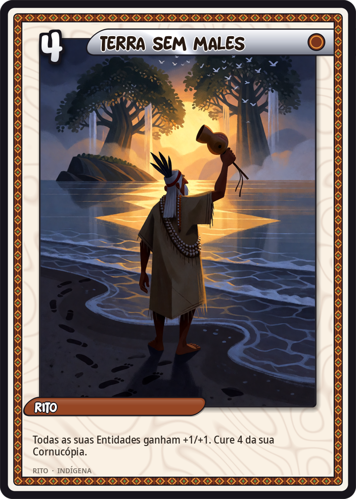
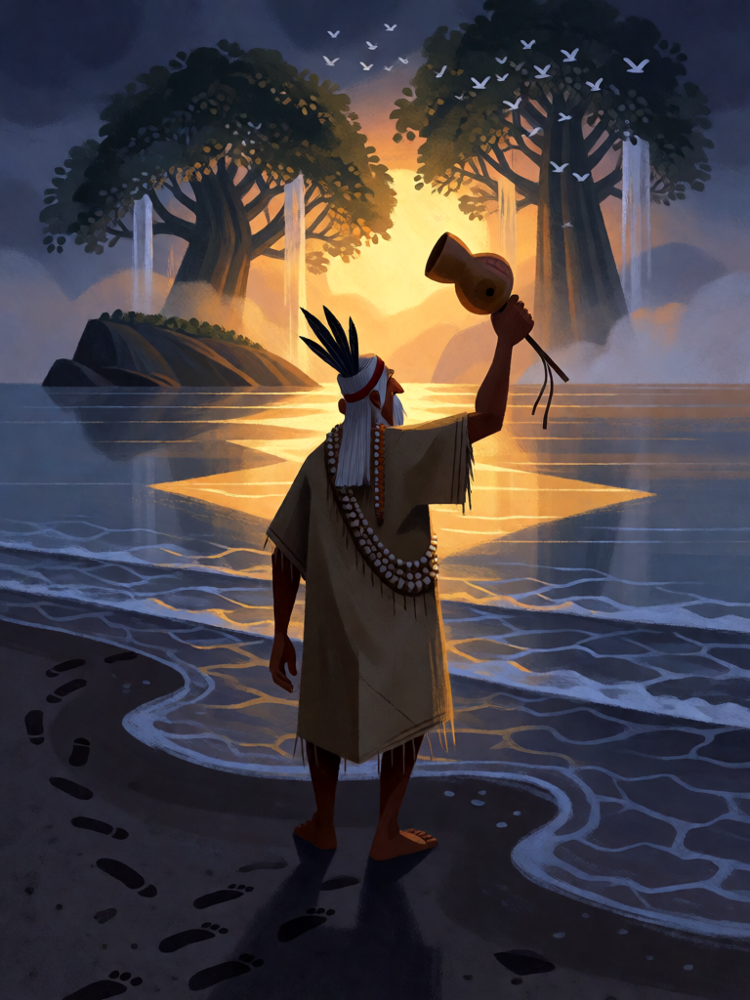

# Terra sem Males

[← Indígena brasileira](../indigena.md) · [Wiki KodeX](../README.md) · [◀ Kuarup](ind_kuarup.md) · [Ibirapema ▶](ind_ibirapema.md)

| Carta | Arte |
|---|---|
|  |  |

| | |
|---|---|
| **Tradição** | Indígena brasileira |
| **Tipo** | Rito |
| **Custo de Fé** | 4 |
| **Palavras-chave** | — |
| **Lendária** | não |
| **Cópias no deck** | 1 |
| **Id** | `ind_terra_sem_males` |

## Texto da carta

> Todas as suas Entidades ganham +1/+1 permanente. Sua Cornucópia cura 4.

**EN — Land Without Evil:** *All your Entities gain permanent +1/+1. Your Cornucopia heals 4.*

## Contexto mitológico

*Yvy marã e'ỹ* — a "terra sem mal", "terra indestrutível" — é o lugar que os Guarani buscam há séculos: onde o milho cresce sozinho, as flechas caçam por si, ninguém envelhece nem morre, e a festa não acaba. Curt Nimuendajú (*As lendas da criação e destruição do mundo como fundamentos da religião dos Apapocúva-Guarani*, 1914) foi o primeiro a descrever o profetismo guarani: o pajé-herói **Guyraypoty** dançou com seu povo até o mar e o atravessou; outros grupos caminharam do Paraguai à costa brasileira seguindo pajés que anunciavam a terra prometida, e muitos morreram no caminho.

Hélène Clastres (*Terra sem Mal: o profetismo tupi-guarani*, 1975) mostra que a busca é anterior à colonização e já movia as migrações tupi do século XVI relatadas por Thevet e pelos jesuítas; Pierre Clastres a lê como recusa radical do poder e da sociedade dividida. Para os Mbyá de hoje (Cadogan, *Ayvu Rapyta*, 1959), a Terra sem Males se alcança pela "palavra-alma" e pela dança, e fica a leste, além do mar — ou dentro de quem vive bem.

A carta não é um lugar: é o vislumbre dela — por um momento a mata inteira cresce e a aldeia se renova.

## Papel no jogo

Finalizador de campo largo: com 3 ou 4 Entidades (Caipora + Queixada, Aruanãs, Veados Brancos, Boitatá), +1/+1 permanente em cada vale 6 a 8 pontos, e a Cornucópia recupera 4. Jogue depois de Dança do Aruanã ou com Jaci em campo. Com campo vazio é só uma cura cara — segure até ter corpos. Vulnerável à Iara inimiga e a `bounce`, que desfazem o buff.

## Atributos visuais

pajé guarani idoso de costas · maracá erguido na mão direita · túnica de algodão · caminho de luz dourada no mar · terra radiante no horizonte

Balanço (conta de custo)

Orçamento P = 2·4+1 = 9 pts. Gasto (tabela §10): buff "em todas as aliadas" = unitário × 3 → (+1 ATK 1 + +1 Vida 1 = 2) × 3 = 6 + curar 4 de Cornucópia (2) = 8. Dentro (P−1). _(Revisão: conta refeita com a regra oficial "buff em todas = unitário×3"; com campo cheio de 4 chega a 10 na prática, mas a tabela fixa o caso típico de 3 corpos.)_

Ficha completa: `cartas/indigena/21_terra_sem_males.md` · cartas base da versão Alpha
