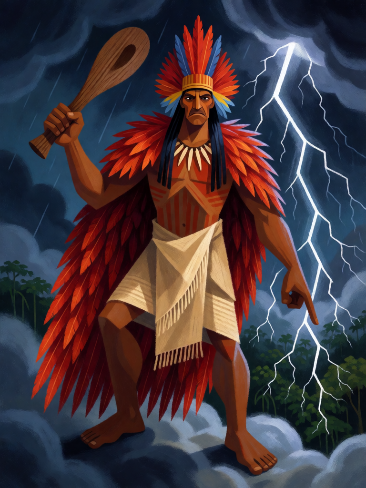

# Tupã, o Trovão

[← Indígena brasileira](../indigena.md) · [Wiki KodeX](../README.md) · [◀ Jaci, a Lua](ind_jaci.md) · [Arapuca ▶](ind_arapuca.md)

| Carta | Arte |
|---|---|
|  |  |

| | |
|---|---|
| **Tradição** | Indígena brasileira |
| **Tipo** | Entidade |
| **Custo de Fé** | 7 |
| **ATK / DEF** | 6 / 7 |
| **Palavras-chave** | Guarda |
| **Lendária** | sim |
| **Cópias no deck** | 1 |
| **Id** | `ind_tupa` |

## Texto da carta

> Lendária. Guarda. Despertar: causa 2 de dano a todas as Entidades inimigas.

**EN — Tupã, the Thunder:** *Legendary. Guard. Awaken: Deal 2 damage to all enemy Entities.*

## Contexto mitológico

Para os Tupinambá da costa, no século XVI, *Tupã* não era um deus supremo: era o **trovão**, a força que faz o céu estrondar. Jean de Léry (*Viagem à Terra do Brasil*, 1578, cap. XVI) escreve que os indígenas chamavam *Toupan* ao trovão e "não lhe prestavam culto"; André Thevet (*Singularidades da França Antártica*, 1557) o descreve como senhor do trovão e da chuva, de quem se tinha medo, mas a quem não se rezava. Alfred Métraux (*A religião dos Tupinambás*, 1928) confirma: não havia sacerdócio nem oferendas para Tupã.

Foram os jesuítas — Anchieta à frente — que escolheram "Tupã" para traduzir "Deus" nos catecismos em tupi, por ser a única palavra para uma potência celeste. Trezentos anos depois o romantismo indianista (Gonçalves Dias em *I-Juca-Pirama* e no *Dicionário da língua tupi*, José de Alencar) o consolidou como o deus criador do "panteão tupi", e assim ele entrou no imaginário brasileiro e nos registros de Couto de Magalhães. Kaká Werá Jecupé (*Tupã Tenondé*, 2001) retoma o nome em chave guarani, como o princípio sonoro que origina tudo.

A carta fica com o Tupã original e o acrescido: o trovão que cai sobre o campo inimigo ao chegar, e a estatura de deus maior que todos têm de enfrentar antes dos outros.

## Papel no jogo

O momento "uau" do deck e sua única limpeza em massa além do Fogo de Monan: 2 de dano em todas as inimigas ao entrar mata tokens e criaturas feridas, e cada morte alimenta a Cobra-Grande. Depois, com Guarda e 6/7, obriga o inimigo a bater nele enquanto o resto do campo ataca livre. Custo 7 — chega no turno 7 ou 8; até lá o deck sobrevive de Guarda e cura. Vulnerável a `bounce` (perde o Despertar já gasto) e a `destroy`.

## Atributos visuais

homem indígena adulto alto · de pé sobre nuvens de tempestade em guarda · manto de penas vermelhas e cocar de arara · tacape na mão direita · raios na mão esquerda

Balanço (conta de custo)

Orçamento P = 2·7+1 = 15 pts; Lendária pode ir até 17. Gasto (tabela §10): ATK 6 + Vida 7 + Guarda 1 + Despertar 2 de dano a todas as Entidades inimigas (1,5 por ponto × 2 = 3) = 17. Lendária +2, no teto. _(Revisão: conta confirmada.)_

Ficha completa: `cartas/indigena/10_tupa.md` · cartas base da versão Alpha
