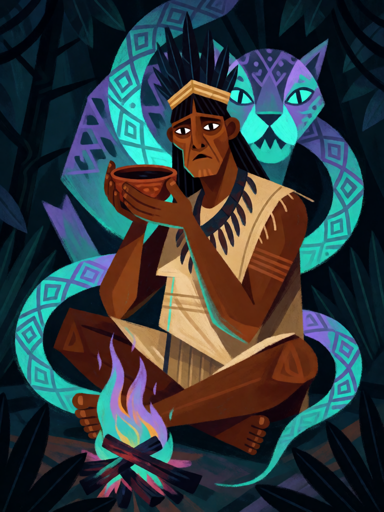

# Visão do Caapi

[← Indígena brasileira](../indigena.md) · [Wiki KodeX](../README.md) · [◀ Cauim](ind_cauim.md) · [Fogo de Monan ▶](ind_fogo_de_monan.md)

| Carta | Arte |
|---|---|
|  |  |

| | |
|---|---|
| **Tradição** | Indígena brasileira |
| **Tipo** | Rito |
| **Custo de Fé** | 2 |
| **Palavras-chave** | — |
| **Lendária** | não |
| **Cópias no deck** | 1 |
| **Id** | `ind_visao_do_caapi` |
| **Arte** | provisória nesta Alpha |

## Texto da carta

> Compre 2 cartas. Ganhe +1 Fé neste turno.

**EN — Caapi Vision:** *Draw 2 cards. Gain +1 Faith this turn.*

## Contexto mitológico

*Caapi* (ou *kahpi*, em tukano) é o cipó *Banisteriopsis caapi*, base da bebida que no Brasil é mais conhecida pelo nome quéchua *ayahuasca* e que dezenas de povos amazônicos preparam há séculos: os Tukano e Dessana do Rio Negro (*kahpi*), os Huni Kuin do Acre (*nixi pae*), os Yawanawá (*uni*), entre muitos outros. Gerardo Reichel-Dolmatoff (*Amazonian Cosmos*, 1971) descreve as sessões dessana: o pajé toma o caapi e vê as "casas" dos animais, as origens do mundo e as doenças da aldeia.

Em *Antes o mundo não existia* (1980), os autores dessana Umúsin Panlõn Kumu e Tolamãn Kenhíri contam a origem mítica: o caapi nasce de uma mulher, Kahpi Mahsõ, cujo filho é despedaçado e repartido entre os grupos — cada povo tem o seu pedaço, o seu caapi. A bebida é via de conhecimento, não de lazer: dá ao pajé a visão do que está escondido e o fôlego para agir.

A carta traduz isso em termos de jogo: você vê mais (compra 2) e ganha fôlego para agir agora (+1 Fé neste turno).

## Papel no jogo

Motor de cartas do deck. Por 2 de Fé devolve 1 (ganho temporário), então custa 1 na prática e dá duas cartas — jogado no turno 3, permite ainda invocar Caipora ou colocar um Selo. Melhor no meio do jogo, quando a mão esvazia e o deck precisa achar Jaci, Tupã ou o Kuarup. Cuidado com a mão máxima de 7.

## Atributos visuais

pajé adulto sentado de pernas cruzadas · tigela de barro com caapi nas duas mãos · olhos brilhando · serpentes de luz e padrões geométricos · rosto de onça no escuro

Balanço (conta de custo)

Orçamento P = 2·2+1 = 5 pts. Gasto (tabela §10): comprar 2 (1,5 × 2 = 3) + +1 Fé temporária (1,5) = 4,5. Dentro (P−0,5). _(Revisão: conta confirmada.)_

Ficha completa: `cartas/indigena/16_visao_do_caapi.md` · cartas base da versão Alpha
