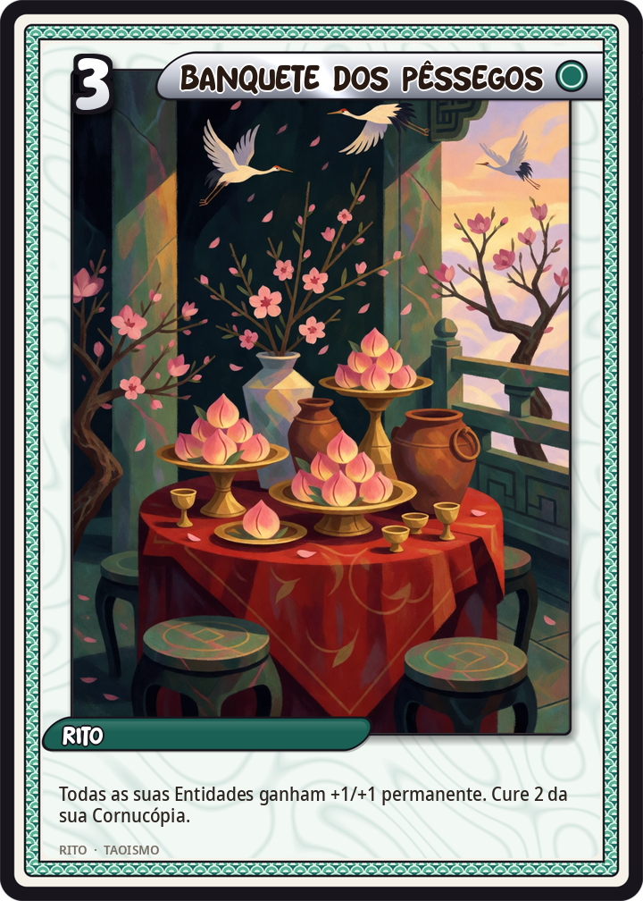
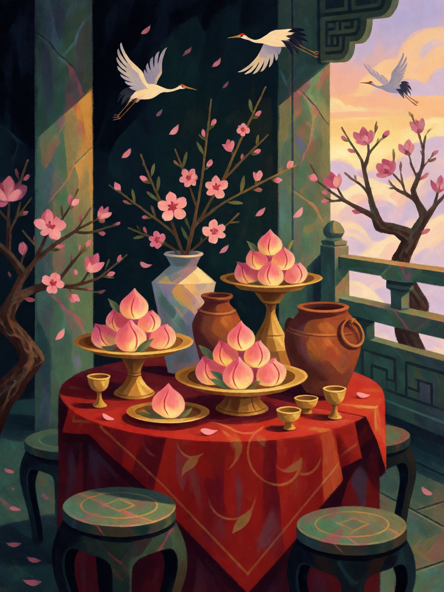

# Banquete dos Pêssegos

[← Taoismo](../taoismo.md) · [Wiki KodeX](../README.md) · [◀ Pílula de Ouro](tao_pilula_de_ouro.md) · [Taiji ▶](tao_taiji.md)

| Carta | Arte |
|---|---|
|  |  |

| | |
|---|---|
| **Tradição** | Taoismo |
| **Tipo** | Rito |
| **Custo de Fé** | 3 |
| **Palavras-chave** | — |
| **Lendária** | não |
| **Cópias no deck** | 1 |
| **Id** | `tao_banquete_dos_pessegos` |

## Texto da carta

> Todas as suas Entidades ganham +1/+1 permanente. Cure 2 da sua Cornucópia.

**EN — Peach Banquet:** *All your Entities gain permanent +1/+1. Heal your Cornucopia for 2.*

## Contexto mitológico

O Pantao Hui (蟠桃會), Banquete dos Pêssegos Achatados, é a festa que Xiwangmu oferece no Palácio de Jade do Kunlun quando os pêssegos da imortalidade amadurecem. Na *Jornada ao Oeste* (cap. 5) o pomar tem três mil e seiscentas árvores: as da frente dão fruto a cada três mil anos e tornam quem os come leve e sadio; as do meio, a cada seis mil, e dão o voo e a vida eterna; as do fundo, a cada nove mil, e fazem o comensal durar tanto quanto céu e terra. Sun Wukong, nomeado guardião do pomar, come os melhores, invade o banquete antes dos convidados, bebe o vinho imperial e engole o elixir de Laozi — o que desencadeia a guerra contra o céu.

A festa é anterior ao romance: no *Han Wudi gushi* Dongfang Shuo é acusado de ter roubado três vezes os pêssegos da Rainha Mãe; no teatro Yuan e nas pinturas de aniversário (*zhushou tu*) o banquete é a cena-padrão para desejar longevidade, com os Oito Imortais chegando pelo mar para brindar. Todos os deuses recebem convite — e ser convidado é ser imortal.

Como Rito, o banquete alimenta quem está à mesa: todas as suas Entidades crescem e um pouco de vida volta à Cornucópia.

## Papel no jogo

Virada de meio de jogo para uma mesa larga: com quatro Imortais em campo, +4/+4 em estatísticas permanentes por 3 Fé, e a cura compensa o atrito de ter deixado o oponente bater na Cornucópia enquanto a mesa se formava. Combina com Lü Dongbin (que soma a aura) e precede bem o Imperador de Jade. Inútil em mesa vazia — jogar cedo é desperdício.

## Atributos visuais

mesa de banquete com pêssegos brilhantes · jarros de vinho e taças de jade · terraço de palácio de jade acima das nuvens · grous voando

Balanço (conta de custo)

Orçamento P = 2·C+1 = 7 pts. Gasto: +1 ATK e +1 Vida permanentes em todas as aliadas = (1 + 1) × 3 = 6 + curar 2 de Cornucópia (1) = 7. Dentro.

Ficha completa: `cartas/taoismo/23_banquete_dos_pessegos.md` · cartas base da versão Alpha
