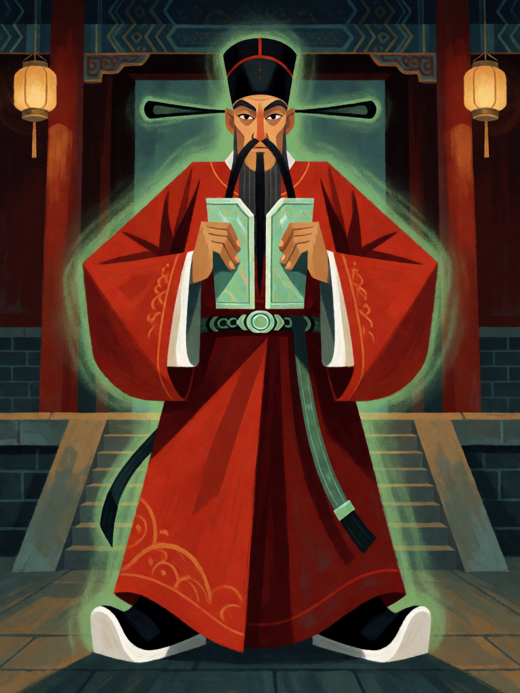

# Cao Guojiu

[← Taoismo](../taoismo.md) · [Wiki KodeX](../README.md) · [◀ Zhang Guolao](tao_zhang_guolao.md) · [Nezha ▶](tao_nezha.md)

| Carta | Arte |
|---|---|
|  |  |

| | |
|---|---|
| **Tradição** | Taoismo |
| **Tipo** | Entidade |
| **Custo de Fé** | 3 |
| **ATK / DEF** | 1 / 4 |
| **Palavras-chave** | Guarda |
| **Lendária** | não |
| **Cópias no deck** | 1 |
| **Id** | `tao_cao_guojiu` |

## Texto da carta

> Guarda. Despertar: cure 2 de Vida de uma Entidade aliada.

**EN — Cao Guojiu:** *Guard. Awaken: Restore 2 Health to an allied Entity.*

## Contexto mitológico

Cao Guojiu (曹國舅, "Tio Imperial Cao") é o aristocrata dos Oito Imortais — o único retratado com roupa de corte, chapéu oficial e um tablete de jade (*hu*) nas mãos. A lenda o faz irmão da imperatriz Cao, consorte do imperador Song Renzong (r. 1022–1063), ligando-o a uma família histórica, a do general Cao Bin. O irmão mais novo, protegido pelo parentesco, cometia crimes impunemente; Cao Guojiu, envergonhado, tentou corrigi-lo, fracassou, distribuiu sua fortuna e se retirou para as montanhas.

Ali Zhongli Quan e Lü Dongbin o encontram e perguntam o que ele cultiva. "O Dao." "Onde está o Dao?" Ele aponta para o céu. "E onde está o céu?" Ele aponta para o coração. Os dois riem e o aceitam. O tablete de jade, passaporte que abria qualquer porta da corte, vira nas mãos dele instrumento de purificação do ar; nas versões populares é trocado por castanholas, e ele se torna padroeiro dos atores. Fontes: *Dongyou Ji*; *Liexian quanzhuan*; *Song shi* para a família Cao.

A carta é o cortesão que se põe à frente: Guarda, corpo resistente, e ao chegar cuida de quem já estava lutando.

## Papel no jogo

Primeira linha de defesa barata: com Guarda e 4 de Vida, segura dois ataques de Entidades pequenas e obriga o oponente a gastar nela em vez de em Lü Dongbin ou He Xiangu. A cura de Despertar repara a troca do turno anterior. Fraco contra ataques grandes (1 ATK não troca com nada) e contra Furtivo, que ignora Guarda por não ser combate.

## Atributos visuais

chapéu oficial preto de abas horizontais longas · túnica vermelha de corte · tábua de jade nas duas mãos · barba preta longa · postura de guarda frontal

Balanço (conta de custo)

Orçamento P = 2·C+1 = 7 pts. Gasto: ATK 1 + Vida 4 + Guarda (1) + Despertar "cura 2 em aliada" (1) = 7. Dentro.

Ficha completa: `cartas/taoismo/08_cao_guojiu.md` · cartas base da versão Alpha
