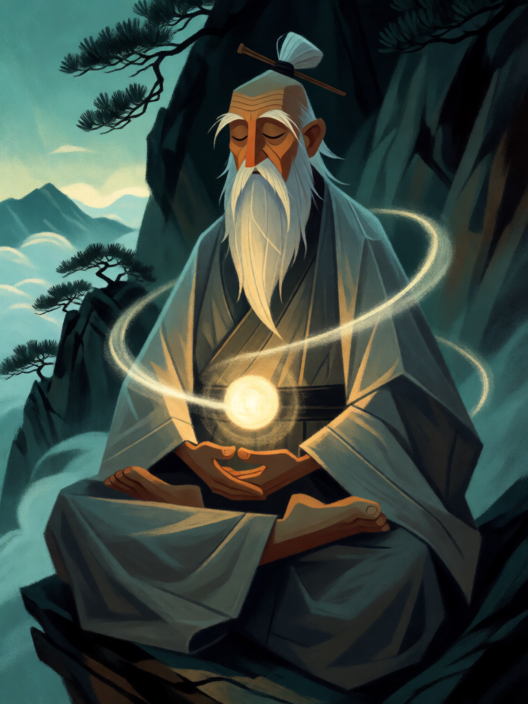

# Circulação do Qi

[← Taoismo](../taoismo.md) · [Wiki KodeX](../README.md) · [◀ Tartaruga Negra do Norte](tao_tartaruga_negra_do_norte.md) · [Flechas de Houyi ▶](tao_flechas_de_houyi.md)

| Carta | Arte |
|---|---|
|  |  |

| | |
|---|---|
| **Tradição** | Taoismo |
| **Tipo** | Rito |
| **Custo de Fé** | 1 |
| **Palavras-chave** | — |
| **Lendária** | não |
| **Cópias no deck** | 2 |
| **Id** | `tao_circulacao_do_qi` |

## Texto da carta

> Ganhe 1 Fé temporária. Compre 1 carta.

**EN — Qi Circulation:** *Gain 1 temporary Faith. Draw 1 card.*

## Contexto mitológico

*Qi* (氣) é o sopro: o ar que se respira, o vapor que sobe do arroz (a etimologia do caractere), a energia que anima o corpo e o cosmo. O *Daodejing* pede para "concentrar o sopro e tornar-se macio como um recém-nascido" (cap. 10) e descreve as dez mil coisas "carregando o yin, abraçando o yang, harmonizadas pelo sopro do vazio" (cap. 42). O *Zhuangzi* (cap. 6) diz que "o homem verdadeiro respira pelos calcanhares; o homem comum, pela garganta". Daí nasce toda a ginástica taoista: *daoyin* (guiar e esticar), *tuna* (expirar o velho, inspirar o novo), a respiração embrionária (*taixi*) descrita por Ge Hong no *Baopuzi* (cap. 8), em que o adepto respira tão devagar que uma pluma diante do nariz não se move.

Na alquimia interna o qi circula pela "órbita microcósmica": sobe pela coluna (canal *du*), desce pela frente (canal *ren*), passando pelos três campos de cinábrio (*dantian*). Fazer o sopro circular é não perder nada: tudo o que entra volta a servir.

A carta é esse circuito em miniatura: a Fé gasta volta no mesmo turno, e a carta que se gasta é reposta. Nada se perde, nada se cria — circula.

## Papel no jogo

Cantrip neutro em Fé: custa 1, devolve 1, troca-se por outra carta. Serve para afinar a mão (achar Lü Dongbin ou a Pílula de Ouro), para ativar Han Xiangzi sem perder tempo e para esvaziar o deck com segurança — cuidado com o fim do deck (2 de dano por carta não comprada). Duas cópias porque o deck quer ver muitas cartas: os Imortais são singletons.

## Atributos visuais

monge em posição de lótus · círculo de luz percorrendo coluna e frente do tronco · orbe brilhando no ventre · túnica cinza · cabelos brancos em coque

Balanço (conta de custo)

Orçamento P = 2·C+1 = 3 pts. Gasto: +1 Fé temporária (1,5) + comprar 1 (1,5) = 3. Dentro.

Ficha completa: `cartas/taoismo/20_circulacao_do_qi.md` · cartas base da versão Alpha
