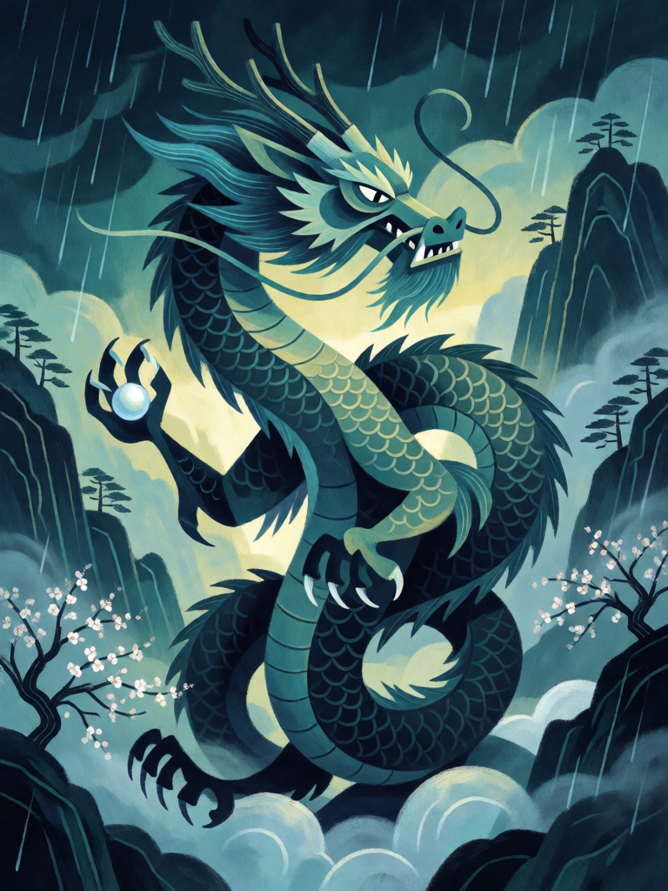

# Dragão Azul do Leste

[← Taoismo](../taoismo.md) · [Wiki KodeX](../README.md) · [◀ Fulu de Selamento](tao_fulu_de_selamento.md) · [Tigre Branco do Oeste ▶](tao_tigre_branco_do_oeste.md)

| Carta | Arte |
|---|---|
|  |  |

| | |
|---|---|
| **Tradição** | Taoismo |
| **Tipo** | Selo |
| **Custo de Fé** | 2 |
| **Palavras-chave** | — |
| **Lendária** | não |
| **Cópias no deck** | 1 |
| **Id** | `tao_dragao_azul_do_leste` |

## Texto da carta

> No fim do turno do oponente: todas as suas Entidades ganham +1/+1 permanente.

**EN — Azure Dragon of the East:** *At the end of your opponent's turn: all your Entities gain permanent +1/+1.*

## Contexto mitológico

Qinglong (青龍), o Dragão Azul (ou Verde-Azulado) do Leste, é o primeiro dos Quatro Símbolos (*Sixiang*), as quatro criaturas que dividem o céu chinês em quadrantes de sete mansões lunares cada. O *Liji* ("Quli") prescreve a formação de marcha: "à frente o Pássaro Vermelho, atrás a Tartaruga Negra, à esquerda o Dragão Azul, à direita o Tigre Branco" — isto é, os estandartes do exército repetem o mapa do céu. O *Shiji* ("Tianguan shu", de Sima Qian) e o *Huainanzi* ("Tianwen") fixam as correspondências: leste, primavera, madeira, a cor azul-verde, o yang que nasce.

O dragão do leste é por isso o símbolo do crescimento: a seiva que sobe, a chuva de primavera, o imperador (que se senta voltado para o sul, com o leste à esquerda, o lado do dragão). Nos tijolos de tumbas Han e nos espelhos TLV, Qinglong aparece sinuoso e com chifres, o corpo em S. No taoismo religioso os quatro são guardiões do altar e das portas do templo, e Qinglong guarda a entrada do leste junto com Baihu.

Como Selo-guardião, o Dragão Azul não ataca: faz a primavera chegar. Quando o turno inimigo termina, tudo que é seu cresceu.

## Papel no jogo

O Selo mais seguro do deck: `enemy_end_turn` sempre acontece, então ele resolve no turno seguinte ao que foi colocado, com a mesa que você tiver. Com três ou quatro Imortais em campo é +3/+3 ou +4/+4 em estatísticas permanentes por 2 Fé. O timing é a arte: colocar quando a mesa está cheia, não vazia. Não protege contra nada no turno inimigo — é um Selo de yang, de crescimento; o Tigre é o de punição.

## Atributos visuais

dragão chinês serpentino azul-esverdeado · chifres de cervo · corpo em S · pérola na garra · chuva de primavera ao amanhecer

Balanço (conta de custo)

Orçamento P = 2·C+1 = 5 pts, +1 grátis de Selo = 6. Gasto: +1 ATK e +1 Vida permanentes em todas as aliadas = (1 + 1) × 3 = 6. Dentro.

Ficha completa: `cartas/taoismo/16_dragao_azul_do_leste.md` · cartas base da versão Alpha
