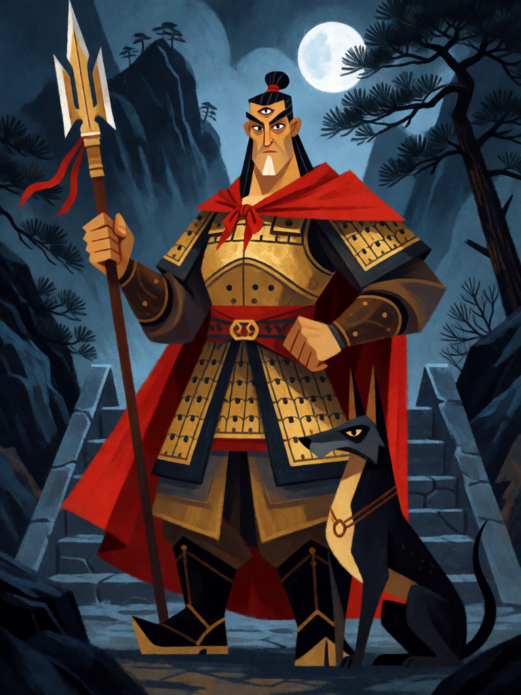

# Erlang Shen

[← Taoismo](../taoismo.md) · [Wiki KodeX](../README.md) · [◀ Zhong Kui](tao_zhong_kui.md) · [Guan Yu, Imperador Guan ▶](tao_guan_yu.md)

| Carta | Arte |
|---|---|
|  |  |

| | |
|---|---|
| **Tradição** | Taoismo |
| **Tipo** | Entidade |
| **Custo de Fé** | 5 |
| **ATK / DEF** | 3 / 5 |
| **Palavras-chave** | — |
| **Lendária** | não |
| **Cópias no deck** | 1 |
| **Id** | `tao_erlang_shen` |

## Texto da carta

> Despertar: invoque Xiaotian Quan, o Cão Celestial (2/1), se houver slot livre.

**EN — Erlang Shen:** *Awaken: Summon Xiaotian Quan, the Celestial Hound (2/1), if there's a free slot.*

## Contexto mitológico

Erlang Shen (二郎神, "o Deus Segundo Filho") é o guerreiro de três olhos do panteão popular: o terceiro olho, vertical no meio da testa, enxerga a verdade por baixo de qualquer transformação. Empunha uma lança de três pontas e dois gumes e anda com o Cão Celestial Uivante (Xiaotian Quan). Sua identidade é múltipla: em Sichuan é o filho de Li Bing, o engenheiro que domou o rio Min em Dujiangyan (séc. III a.C.), que matou um dragão de rio; no *Fengshen Yanyi* é Yang Jian, discípulo de Yuding Zhenren, mestre das 72 transformações; noutras versões é Zhao Yu, governador dos Sui.

Seu episódio mais famoso está na *Jornada ao Oeste* (cap. 6): quando o exército celeste não consegue prender Sun Wukong, o Imperador de Jade chama Erlang, seu sobrinho. Os dois duelam trocando formas — pardal, garça, peixe, serpente, templo com a cauda virada em mastro —, e é o cão de Erlang que morde a perna do Macaco e o derruba, permitindo a captura. O culto de Erlang em Guankou tem festas de sacrifício desde os Tang.

A carta é ele e o cão: um corpo grande que chega acompanhado.

## Papel no jogo

Dois corpos por uma carta no turno 5, o que para um deck de `ally_count_min` e auras é ouro: o cão 2/1 recebe o +1 ATK de Lü Dongbin e vira um 3/1 descartável. Erlang 3/5 segura trocas. Cuidado com o campo cheio (4 slots): se os Imortais já ocupam tudo, o cão não aparece — invocá-lo antes do quarto Imortal é a ordem certa.

## Atributos visuais

terceiro olho vertical na testa · lança de três pontas · armadura dourada · capa vermelha · cão de caça preto aos pés

Balanço (conta de custo)

Orçamento P = 2·C+1 = 11 pts. Gasto: ATK 3 + Vida 5 + Despertar "invocar token 2/1" (2 + 1 = 3) = 11. Dentro.

Ficha completa: `cartas/taoismo/11_erlang_shen.md` · cartas base da versão Alpha
