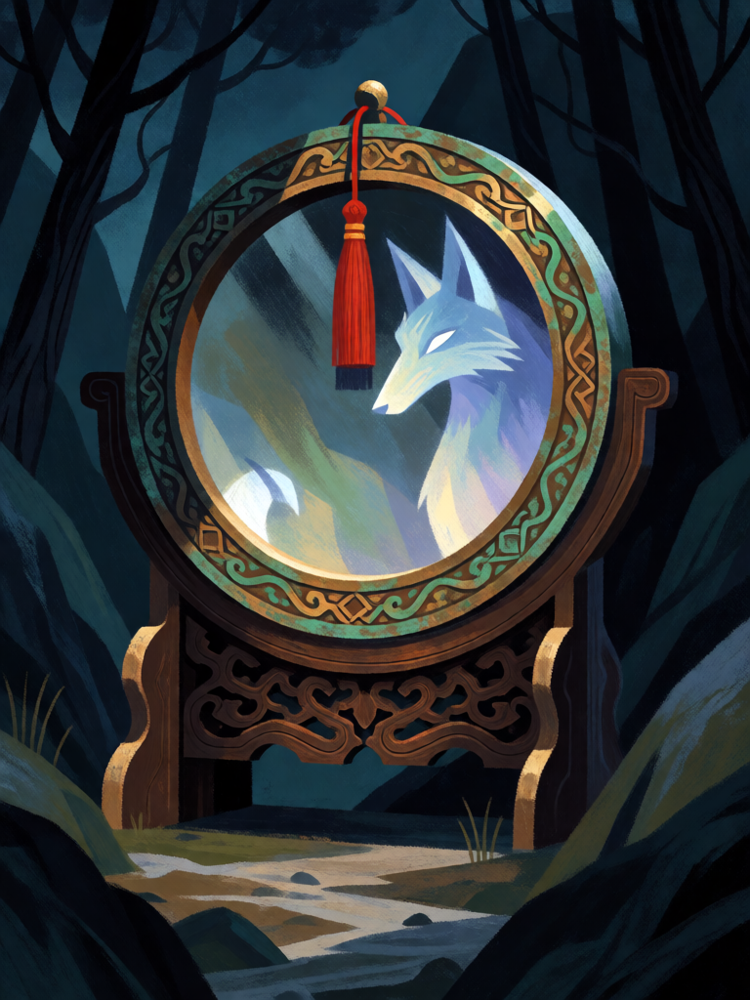

# Espelho de Bronze

[← Taoismo](../taoismo.md) · [Wiki KodeX](../README.md) · [◀ Pêssego da Imortalidade](tao_pessego_da_imortalidade.md)

| Carta | Arte |
|---|---|
|  |  |

| | |
|---|---|
| **Tradição** | Taoismo |
| **Tipo** | Relíquia |
| **Custo de Fé** | 2 |
| **Palavras-chave** | — |
| **Lendária** | não |
| **Cópias no deck** | 2 |
| **Id** | `tao_espelho_de_bronze` |

## Texto da carta

> Equipe uma Entidade aliada: +1/+1 e Furtivo. Ao equipar, silencie uma Entidade inimiga.

**EN — Bronze Mirror:** *Equip an allied Entity: +1/+1 and Stealth. When equipped, silence an enemy Entity.*

## Contexto mitológico

"As coisas velhas, de dez mil anos, são capazes de tomar forma humana para iludir os olhos dos homens — mas não conseguem alterar sua forma verdadeira dentro de um espelho." A frase é de Ge Hong, *Baopuzi*, cap. 17 ("Dengshe", "Subir montanhas e atravessar rios"), que recomenda ao taoista que entra nas montanhas levar às costas um espelho de bronze de nove polegadas ou mais: os espíritos, ao se aproximarem por trás, veem-se refletidos como são — raposa, tartaruga, árvore velha — e fogem, ou ficam paralisados de vergonha. O espelho não mata: desmascara.

O espelho de bronze polido é, desde os Zhou e sobretudo nos Han, um objeto cosmológico: o verso traz o padrão TLV (o quadrado da terra dentro do círculo do céu), os Quatro Símbolos, inscrições pedindo longevidade e, nos Tang, as Oito Trigramas. O *Gujing ji* ("Registro de um Espelho Antigo", Wang Du, Tang) narra um espelho que revela e destrói demônios por onde passa; o espelho *bagua* pendurado sobre a porta é o mesmo objeto em versão doméstica. Dianmu, a Mãe do Relâmpago, carrega dois espelhos cujos reflexos são os raios.

Como Relíquia, o espelho faz duas coisas: quem o porta não é visto pelo que é (Furtivo) e o que ele reflete perde a máscara (silêncio).

## Papel no jogo

Segundo e terceiro silêncios do deck (duas cópias desde a revisão; o Caldeirão dos Nove Tripés saiu), em Relíquia barata: desarma Guarda, Renascer ou aura inimiga e ainda deixa a portadora Furtiva até atacar — ideal para proteger Lü Dongbin ou He Xiangu de Ritos e Selos inimigos enquanto ficam atrás sem atacar. Pouco corpo (+1/+1); é carta de utilidade, não de estatísticas.

## Atributos visuais

espelho redondo de bronze polido · borda ornamentada com pátina verde · borla vermelha · raposa-demônio revelada no reflexo · suporte de madeira

Balanço (conta de custo)

Orçamento P = 2·C+1 = 5 pts, +1 grátis de Relíquia = 6. Gasto: +1 ATK (1) + +1 Vida (1) + Furtivo (1) + silenciar Entidade inimiga (2) = 5. Dentro.

Ficha completa: `cartas/taoismo/26_espelho_de_bronze.md` · cartas base da versão Alpha
