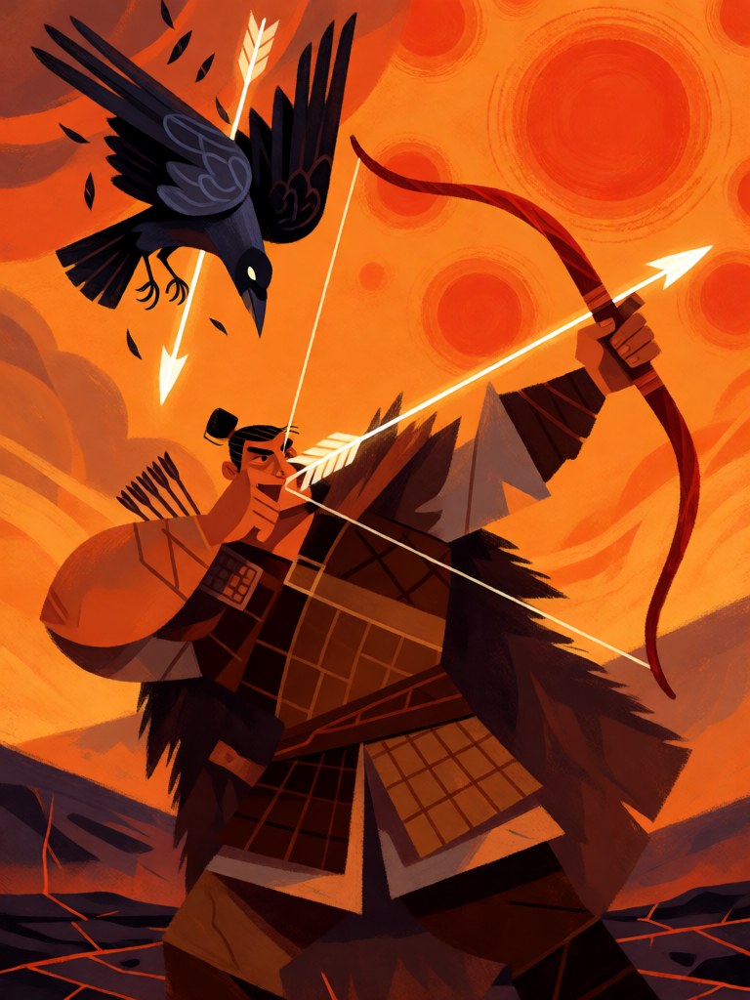

# Flechas de Houyi

[← Taoismo](../taoismo.md) · [Wiki KodeX](../README.md) · [◀ Circulação do Qi](tao_circulacao_do_qi.md) · [Pílula de Ouro ▶](tao_pilula_de_ouro.md)

| Carta | Arte |
|---|---|
|  |  |

| | |
|---|---|
| **Tradição** | Taoismo |
| **Tipo** | Rito |
| **Custo de Fé** | 2 |
| **Palavras-chave** | — |
| **Lendária** | não |
| **Cópias no deck** | 1 |
| **Id** | `tao_flechas_de_houyi` |
| **Arte** | provisória nesta Alpha |

## Texto da carta

> Cause 3 de dano a uma Entidade inimiga. Compre 1 carta.

**EN — Arrows of Houyi:** *Deal 3 damage to an enemy Entity. Draw 1 card.*

## Contexto mitológico

No tempo do imperador Yao, os dez sóis — filhos de Di Jun e Xihe, que deviam revezar-se um por dia no alto da amoreira Fusang — subiram todos ao céu de uma vez. As colheitas queimaram, as pedras derreteram, monstros saíram dos pântanos. Yao ordenou ao arqueiro Yi (后羿, Houyi, "o senhor Yi") que resolvesse: ele retesou o arco vermelho e derrubou nove sóis, que caíram como corvos de três patas mortos, deixando só o que ainda nos aquece; depois matou o Chiselado-de-Dentes, as Nove Crianças, o Grande Javali e a serpente Xiushe (a Bashe do *Shanhaijing*). Fonte: *Huainanzi*, "Benjing xun"; *Shanhaijing* ("Haiwai dong" e "Dahuang nan"); *Chuci*, "Tianwen".

Houyi é o herói que acerta o que está em excesso. Sua história continua com Xiwangmu, que lhe dá o elixir da imortalidade, e com Chang'e, que o engole e sobe à lua (*Huainanzi*, "Lanming xun") — a Rainha Mãe e a Pílula de Ouro, cartas deste mesmo deck.

Como Rito — o disparo, não o arco: é o ato de Houyi que vira carta, por isso não é Relíquia —, as flechas fazem o que fizeram no mito: tiram do céu o que estava demais, sem destruir o mundo. É a única carta de dano puro do deck.

## Papel no jogo

Remoção pontual e única: 3 de dano acaba com a maior parte dos corpos de custo até 3 e termina o serviço em Entidades grandes feridas em combate. O compre 1 evita que seja carta a menos. Um deck de equilíbrio precisa de ao menos uma resposta direta a um corpo problemático (Guarda inimiga, portadora de Relíquia), e é isto. Não atinge a Cornucópia.

## Atributos visuais

arco vermelho retesado para o alto · flecha de luz · dez sóis no céu · corvo de três patas caindo · capa de pele

Balanço (conta de custo)

Orçamento P = 2·C+1 = 5 pts. Gasto: 3 de dano a Entidade escolhida (3) + comprar 1 (1,5) = 4,5. Dentro.

Ficha completa: `cartas/taoismo/21_flechas_de_houyi.md` · cartas base da versão Alpha
