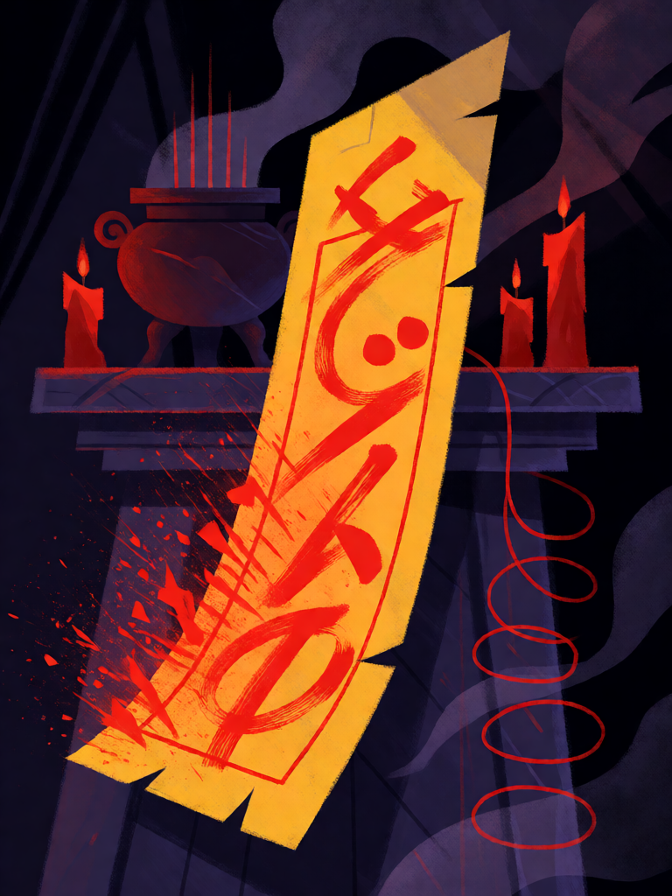

# Fulu de Selamento

[← Taoismo](../taoismo.md) · [Wiki KodeX](../README.md) · [◀ Imperador de Jade](tao_imperador_de_jade.md) · [Dragão Azul do Leste ▶](tao_dragao_azul_do_leste.md)

| Carta | Arte |
|---|---|
|  |  |

| | |
|---|---|
| **Tradição** | Taoismo |
| **Tipo** | Selo |
| **Custo de Fé** | 2 |
| **Palavras-chave** | — |
| **Lendária** | não |
| **Cópias no deck** | 2 |
| **Id** | `tao_fulu_de_selamento` |

## Texto da carta

> Quando o oponente jogar um Rito: anule-o (vai ao cemitério sem efeito). Compre 1 carta.

**EN — Sealing Fulu:** *When your opponent plays a Rite: counter it (it goes to the graveyard with no effect). Draw 1 card.*

## Contexto mitológico

*Fulu* (符籙) são os talismãs escritos do taoismo: tiras de papel amarelo com caracteres em tinta vermelha ou preta numa "escrita celeste" que mistura grafias arcaicas, nomes de deuses, estrelas e ordens ("ao receber esta ordem, obedeça depressa, depressa, conforme a lei"). O *fu* é o talismã; o *lu* é o registro dos espíritos que o sacerdote tem autoridade para comandar. A tradição remonta a Zhang Daoling, fundador dos Mestres Celestiais (142 d.C.), que teria recebido de Laozi o pacto e os selos.

Ge Hong, no *Baopuzi* (c. 320), dedica os capítulos 17 e 19 aos talismãs: há *fu* para entrar nas montanhas sem ser atacado por tigres e espíritos, para atravessar rios, para curar — queimados e bebidos em água, colados nas portas, pendurados no cinto. O talismã funciona como um documento oficial do céu: o demônio que o lê é obrigado a obedecer, como um funcionário diante de um edito. Daí a mecânica de "selar": o Fulu interrompe o que o inimigo tenta fazer.

Esta carta é o talismã de interdição: a magia inimiga chega, encontra o selo e se dissolve.

## Papel no jogo

A anulação do deck, em duas cópias (o Fulu de Imobilização saiu para dar lugar à segunda). Virada para baixo no turno 2 ou 3, protege a mesa de Imortais contra o Rito de área ou de destruição que a desmontaria. O oponente, vendo um Selo, hesita em jogar a magia cara — o que já é valor. Péssima contra decks que quase não têm Ritos; o compre 1 garante que não seja carta morta de todo. Atenção ao motor: dois Selos com o mesmo gatilho disparam ambos no mesmo Rito (README do sim, regra 12) — não ponha os dois Fulu ao mesmo tempo.

## Atributos visuais

tira de papel amarelo vertical · sinais vermelhos de pincel brilhando · magia escura se desfazendo em faíscas · altar com incensário de bronze

Balanço (conta de custo)

Orçamento P = 2·C+1 = 5 pts, +1 grátis de Selo = 6. Gasto: anular Rito inimigo (3) + comprar 1 (1,5) = 4,5. Dentro.

Ficha completa: `cartas/taoismo/15_fulu_de_selamento.md` · cartas base da versão Alpha
