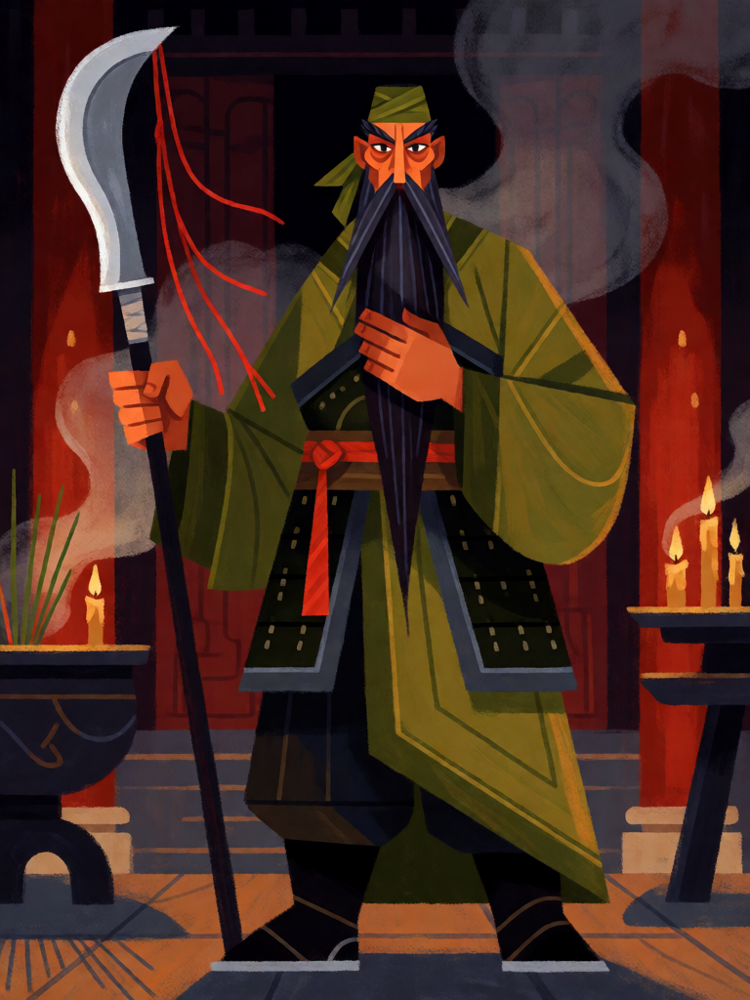

# Guan Yu, Imperador Guan

[← Taoismo](../taoismo.md) · [Wiki KodeX](../README.md) · [◀ Erlang Shen](tao_erlang_shen.md) · [Xiwangmu, Rainha Mãe do Oeste ▶](tao_xiwangmu.md)

| Carta | Arte |
|---|---|
|  |  |

| | |
|---|---|
| **Tradição** | Taoismo |
| **Tipo** | Entidade |
| **Custo de Fé** | 5 |
| **ATK / DEF** | 4 / 5 |
| **Palavras-chave** | Guarda |
| **Lendária** | não |
| **Cópias no deck** | 1 |
| **Id** | `tao_guan_yu` |

## Texto da carta

> Guarda. Despertar: uma Entidade aliada ganha +1 ATK permanente.

**EN — Guan Yu, Emperor Guan:** *Guard. Awaken: An allied Entity gains permanent +1 ATK.*

## Contexto mitológico

Guan Yu (關羽, m. 220) foi general de Liu Bei no fim dos Han, um dos três irmãos do Juramento do Jardim dos Pessegueiros no *Sanguo yanyi* (Romance dos Três Reinos, séc. XIV): rosto vermelho, barba de dois chi, a Alabarda do Dragão Verde na mão e o cavalo Lebre Vermelha. Capturado por Sun Quan e executado, a lealdade ao irmão até a morte fez dele, ao longo de mil anos, mais do que um herói: um deus.

A divinização é tripla. Os budistas o fazem Sangharama, guardião dos monastérios; os confucianos, modelo de retidão (*yi*); o taoismo religioso o incorpora como deus da guerra e exorcista e, em 1614, o imperador Ming Wanli lhe dá o título de *Guansheng Dijun*, "Imperador Guan, Sábio Santo". Templos de Guandi existem em toda a diáspora chinesa; comerciantes o veneram como deus da riqueza (ele teria inventado o livro-caixa), policiais e tríades juram sobre sua imagem. Fontes: *Sanguo zhi* (histórico), *Sanguo yanyi*, *Guandi shengji tuzhi* (Qing).

A carta é o general leal que se põe à frente (Guarda) e, ao chegar, arma um companheiro — o irmão de armas que ganha +1 ATK.

## Papel no jogo

Muralha do deck no turno 5: Guarda com 5 de Vida protege Lü Dongbin, He Xiangu e o Imperador de Jade que vem depois. O +1 ATK permanente vai de preferência para Nezha ou para um Imortal que vai atacar várias vezes. Fraco contra devolver à mão (perde o Despertar gasto) e contra silêncio, que tira a Guarda e expõe a linha.

## Atributos visuais

rosto vermelho · barba preta muito longa · guandao (alabarda lua crescente) plantada em pé · túnica verde sobre armadura · lenço verde na cabeça

Balanço (conta de custo)

Orçamento P = 2·C+1 = 11 pts. Gasto: ATK 4 + Vida 5 + Guarda (1) + Despertar "+1 ATK permanente em aliada" (1) = 11. Dentro.

Ficha completa: `cartas/taoismo/12_guan_yu.md` · cartas base da versão Alpha
