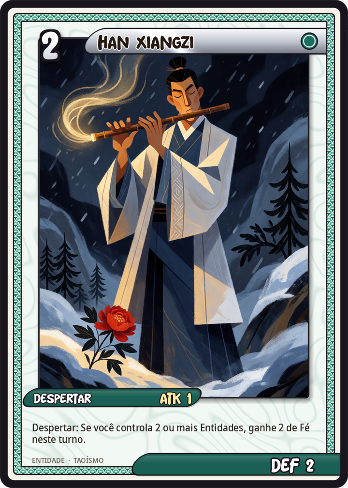

# Han Xiangzi

[← Taoismo](../taoismo.md) · [Wiki KodeX](../README.md) · [◀ He Xiangu](tao_he_xiangu.md) · [Li Tieguai ▶](tao_li_tieguai.md)

| Carta | Arte |
|---|---|
|  |  |

| | |
|---|---|
| **Tradição** | Taoismo |
| **Tipo** | Entidade |
| **Custo de Fé** | 2 |
| **ATK / DEF** | 1 / 2 |
| **Palavras-chave** | — |
| **Lendária** | não |
| **Cópias no deck** | 1 |
| **Id** | `tao_han_xiangzi` |

## Texto da carta

> Despertar: se você controla 2 ou mais Entidades, ganhe 2 Fé temporária.

**EN — Han Xiangzi:** *Awaken: If you control 2 or more Entities, gain 2 temporary Faith.*

## Contexto mitológico

Han Xiangzi (韓湘子) é o músico dos Oito Imortais, sempre com uma flauta transversal (*dizi*) nas mãos. A tradição o faz sobrinho-neto de Han Yu (768–824), o grande prosador confuciano dos Tang, que desprezava o taoismo. A lenda inverte o jogo: o jovem Han Xiang, discípulo de Lü Dongbin, faz peônias florescerem no meio do inverno diante do tio, e nas pétalas aparece um dístico que o tio só entenderá anos depois, exilado, na passagem nevada de Lan — episódio que ecoa um poema real de Han Yu ao sobrinho.

As fontes são o *Qingsuo gaoyi* (Song), o *Dongyou Ji* e peças de teatro Yuan sobre a conversão de Han Yu. Em algumas versões Han Xiangzi cai do pessegueiro da imortalidade ao colhê-lo e se torna imortal na queda. É padroeiro dos músicos.

Como carta, ele toca para os companheiros: a flauta levanta o *qi* (Fé temporária) quando há plateia — isto é, quando já existem outras Entidades em campo.

## Papel no jogo

Acelerador: com outra Entidade em campo, custa 2 e devolve 2, saindo "de graça" e deixando um corpo. Permite, no turno 3, jogar Han Xiangzi + outro Imortal de custo 3, ou no turno 4 Han Xiangzi + Nezha. Sinergia direta com Lan Caihe (que também pede companhia) e com a Circulação do Qi. Sem companhia é só um 1/2 por 2.

## Atributos visuais

flauta transversal dizi de bambu nos lábios · túnica azul de letrado · peônia vermelha na neve · coque

Balanço (conta de custo)

Orçamento P = 2·C+1 = 5 pts. Gasto: ATK 1 + Vida 2 + Despertar condicional "+2 Fé temporária" (3 × 0,7 = 2,1) = 5,1. Dentro (arredondamento de condicional).

Ficha completa: `cartas/taoismo/03_han_xiangzi.md` · cartas base da versão Alpha
