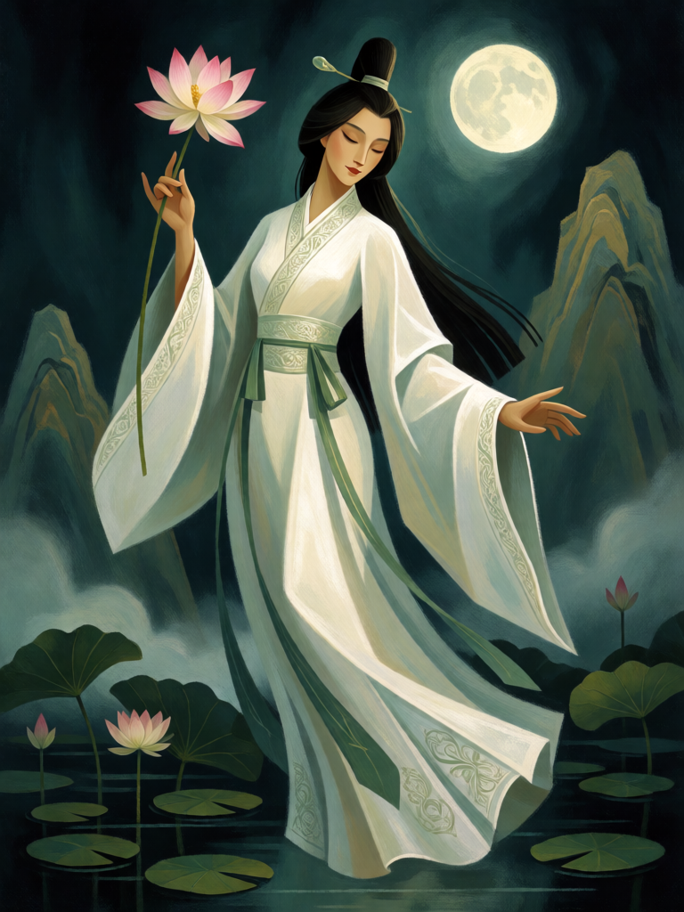

# He Xiangu

[← Taoismo](../taoismo.md) · [Wiki KodeX](../README.md) · [◀ Lan Caihe](tao_lan_caihe.md) · [Han Xiangzi ▶](tao_han_xiangzi.md)

| Carta | Arte |
|---|---|
|  |  |

| | |
|---|---|
| **Tradição** | Taoismo |
| **Tipo** | Entidade |
| **Custo de Fé** | 2 |
| **ATK / DEF** | 1 / 3 |
| **Palavras-chave** | — |
| **Lendária** | não |
| **Cópias no deck** | 1 |
| **Id** | `tao_he_xiangu` |

## Texto da carta

> No fim do seu turno, cure 2 de Vida de uma Entidade aliada.

**EN — He Xiangu:** *At the end of your turn, restore 2 Health to an allied Entity.*

## Contexto mitológico

He Xiangu (何仙姑, "a Imortal He") é a única mulher inequívoca entre os Oito Imortais. Nasceu em Zengcheng, Guangdong, no tempo da imperatriz Wu Zetian (séc. VII), com seis fios de cabelo no alto da cabeça. Aos catorze anos um espírito lhe apareceu em sonho e a instruiu a comer pó de mica (*yunmu*) para tornar o corpo leve e imortal. Ela obedeceu, fez voto de castidade, parou de comer e passou a flutuar de montanha em montanha colhendo frutos para a mãe.

As fontes são o *Taiping Guangji* (Song) e, para a versão canônica, o *Dongyou Ji* (Ming), onde Lü Dongbin a instrui e a leva ao grupo. Seu atributo é a flor de lótus — às vezes com uma concha ou um caldeirão de vinho —, símbolo de pureza e saúde; ela é padroeira das donas de casa e a quem se pede por saúde.

Virou a curandeira do deck: a flor de lótus em sua mão cura um pouco todo turno, o que, num deck de Entidades pequenas que trocam golpes, equivale a manter uma delas viva uma rodada a mais.

## Papel no jogo

Peça de atrito: cada turno em campo anula 2 de dano sofrido por alguém, e com 3 de Vida sobrevive ao primeiro golpe de um 2/x para curar ao menos uma vez. Combina com Cao Guojiu e Guan Yu (Guarda absorve, He Xiangu repõe) e com a Tartaruga Negra. Alvo prioritário para o oponente — o que é bom, porque desvia o foco de Lü Dongbin. Fraca em mesas vazias (sem quem curar) e contra silêncio.

## Atributos visuais

lótus rosa de haste longa · hanfu branco que cobre o peito · coque alto · flutua sobre o lago · brilho de cura

Balanço (conta de custo)

Orçamento P = 2·C+1 = 5 pts. Gasto: ATK 1 + Vida 3 + "fim do turno: cura 2 em aliada" (gatilho repetível: valor cheio da cura, 1 pt — mesma regra usada em Orobas e Jaci nos outros decks) = 5. Dentro (aviso esperado do validador: corpo de 4 pts em P = 5). _(Revisão: a versão anterior contava o efeito recorrente em dobro, convenção que não existe em §10; refeita a conta, 1/2 ficava em P−1 e o corpo subiu para 1/3.)_

Ficha completa: `cartas/taoismo/02_he_xiangu.md` · cartas base da versão Alpha
