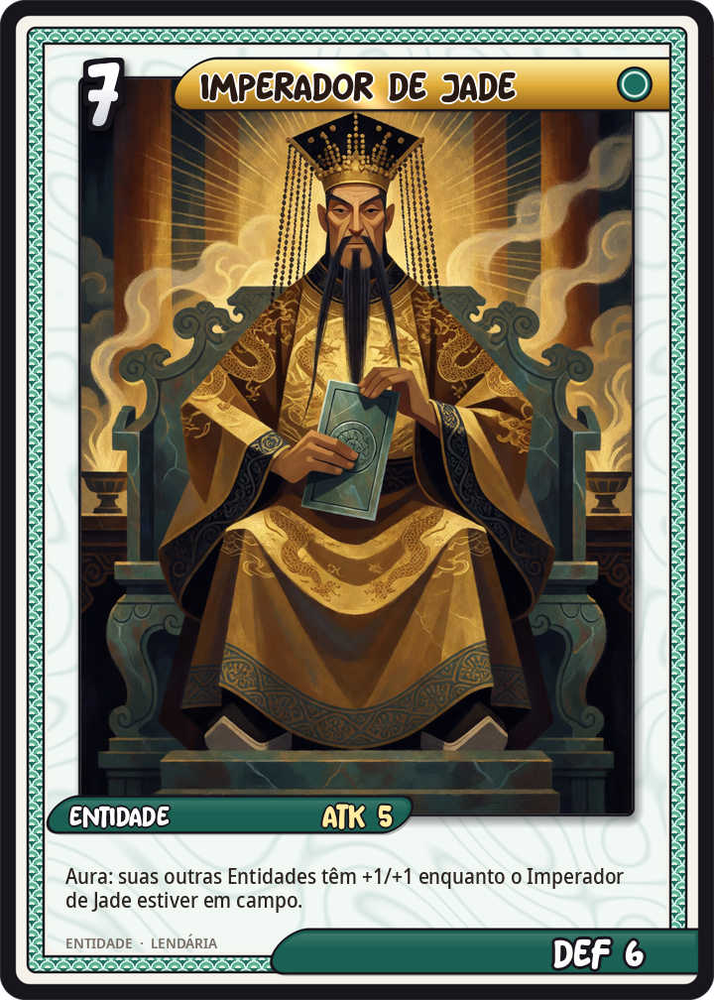
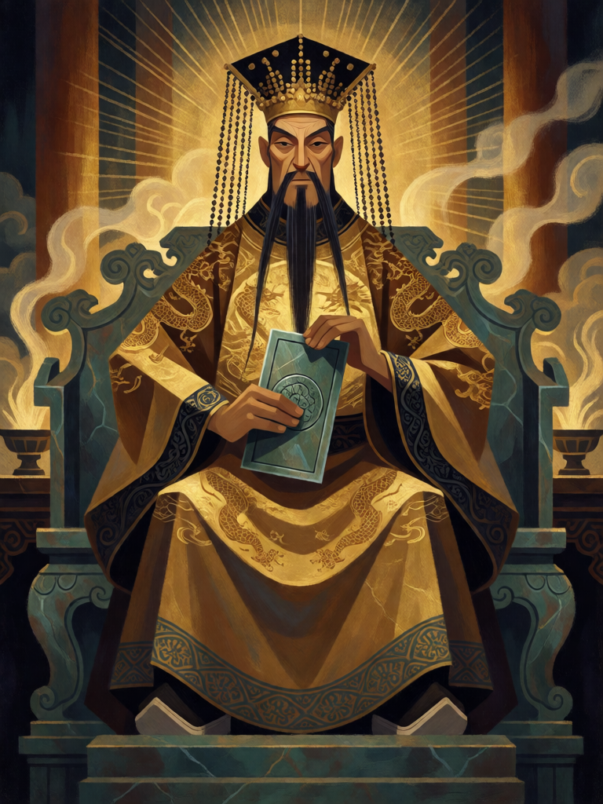

# Imperador de Jade

[← Taoismo](../taoismo.md) · [Wiki KodeX](../README.md) · [◀ Xiwangmu, Rainha Mãe do Oeste](tao_xiwangmu.md) · [Fulu de Selamento ▶](tao_fulu_de_selamento.md)

| Carta | Arte |
|---|---|
|  |  |

| | |
|---|---|
| **Tradição** | Taoismo |
| **Tipo** | Entidade |
| **Custo de Fé** | 7 |
| **ATK / DEF** | 5 / 6 |
| **Palavras-chave** | — |
| **Lendária** | sim |
| **Cópias no deck** | 1 |
| **Id** | `tao_imperador_de_jade` |

## Texto da carta

> Aura: suas outras Entidades têm +1/+1 enquanto o Imperador de Jade estiver em campo.

**EN — Jade Emperor:** *Aura: Your other Entities have +1/+1 while the Jade Emperor is on the field.*

## Contexto mitológico

O Imperador de Jade (玉皇大帝, Yuhuang Dadi; também Yudi, "Augusto de Jade") é o soberano do céu na religião chinesa: não o princípio mais alto — acima dele, imóveis, estão os Três Puros —, mas o administrador, aquele que governa deuses, homens e demônios por meio de uma burocracia celeste espelhada na imperial, com ministérios, censos e relatórios anuais (o Deus da Cozinha sobe no fim do ano para contar o que viu em cada casa). Sua escritura própria, o *Gaoshang Yuhuang benxing jijing*, narra como, príncipe de um reino de luz, renunciou ao trono, cultivou o Dao por milhões de kalpas e alcançou a soberania.

O culto é relativamente tardio: o imperador Song Zhenzong, para legitimar a dinastia, anunciou revelações do Imperador de Jade e lhe deu títulos oficiais em 1012 e 1017; Huizong ampliou-os em 1115. Daí em diante ele é onipresente na literatura: na *Jornada ao Oeste* convoca exércitos contra Sun Wukong e recorre a Buda; no *Fengshen Yanyi* preside à investidura final dos 365 deuses. Seu aniversário, no nono dia do primeiro mês lunar, abre o ano religioso.

Lendária de custo 7 e o "uau" do deck — mas sem dano. Ele não luta: faz a corte inteira valer mais. Uma aura de +1/+1 em todas as aliadas é o decreto imperial.

## Papel no jogo

Fechamento: cai no turno 7 numa mesa de Imortais e transforma cada 1/2 em 2/3 (3/3 com Lü Dongbin), virando qualquer troca. Corpo 5/6 que ainda se defende sozinho. O oponente tem de matá-lo ou silenciá-lo, e Guan Yu com Guarda impede que o alcance pelo combate. Fraco se cair em campo vazio — a aura não vale nada sem corte.

## Atributos visuais

coroa mian com tábua plana e franjas de contas · túnica dourada de dragão · tábua de jade nas duas mãos · trono de jade · barba preta longa

Balanço (conta de custo)

Orçamento P = 2·C+1 = 15 pts; Lendária até +2 = 17. Gasto: ATK 5 + Vida 6 + aura +1 ATK em todas (3) + aura +1 Vida em todas (3) = 17. Lendária +2.

Ficha completa: `cartas/taoismo/14_imperador_de_jade.md` · cartas base da versão Alpha
