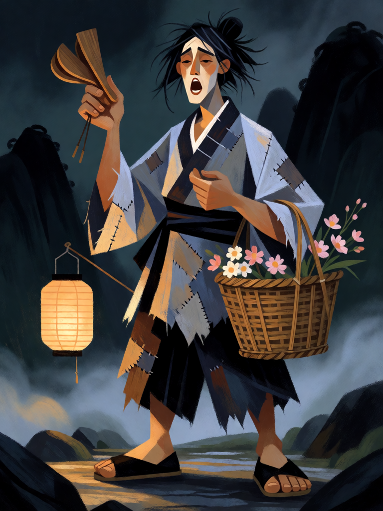

# Lan Caihe

[← Taoismo](../taoismo.md) · [Wiki KodeX](../README.md) · [He Xiangu ▶](tao_he_xiangu.md)

| Carta | Arte |
|---|---|
|  |  |

| | |
|---|---|
| **Tradição** | Taoismo |
| **Tipo** | Entidade |
| **Custo de Fé** | 1 |
| **ATK / DEF** | 1 / 1 |
| **Palavras-chave** | — |
| **Lendária** | não |
| **Cópias no deck** | 1 |
| **Id** | `tao_lan_caihe` |
| **Arte** | provisória nesta Alpha |

## Texto da carta

> Despertar: se você controla 2 ou mais Entidades, compre 1 carta.

**EN — Lan Caihe:** *Awaken: If you control 2 or more Entities, draw 1 card.*

## Contexto mitológico

Lan Caihe (藍采和) é o mais estranho dos Oito Imortais: um andarilho de idade e sexo incertos, que canta pelas ruas batendo o pé, com um pé calçado e o outro nu, vestindo trapos no verão e deitando-se na neve no inverno sem sentir frio. Carrega uma cesta de flores e, nas versões tardias, castanholas de madeira. Quando lhe dão moedas, ele as enfia num cordão e deixa que caiam pelo caminho.

A biografia mais antiga está no *Xu xianzhuan* (Biografias Continuadas dos Imortais, Shen Fen, séc. X): Lan Caihe bebe numa taverna, ouve uma flauta, sobe num grou e some no céu, deixando para trás sapato, roupa e castanholas. O *Dongyou Ji* (Jornada ao Leste, Ming) o integra ao grupo dos Oito, e ele se torna padroeiro de floristas e jardineiros.

Virou a Entidade de custo 1 do deck porque é o Imortal "da rua", o que chega primeiro e sem peso. Sua canção reúne gente em volta: por isso ele compra uma carta quando já há companhia em campo.

## Papel no jogo

Abertura ideal no turno 1 e cantrip nos turnos seguintes, quando já há outro Imortal em campo. Corpo de 1/1 que ganha valor real com a aura de Lü Dongbin e do Imperador de Jade e que pode voltar com Zhongli Quan ou a Pílula de Ouro. Ruim contra dano em área; serve de alvo barato para a Tartaruga Negra e o Pêssego da Imortalidade.

## Atributos visuais

um pé calçado e um pé descalço · cesta de flores · castanholas de madeira · túnica azul esfarrapada · jovem andrógino cantando

Balanço (conta de custo)

Orçamento P = 2·C+1 = 3 pts. Gasto: ATK 1 + Vida 1 + Despertar condicional "compre 1" (1,5 × 0,7 = 1,05) = 3,05. Dentro (aviso esperado do validador: corpo de 2 pts em P = 3).

Ficha completa: `cartas/taoismo/01_lan_caihe.md` · cartas base da versão Alpha
