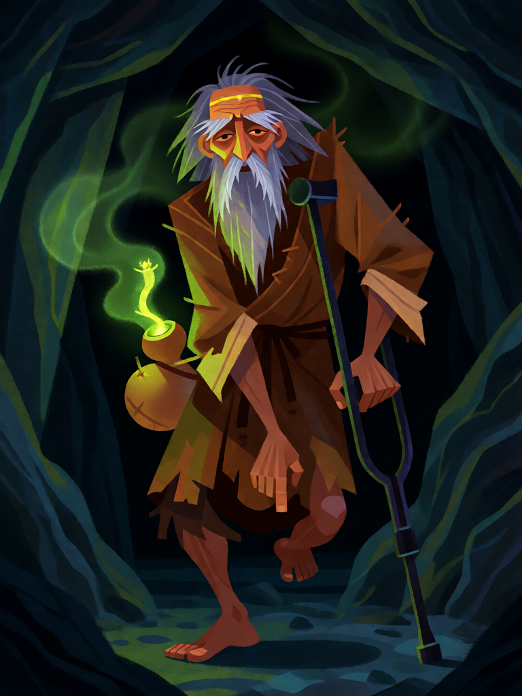

# Li Tieguai

[← Taoismo](../taoismo.md) · [Wiki KodeX](../README.md) · [◀ Han Xiangzi](tao_han_xiangzi.md) · [Zhongli Quan ▶](tao_zhongli_quan.md)

| Carta | Arte |
|---|---|
|  |  |

| | |
|---|---|
| **Tradição** | Taoismo |
| **Tipo** | Entidade |
| **Custo de Fé** | 2 |
| **ATK / DEF** | 1 / 2 |
| **Palavras-chave** | Renascer |
| **Lendária** | não |
| **Cópias no deck** | 1 |
| **Id** | `tao_li_tieguai` |

## Texto da carta

> Renascer.

**EN — Li Tieguai:** *Rebirth.*

## Contexto mitológico

Li Tieguai (李鐵拐, "Li da Muleta de Ferro") é o Imortal mendigo: coxo, sujo, apoiado numa muleta de ferro, com uma cabaça de remédios pendurada da qual sai fumaça — às vezes com sua própria alma desenhada nela. Sua história é a mais clara parábola de renascimento do grupo. Li era um asceta belo e sério que dominou a arte de deixar o corpo em espírito. Um dia partiu para visitar Laozi no Monte Hua e mandou o discípulo vigiar o corpo por sete dias, com ordem de cremá-lo se não voltasse. No sexto dia o discípulo soube que a mãe estava morrendo, cremou o corpo e partiu. Quando a alma de Li voltou, só encontrou cinzas — e o cadáver de um mendigo coxo que acabara de morrer de fome ali perto. Entrou nele.

A fonte canônica é o *Dongyou Ji* (Ming) e o *Liexian quanzhuan*; a tradição popular o liga a Li Xuan ou Li Ningyang. A ideia de fundo é a das almas *hun* e *po* (Liji, Zuo zhuan): a vida é a união das duas; a morte, a separação; o imortal é quem controla a saída e a volta. Li Tieguai é padroeiro dos farmacêuticos e dos doentes.

A mecânica foi imediata: Renascer. Ele morre e volta à mão — noutro corpo, mas o mesmo Imortal.

## Papel no jogo

Corpo barato que o oponente não quer matar: ao morrer volta à mão e repete Despertares alheios (nenhum próprio, mas ocupa de novo o slot e conta de novo para `ally_count_min`). Escudo ideal para absorver o primeiro ataque enquanto Lü Dongbin e He Xiangu ficam atrás. Perde força contra silêncio, que remove o Renascer.

## Atributos visuais

perna esquerda aleijada e dobrada · muleta de ferro · cabaça dupla fumegante · mendigo velho de barba desgrenhada · faixa dourada na cabeça

Balanço (conta de custo)

Orçamento P = 2·C+1 = 5 pts. Gasto: ATK 1 + Vida 2 + Renascer (2) = 5. Dentro.

Ficha completa: `cartas/taoismo/04_li_tieguai.md` · cartas base da versão Alpha
