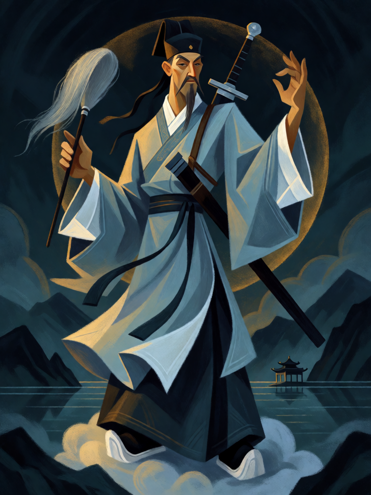

# Lü Dongbin

[← Taoismo](../taoismo.md) · [Wiki KodeX](../README.md) · [◀ Zhongli Quan](tao_zhongli_quan.md) · [Zhang Guolao ▶](tao_zhang_guolao.md)

| Carta | Arte |
|---|---|
|  |  |

| | |
|---|---|
| **Tradição** | Taoismo |
| **Tipo** | Entidade |
| **Custo de Fé** | 3 |
| **ATK / DEF** | 2 / 2 |
| **Palavras-chave** | — |
| **Lendária** | não |
| **Cópias no deck** | 1 |
| **Id** | `tao_lu_dongbin` |

## Texto da carta

> Aura: suas outras Entidades têm +1 ATK enquanto Lü Dongbin estiver em campo.

**EN — Lü Dongbin:** *Aura: Your other Entities have +1 ATK while Lü Dongbin is on the field.*

## Contexto mitológico

Lü Dongbin (呂洞賓, nome pessoal Lü Yan), o mais popular dos Oito Imortais, é um letrado Tang de túnica de erudito e espada mata-demônios às costas. Sua conversão é o "Sonho do Painço Amarelo": numa pousada de Handan, enquanto Zhongli Quan cozinha painço, Lü adormece e vive uma vida inteira — exames, altos cargos, casamento, filhos, desgraça, exílio, morte. Acorda e o painço ainda não ficou pronto. Compreende que a carreira mundana é sonho e segue o mestre, que o submete a dez provas (dar fortuna, ser caluniado, enfrentar demônios) antes de ensinar a alquimia.

A espada, que ele recebe do Imortal do Dragão de Fogo, corta paixões e demônios — mas a lenda mais contada é a da espada que falha: Lü a lança voando contra o mestre chan Huanglong, ela não o alcança, e Lü aprende humildade e se torna discípulo ("a espada voadora contra Huanglong"). Aparece três vezes, não reconhecido, na Torre de Yueyang, sobre o Lago Dongting ("três vezes bêbado em Yueyang, e ninguém o conhece"). O motivo do painço vem do *Zhenzhong ji* (Shen Jiji, Tang), onde o sonhador ainda é um certo Lu Sheng e o taoista um "Velho Lü"; a peça Yuan *Huangliang meng* de Ma Zhiyuan transfere o sonho para Lü Dongbin e faz de Zhongli o mestre. Outras fontes: *Dongyou Ji*; *Chunyang dijun shenhua miaotong ji* (Miao Shanshi, Yuan). A escola Quanzhen o venera como patriarca ("Imperador Chunyang"); é padroeiro de barbeiros, letrados e fabricantes de tinta de escrever.

Na carta é o líder que faz os outros valerem mais: a aura de +1 ATK nos companheiros é o que torna uma fileira de 1/2 uma ameaça.

## Papel no jogo

Centro da sinergia dos Oito Imortais. Com três outros corpos em campo a aura vale +3 ATK total por turno de ataque. Deve ser protegido (Cao Guojiu, Guan Yu com Guarda; Pêssego da Imortalidade para voltar à mão). O oponente que o silencia ou o mata primeiro desarma o deck — por isso ele é fraco sozinho e forte atrás de uma linha.

## Atributos visuais

espada mata-demônios nas costas · espanador de crina na mão · túnica e chapéu de letrado · bigode e cavanhaque · sobre nuvem

Balanço (conta de custo)

Orçamento P = 2·C+1 = 7 pts. Gasto: ATK 2 + Vida 2 + aura +1 ATK nas outras aliadas (3, §10) = 7. Dentro.

Ficha completa: `cartas/taoismo/06_lu_dongbin.md` · cartas base da versão Alpha
