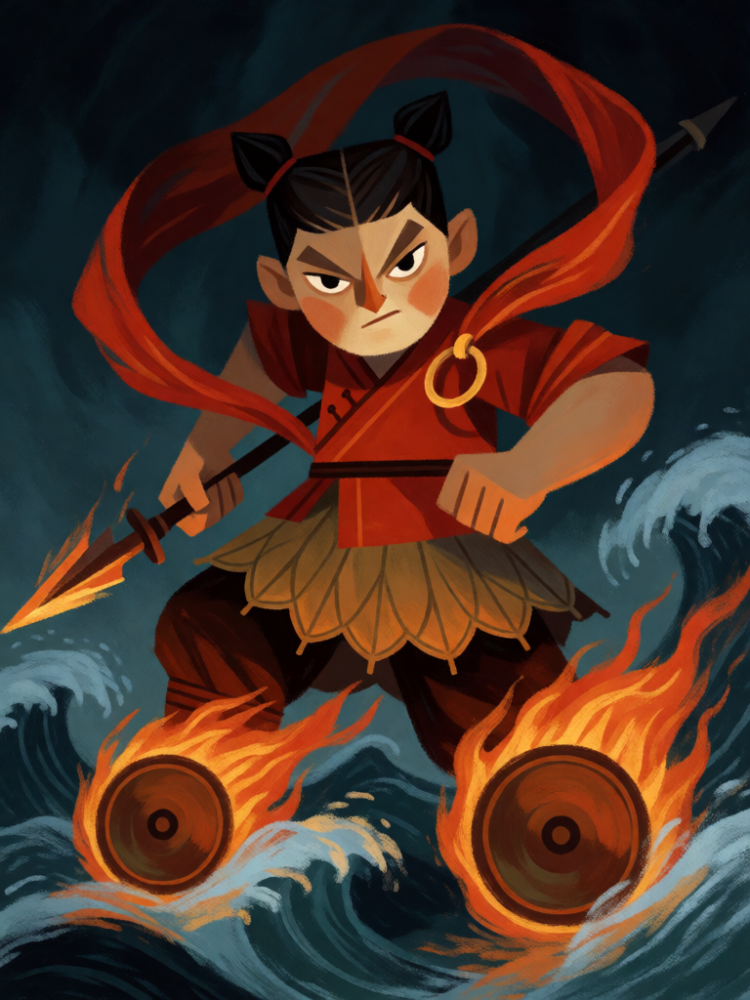

# Nezha

[← Taoismo](../taoismo.md) · [Wiki KodeX](../README.md) · [◀ Cao Guojiu](tao_cao_guojiu.md) · [Zhong Kui ▶](tao_zhong_kui.md)

| Carta | Arte |
|---|---|
|  |  |

| | |
|---|---|
| **Tradição** | Taoismo |
| **Tipo** | Entidade |
| **Custo de Fé** | 4 |
| **ATK / DEF** | 3 / 3 |
| **Palavras-chave** | Ímpeto, Renascer |
| **Lendária** | não |
| **Cópias no deck** | 1 |
| **Id** | `tao_nezha` |

## Texto da carta

> Ímpeto. Renascer.

**EN — Nezha:** *Rush. Rebirth.*

## Contexto mitológico

Nezha (哪吒) é o deus-menino do *Fengshen Yanyi* (Investidura dos Deuses, Ming, caps. 12–14). O nome vem do budismo tântrico (Nalakuvara, filho do rei celeste Vaishravana), mas é a mitologia popular Ming que o reinventa e o taoismo religioso que o absorve como marechal celeste — ele não aparece em texto filosófico algum. Lady Yin, esposa do general Li Jing, fica grávida por três anos e meio e dá à luz uma bola de carne; o pai a corta com a espada e dela salta um menino já grande, com um anel de ouro (Anel do Universo) e uma faixa de seda vermelha (Faixa que Confunde o Céu). O imortal Taiyi Zhenren o toma como discípulo. Aos sete anos, banhando-se no mar, Nezha agita a faixa e sacode o palácio do Rei-Dragão Ao Guang; mata o emissário e depois Ao Bing, terceiro filho do dragão, e lhe arranca os tendões.

Os Dragões-Reis exigem a vida da família. Para poupar os pais, Nezha devolve-lhes o que lhes deve — corta a própria carne e ossos e morre. Taiyi Zhenren recolhe sua alma e reconstrói o corpo com raízes e flores de lótus; o Nezha renascido ganha as Rodas de Vento e Fogo, que o levam voando, e a Lança de Ponta de Fogo. Na *Jornada ao Oeste* (cap. 4) ele luta contra Sun Wukong com três cabeças e seis braços. É venerado como Terceiro Príncipe (San Taizi) e Marechal do Altar Central, protetor de crianças e motoristas (pelas rodas).

Duas palavras-chave bastam para ele: Ímpeto (as rodas) e Renascer (o lótus).

## Papel no jogo

O único corpo agressivo do deck no meio da curva: ataca no turno em que entra e, morto, volta à mão para atacar de novo no turno seguinte. Bom para fechar trocas com Entidades feridas e para pressionar sem expor os Imortais. Como Renascer o devolve à mão, Zhongli Quan e a Pílula de Ouro não precisam dele — e ele cobra 4 Fé a cada retorno.

## Atributos visuais

menino de 10 anos com dois coques · faixa de seda vermelha flutuante · anel de ouro no ombro · lança de ponta de fogo · rodas de vento e fogo sob os pés

Balanço (conta de custo)

Orçamento P = 2·C+1 = 9 pts. Gasto: ATK 3 + Vida 3 + Ímpeto (1) + Renascer (2) = 9. Dentro.

Ficha completa: `cartas/taoismo/09_nezha.md` · cartas base da versão Alpha
