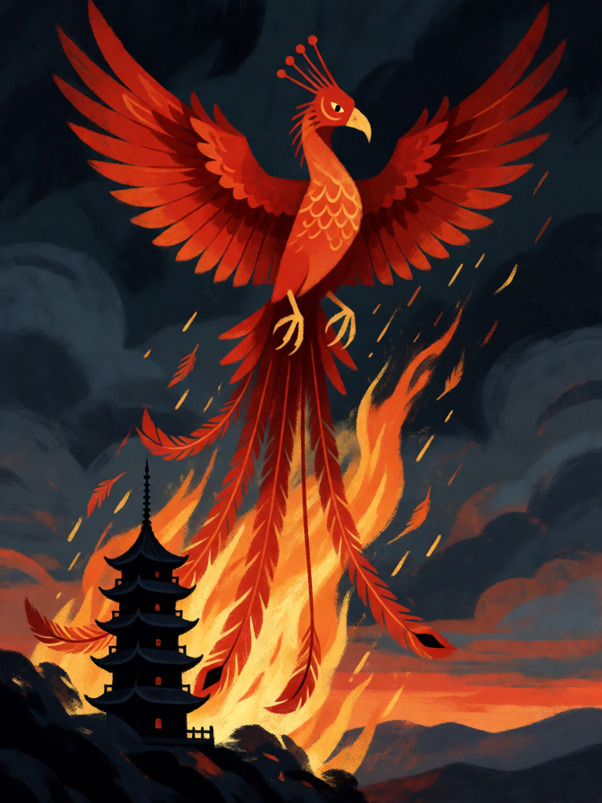

# Pássaro Vermelho do Sul

[← Taoismo](../taoismo.md) · [Wiki KodeX](../README.md) · [◀ Tigre Branco do Oeste](tao_tigre_branco_do_oeste.md) · [Tartaruga Negra do Norte ▶](tao_tartaruga_negra_do_norte.md)

| Carta | Arte |
|---|---|
|  |  |

| | |
|---|---|
| **Tradição** | Taoismo |
| **Tipo** | Selo |
| **Custo de Fé** | 2 |
| **Palavras-chave** | — |
| **Lendária** | não |
| **Cópias no deck** | 1 |
| **Id** | `tao_passaro_vermelho_do_sul` |

## Texto da carta

> Quando uma Entidade aliada morrer: reviva uma Entidade do seu cemitério para o campo e cure 2 da sua Cornucópia.

**EN — Vermilion Bird of the South:** *When an allied Entity dies: revive an Entity from your graveyard to the field and heal your Cornucopia for 2.*

## Contexto mitológico

Zhuque (朱雀), o Pássaro Vermelho do Sul, governa o verão, o fogo e o meio-dia. Nas fontes Han (*Shiji*, "Tianguan shu"; *Huainanzi*) é a figura das sete mansões meridionais (de Jing, em Gêmeos, a Zhen, em Corvus; Antares, muitas vezes citada por engano, pertence à mansão Xin do Dragão Azul); nas tumbas aparece como ave de longa cauda e crista, asas abertas, entre chamas. Não é a fênix (*fenghuang*), ave de bom augúrio ligada à imperatriz, mas as duas se confundem desde cedo, e a confusão trouxe para Zhuque a ideia que o Ocidente associa à fênix: o fogo que consome e devolve.

No taoismo ritual, Zhuque guarda o sul do altar e a porta pela qual entram os espíritos convidados; nos textos de *neidan* o pássaro vermelho é o fogo do coração (*xinhuo*) que aquece o caldeirão. O sul é, na geomancia (*fengshui*), a frente ideal de uma casa — o lado da vida.

Como Selo-guardião, o Pássaro Vermelho responde à morte com fogo de verão: quando algo seu cai, algo seu renasce.

## Papel no jogo

A segurança contra remoção: o oponente mata um Imortal no turno dele e o vê voltar — no motor, `_morrer` põe a carta no cemitério **antes** de disparar `ally_dies` (README do sim, regra 18b), então o Selo pode reviver exatamente quem acabou de cair, ou um morto anterior, à escolha — sem Despertar (reviver para o campo não o dispara, regras §8): volta o corpo, a Guarda, a aura, não o golpe de entrada. Se a morta tinha Renascer ela foi para a mão, não para o cemitério, e o Selo revive outra. Só dispara em morte no turno do oponente (regra 15), inclusive por Rito inimigo; precisa de slot livre. Cedo demais é carta parada.

## Atributos visuais

ave vermelha de cauda longa e crista · asas abertas · renascendo das chamas · plumagem carmesim e dourada

Balanço (conta de custo)

Orçamento P = 2·C+1 = 5 pts, +1 grátis de Selo = 6. Gasto: revive para o campo (3 + custo ÷ 2; alvo típico 2–3 → 4–4,5) + curar 2 de Cornucópia (1) = 5–5,5. Dentro.

Ficha completa: `cartas/taoismo/18_passaro_vermelho_do_sul.md` · cartas base da versão Alpha
