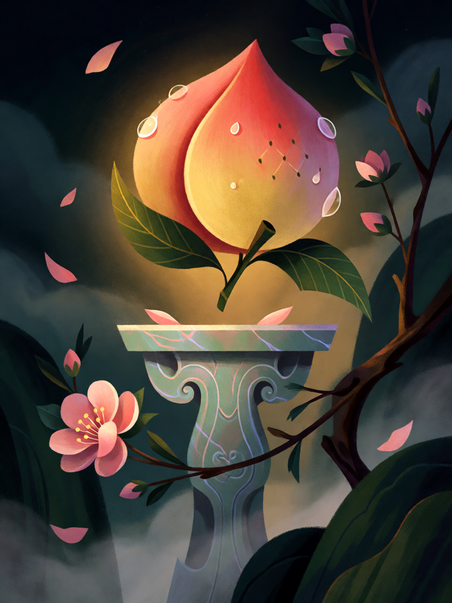

# Pêssego da Imortalidade

[← Taoismo](../taoismo.md) · [Wiki KodeX](../README.md) · [◀ Taiji](tao_taiji.md) · [Espelho de Bronze ▶](tao_espelho_de_bronze.md)

| Carta | Arte |
|---|---|
|  |  |

| | |
|---|---|
| **Tradição** | Taoismo |
| **Tipo** | Relíquia |
| **Custo de Fé** | 2 |
| **Palavras-chave** | — |
| **Lendária** | não |
| **Cópias no deck** | 2 |
| **Id** | `tao_pessego_da_imortalidade` |

## Texto da carta

> Equipe uma Entidade aliada: +1/+2. A portadora ganha Renascer.

**EN — Peach of Immortality:** *Equip an allied Entity: +1/+2. The bearer gains Rebirth.*

## Contexto mitológico

O pêssego (*tao*, 桃) é a fruta da longevidade na China desde antes do taoismo: a madeira de pessegueiro afasta espíritos (os *taofu*, tabuletas de pessegueiro penduradas nas portas no Ano-Novo, antecedem os dísticos de papel), a flor é a primavera, e o fruto, com seu sulco e sua forma, é a vida que se renova. Um trecho atribuído ao *Shanhaijing* (citado no *Lunheng* de Wang Chong, séc. I, mas ausente do texto que chegou até nós) fala de uma árvore de pêssego de três mil li no Monte Dushuo, sob cuja porta dos fantasmas montam guarda Shentu e Yulü. Mas é com Xiwangmu que o pêssego vira o alimento dos imortais: no *Han Wudi neizhuan* a Rainha Mãe desce ao palácio com sete pêssegos do tamanho de ovos de pata, come três e dá quatro ao imperador Wu, que guarda os caroços para plantar — "não dão fruto nesta terra", ela ri, "amadurecem a cada três mil anos".

Daí os pêssegos do Banquete, roubados por Dongfang Shuo e por Sun Wukong; o deus da longevidade Shouxing, de testa enorme, sempre segurando um; e a imagem recorrente dos Oito Imortais trazendo pêssegos. Quem come não morre — ou, no mínimo, não fica morto.

Como Relíquia, o pêssego vai para a mão de uma Entidade e lhe dá exatamente isso: um pouco mais de corpo e um retorno garantido.

## Papel no jogo

Seguro de vida barato para a peça que o deck não pode perder: Lü Dongbin com pêssego é 3/4 que, morto, volta à mão e é rejogado com a aura. Também bom em Zhong Kui e Zhang Guolao, que repetem o Despertar ao voltar. Duas cópias porque a imortalidade é a identidade do deck. Como toda Relíquia, perde-se se a portadora for devolvida à mão; silêncio na portadora não tira a Relíquia nem o +1/+2, mas apaga o Renascer concedido (README do sim, regra 24).

## Atributos visuais

um único pêssego grande rosa e dourado com sulco · duas folhas verdes · flutuando sobre pedestal de jade · galho florido

Balanço (conta de custo)

Orçamento P = 2·C+1 = 5 pts, +1 grátis de Relíquia = 6. Gasto: +1 ATK (1) + +2 Vida (2) + Renascer (2) = 5. Dentro.

Ficha completa: `cartas/taoismo/25_pessego_da_imortalidade.md` · cartas base da versão Alpha
