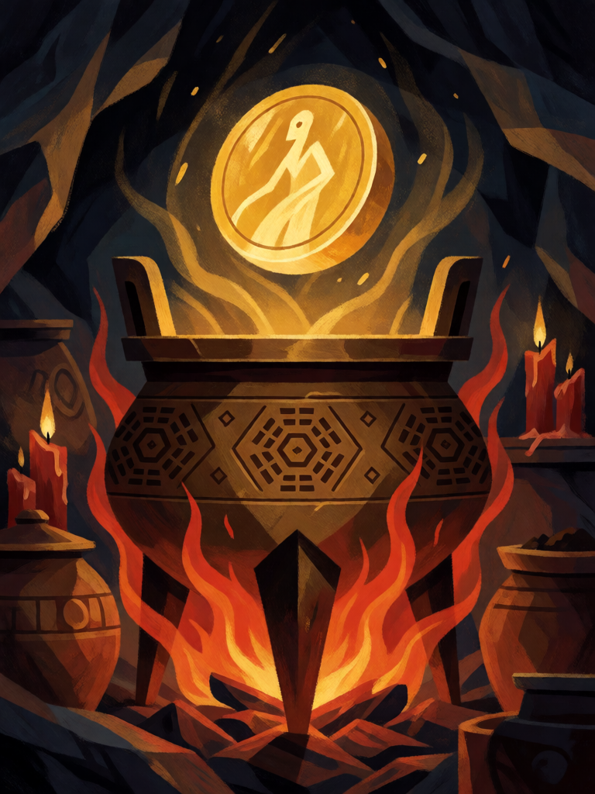

# Pílula de Ouro

[← Taoismo](../taoismo.md) · [Wiki KodeX](../README.md) · [◀ Flechas de Houyi](tao_flechas_de_houyi.md) · [Banquete dos Pêssegos ▶](tao_banquete_dos_pessegos.md)

| Carta | Arte |
|---|---|
|  |  |

| | |
|---|---|
| **Tradição** | Taoismo |
| **Tipo** | Rito |
| **Custo de Fé** | 3 |
| **Palavras-chave** | — |
| **Lendária** | não |
| **Cópias no deck** | 2 |
| **Id** | `tao_pilula_de_ouro` |

## Texto da carta

> Reviva uma Entidade do seu cemitério para o campo. Compre 1 carta.

**EN — Golden Pill:** *Revive an Entity from your graveyard to the field. Draw 1 card.*

## Contexto mitológico

*Jindan* (金丹), a "pílula de ouro" ou "elixir dourado", é o objeto central da alquimia taoista. Na alquimia externa (*waidan*) é uma substância real: cinábrio (sulfeto de mercúrio) aquecido no caldeirão vira mercúrio, que recombinado com enxofre volta a ser cinábrio — um ciclo de morte e retorno que, repetido nove vezes (*jiuzhuan huandan*, "o elixir que retorna nove vezes"), produziria o remédio da imortalidade. Ge Hong, no *Baopuzi* (cap. 4, "Jindan"), diz que ervas e exercícios prolongam a vida, mas só o elixir dourado dá a imortalidade verdadeira: "o ouro não apodrece nem no fogo nem na terra; quem o ingere adquire a mesma natureza". O *Zhouyi cantong qi* (séc. II) codifica a receita em linguagem do *Yijing*.

A história cobrou caro: Qin Shi Huang e Han Wudi gastaram fortunas atrás do elixir; vários imperadores Tang (Xianzong, Muzong, Wuzong, Xuanzong) morreram envenenados por mercúrio. A resposta foi a alquimia interna (*neidan*, a partir dos Song): o caldeirão é o corpo, o cinábrio é a essência e o sopro, e a pílula de ouro é o "embrião imortal" gerado no campo de cinábrio inferior. Na *Jornada ao Oeste*, Sun Wukong engole todas as pílulas de Laozi e se torna indestrutível.

Como Rito, a pílula faz o que promete: quem morreu volta inteiro, e ao campo.

## Papel no jogo

O motor de reciclagem principal: revive para o campo **sem Despertar** (reviver não o dispara, regras §8) — volta o corpo e o que ele tem de contínuo: Guan Yu com Guarda, Cao Guojiu com Guarda, Lü Dongbin com a aura, Nezha com Ímpeto e Renascer — e ainda repõe a carta. Para repetir um Despertar (Zhong Kui, Erlang), o caminho é Zhongli Quan, que devolve à mão. Duas cópias porque é a carta que faz o deck ganhar jogos longos. Precisa de slot livre e de alvo no cemitério — não funciona nos turnos 1–3 na maioria das partidas.

## Atributos visuais

pílula dourada brilhante flutuando · caldeirão ding de bronze de três pés · gravuras de bagua · chamas vermelhas de cinábrio

Balanço (conta de custo)

Orçamento P = 2·C+1 = 7 pts. Gasto: revive para o campo (3 + custo ÷ 2; alvo típico 2–4 → 4–5; máximo Guan Yu/Erlang custo 5 → 5,5) + comprar 1 (1,5) = 5,5–7. Dentro.

Ficha completa: `cartas/taoismo/22_pilula_de_ouro.md` · cartas base da versão Alpha
