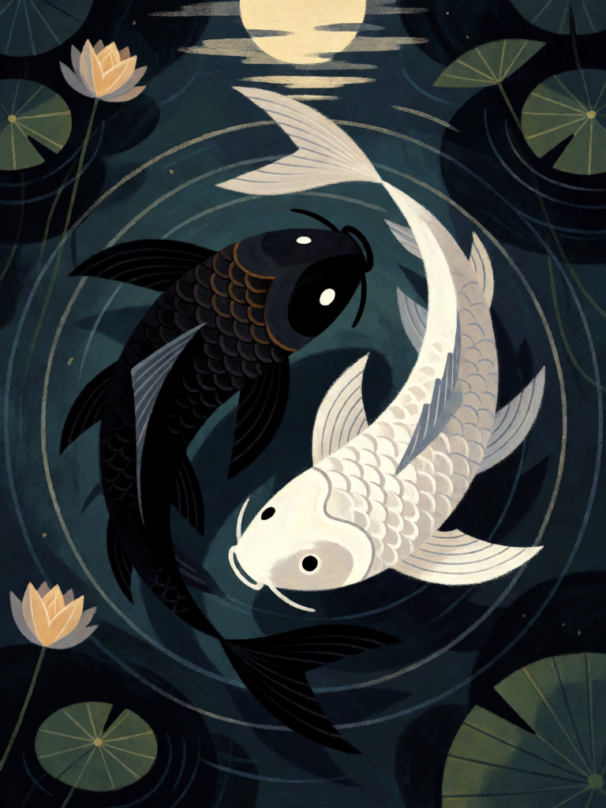

# Taiji

[← Taoismo](../taoismo.md) · [Wiki KodeX](../README.md) · [◀ Banquete dos Pêssegos](tao_banquete_dos_pessegos.md) · [Pêssego da Imortalidade ▶](tao_pessego_da_imortalidade.md)

| Carta | Arte |
|---|---|
|  |  |

| | |
|---|---|
| **Tradição** | Taoismo |
| **Tipo** | Rito |
| **Custo de Fé** | 4 |
| **Palavras-chave** | — |
| **Lendária** | não |
| **Cópias no deck** | 2 |
| **Id** | `tao_taiji` |

## Texto da carta

> Uma Entidade aliada ganha +2/+2 permanente e uma Entidade inimiga recebe −2/−2 permanente.

**EN — Taiji:** *An allied Entity gains permanent +2/+2 and an enemy Entity gets permanent −2/−2.*

## Contexto mitológico

*Taiji* (太極), a "Polaridade Suprema", é o nome que o *Yijing* dá ao estado anterior à divisão: "a Mudança tem o Taiji; este gera as Duas Potências (yin e yang); as duas geram as Quatro Imagens; as quatro geram os Oito Trigramas" ("Xici" I.11). O *Daodejing* (cap. 42) diz o mesmo em outra chave: "o Dao gera o Um, o Um gera o Dois, o Dois gera o Três, o Três gera as dez mil coisas; elas carregam o yin e abraçam o yang". Yin (陰, a encosta sombria da montanha) e yang (陽, a encosta ensolarada) não são bem e mal: são o par que só existe junto, cada um crescendo enquanto o outro míngua, cada um com a semente do outro — os dois pontos no diagrama.

O diagrama em si, o *taijitu* com os dois "peixes" preto e branco, é tardio: o filósofo Song Zhou Dunyi (1017–1073) escreveu o *Taiji tushuo* ("Explicação do Diagrama da Polaridade Suprema") sobre um diagrama de círculos concêntricos, e a figura dos peixes se fixa nos Ming, com Zhao Huiqian e Lai Zhide. Mas a ideia é a mais taoista de todas: nada cresce sem que algo diminua na mesma medida.

Como Rito, Taiji é a lei da compensação em uma carta: o que um lado ganha, o outro perde, e o total da mesa não muda.

## Papel no jogo

A remoção "equilibrada" do deck: −2/−2 mata qualquer Entidade com até 2 de Vida e aleija as maiores, enquanto o +2/+2 faz um Imortal pequeno virar uma ameaça real (Nezha 5/5 com Ímpeto, ou Cao Guojiu 3/6 com Guarda). Custo 4 compete com Nezha e Zhong Kui no turno 4; melhor no turno 6+ junto com um corpo barato. Fraco se não há inimigo em campo (metade da carta se perde). Duas cópias desde a revisão: é a carta-emblema do deck e a resposta a corpos grandes que o Bagua (cortado) não dava.

## Atributos visuais

dois carpas, uma preta e uma branca · nadando em círculo formando o yin-yang · vista de cima · lagoa escura com reflexo da lua

Balanço (conta de custo)

Orçamento P = 2·C+1 = 9 pts. Gasto: +2 ATK e +2 Vida permanentes em aliada (4) + −2 ATK e −2 Vida permanentes em inimiga (equivalente a 2 de dano + −2 ATK = 4) = 8. Dentro.

Ficha completa: `cartas/taoismo/24_taiji.md` · cartas base da versão Alpha
