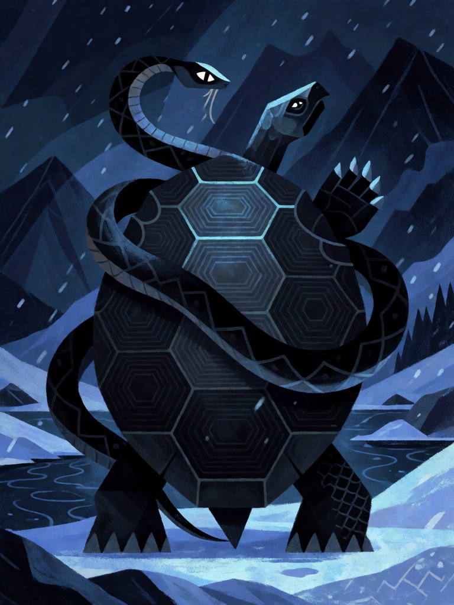

# Tartaruga Negra do Norte

[← Taoismo](../taoismo.md) · [Wiki KodeX](../README.md) · [◀ Pássaro Vermelho do Sul](tao_passaro_vermelho_do_sul.md) · [Circulação do Qi ▶](tao_circulacao_do_qi.md)

| Carta | Arte |
|---|---|
|  |  |

| | |
|---|---|
| **Tradição** | Taoismo |
| **Tipo** | Selo |
| **Custo de Fé** | 1 |
| **Palavras-chave** | — |
| **Lendária** | não |
| **Cópias no deck** | 1 |
| **Id** | `tao_tartaruga_negra_do_norte` |

## Texto da carta

> Quando uma Entidade aliada sofrer dano: cure 4 de Vida dela; ela ganha +0/+1 permanente e Guarda.

**EN — Black Tortoise of the North:** *When an allied Entity takes damage: restore 4 Health to it; it gains permanent +0/+1 and Guard.*

## Contexto mitológico

Xuanwu (玄武), a Tartaruga Negra — literalmente "Guerreiro Sombrio" —, é o Símbolo do norte, do inverno e da água: uma tartaruga enlaçada por uma serpente, imagem já presente nos espelhos e tijolos Han e explicada por comentadores como a união do yin (a tartaruga, que se fecha) com o yang (a serpente, que se enrola). O norte é a direção da morte e do frio, mas também da longevidade, pois a tartaruga vive mil anos e carrega nas costas o mapa do mundo — os cascos usados nos oráculos Shang eram lidos como céu e terra. O *Liji* põe Xuanwu na retaguarda do exército: quem protege as costas.

A partir dos Song a Tartaruga Negra ganha corpo humano: torna-se **Zhenwu**, o Guerreiro Perfeito (ou Xuantian Shangdi, "Imperador Supremo do Céu Sombrio"), deus descalço de cabelo solto e espada, pisando a tartaruga e a serpente — que seriam, numa versão, os seus próprios estômago e intestinos purgados ao alcançar a imortalidade. O imperador Ming Yongle, que atribuiu a ele a vitória que lhe deu o trono, ergueu os templos do Monte Wudang. Fontes: *Beiyou ji* (Jornada ao Norte, Ming); *Xuantian shangdi qisheng lu*.

Como Selo, é a retaguarda: quando alguém seu é ferido, o casco se fecha em volta — cura, mais Vida, e a obrigação de os inimigos baterem ali.

## Papel no jogo

Selo de 1 Fé que vira uma troca ruim em troca boa: o Imortal atacado sobrevive (cura 4 e +1 Vida) e passa a ter Guarda, protegendo Lü Dongbin e He Xiangu. Também dispara com dano de Ritos inimigos. Útil cedo (turno 1–2 sobrando 1 Fé). No motor a cura resolve em `_pos_dano`, antes de as mortes serem apuradas, então pode salvar quem levou dano letal — desde que a cura cubra o excesso. Dá Guarda a quem talvez você não quisesse na frente.

## Atributos visuais

tartaruga negra gigante · serpente preta enrolada no casco · cabeças frente a frente · rio congelado no inverno

Balanço (conta de custo)

Orçamento P = 2·C+1 = 3 pts, +1 grátis de Selo = 4. Gasto: curar 4 (2) + +1 Vida permanente (1) + Guarda (1) = 4. Dentro.

Ficha completa: `cartas/taoismo/19_tartaruga_negra_do_norte.md` · cartas base da versão Alpha
