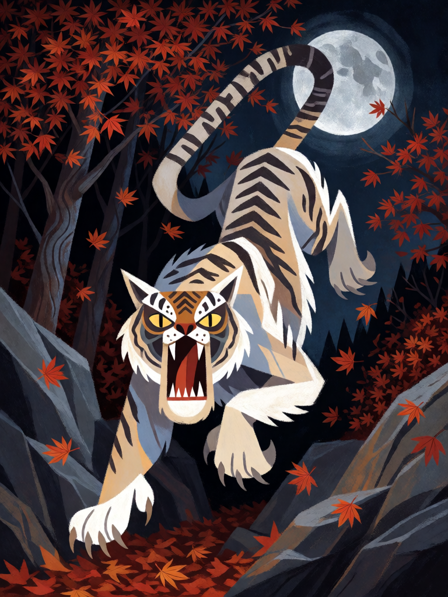

# Tigre Branco do Oeste

[← Taoismo](../taoismo.md) · [Wiki KodeX](../README.md) · [◀ Dragão Azul do Leste](tao_dragao_azul_do_leste.md) · [Pássaro Vermelho do Sul ▶](tao_passaro_vermelho_do_sul.md)

| Carta | Arte |
|---|---|
|  |  |

| | |
|---|---|
| **Tradição** | Taoismo |
| **Tipo** | Selo |
| **Custo de Fé** | 2 |
| **Palavras-chave** | — |
| **Lendária** | não |
| **Cópias no deck** | 1 |
| **Id** | `tao_tigre_branco_do_oeste` |

## Texto da carta

> Quando uma Entidade inimiga atacar: ela sofre 4 de dano e recebe −1 ATK permanente.

**EN — White Tiger of the West:** *When an enemy Entity attacks: it takes 4 damage and gets permanent −1 ATK.*

## Contexto mitológico

Baihu (白虎), o Tigre Branco do Oeste, é o Símbolo do outono, do metal e do ocaso: a estação em que se colhe e se executa. Na cosmologia dos Cinco Agentes o metal corta e o oeste é o lado do poente e dos mortos; o tigre, único predador que a China antiga temia de fato, é o guardião que pune. O *Shiji* o liga às sete mansões ocidentais; o *Fengsu tongyi* (Ying Shao, séc. II) diz que o tigre é "o senhor das feras", devora demônios e, pintado nas portas, afasta o mal. Em pinturas murais Han, o tigre do oeste caça com as costelas à mostra e a cauda erguida, muitas vezes com asas.

No taoismo marcial Baihu é o general do oeste, par do Dragão Azul: os dois guardam o portão do templo, e o par "dragão azul / tigre branco" vira, no *neidan*, a imagem do yang e do yin (ou do mercúrio e do chumbo) que o adepto deve unir no caldeirão interno. Baihu é também a estrela maléfica do almanaque: o dia do Tigre Branco não serve para casamentos.

Como Selo, é o guardião que salta sobre quem avança: o atacante leva as garras e sai da luta aleijado.

## Papel no jogo

A punição do deck contra agressão. Com dano 4, mata a maioria das Entidades de custo até 3 que ousarem atacar, e deixa as maiores feridas e com −1 ATK para a troca seguinte. Como o inimigo deve atacar Guarda, a combinação Cao Guojiu/Guan Yu + Tigre Branco obriga o oponente a escolher entre bater no muro e tomar o tigre, ou não atacar. Inútil contra quem só joga Ritos.

## Atributos visuais

tigre branco de listras pretas · presas à mostra · salto de emboscada com garras · floresta de outono · lua fria

Balanço (conta de custo)

Orçamento P = 2·C+1 = 5 pts, +1 grátis de Selo = 6. Gasto: 4 de dano ao atacante (4) + −1 ATK permanente (1) = 5. Dentro.

Ficha completa: `cartas/taoismo/17_tigre_branco_do_oeste.md` · cartas base da versão Alpha
